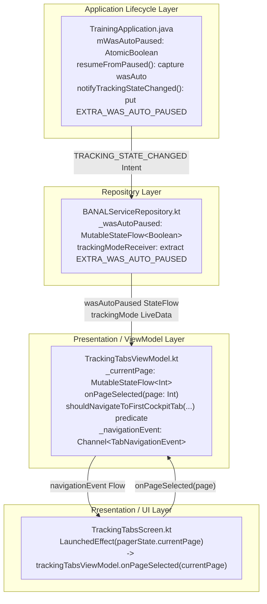

# Stage 3: Implementation Plan - ATT-4373: [Bug] Do not navigate to first Cockpit tab when Auto-Pause ends

**Ticket**: [ATT-4373](https://rainerblind.atlassian.net/browse/ATT-4373)  
**Sub-task**: [ATT-4389](https://rainerblind.atlassian.net/browse/ATT-4389) (`[Impl-Plan]`)  
**Parent Epic**: [ATT-355](https://rainerblind.atlassian.net/browse/ATT-355) (*Good and consistent UI*)  
**Target Release**: `V4.9.40`  
**Active Sprint**: `2026-43.2`  
**Requirement Mapping**: `REQ-UI-163` (*Cockpit Tab Navigation on Tracking Initiation & Origin-Aware Resume Neutrality*)  
**Test Mapping**: `TST-UI-115` (*Cockpit Tab Navigation and Auto-Pause Resume Neutrality Test Suite*)  
**Branch**: `feature/ATT-4373`  
**Author**: AI Agent 1 (Implementer)  
**Date**: 2026-10-20  

---

## 1. Problem Description & Background

During an active workout session (e.g. cycling, running, hiking) with Auto-Pause enabled, an athlete who decelerates below the configured speed threshold (such as stopping at a traffic intersection, road junction, or scenic trail overlook) transitions automatically into the `PAUSED` state (`TrainingApplication.isAutoPaused() == true`). While stationary or moving slowly, athletes routinely swipe across the horizontal pager to inspect:
* Secondary telemetry data tabs (Page 2+, showing lap split tables, heart rate zone gauges, or power distributions).
* The Map and route polyline tab (displaying live GPS positioning, turn cues, or elevation profile).

### Current Defective Behavior
When the athlete resumes moving above the hysteresis threshold (or manually taps "Resume" on the `AutoPauseHudBanner`), `TrackerService` dispatches `REQUEST_RESUME_FROM_PAUSED`. Upon receiving this broadcast, `TrainingApplication.resumeFromPaused()` transitions `cTrackingMode` to `TrackingMode.TRACKING` and broadcasts `TRACKING_STATE_CHANGED`.

In `TrackingTabsViewModel.kt:243-249`, the rising-edge collector observing `banalServiceRepository.trackingMode` catches the transition `PAUSED -> TRACKING` and unconditionally emits:
```kotlin
_navigationEvent.send(TabNavigationEvent.NavigateTo(0))
```
In `TrackingTabsScreen.kt:453-463`, this event is translated into an animated pager scroll to Page 1 (`offset = 1`, `target = 0 + 1 = 1`, the first Cockpit telemetry data tab).

**Impact**: The athlete is abruptly and involuntarily jerked away from whichever tab they were actively consulting (e.g. Map navigation or secondary stats) and snapped back to Page 1 every single time Auto-Pause ends.

### Root Cause
1. **Unconditional Rising-Edge Collector in `TrackingTabsViewModel.kt`**:
   The collector triggers whenever `mode == TRACKING` and `previousMode != null && previousMode != TRACKING`. It makes no distinction between:
   - Initial tracking initiation (`READY -> TRACKING`) vs. resuming (`PAUSED -> TRACKING`).
   - Resuming from **Auto-Pause** vs. resuming from **Manual Pause**.
   - Resuming while viewing the **Control Tab** (`Page 0`) vs. actively viewing a **Telemetry / Map Tab** (`Page >= 1`).
2. **Premature State Wipe in `TrainingApplication.java:1682`**:
   `setAutoPaused(false, this)` is invoked *before* setting `cTrackingMode = TrackingMode.TRACKING` and broadcasting `TRACKING_STATE_CHANGED`. Downstream observers (like `BANALServiceRepository` or ViewModels) receiving `TRACKING_STATE_CHANGED` find `TrainingApplication.isAutoPaused()` already wiped to `false`.
3. **Missing Active Page Awareness in `TrackingTabsViewModel`**:
   The ViewModel has no knowledge of which page the athlete is currently viewing, preventing it from distinguishing between resumes from the Control tab (`Page 0`) and resumes from Cockpit tabs (`Page >= 1`).

### Expected Behavior
* Resumption from **Auto-Pause** (via speed recovery or tapping "Resume" on the HUD banner) MUST NOT emit `TabNavigationEvent.NavigateTo(0)`; the athlete MUST remain uninterrupted on their active Cockpit or Map tab.
* Resuming a **manual pause** while viewing a telemetry or map tab (`Page >= 1`) MUST NOT scroll the pager away from the athlete's chosen tab.
* Navigating to the first Cockpit tab (`NavigateTo(0)`) is strictly reserved for:
  1. Starting an initial tracking session from the "Start Tracking" / Control tab (`READY -> TRACKING`).
  2. Resuming an active workout from a **manual pause** while actively viewing the Control tab (`Page 0`).

---

## 2. Traceability & Requirements Mapping

### Primary Requirement: `REQ-UI-163`
* **REQ-UI-163.1 (Origin-Aware Resume State Tracking)**:
  - `TrainingApplication.java`:
    * Add `public static final String EXTRA_WAS_AUTO_PAUSED = "com.atrainingtracker.trainingapplication.EXTRA_WAS_AUTO_PAUSED";`
    * Add thread-safe static field `private static final AtomicBoolean mWasAutoPaused = new AtomicBoolean(false);`
    * Expose getter `public static boolean wasAutoPaused() { return mWasAutoPaused.get(); }`
    * In `resumeFromPaused()`: capture `boolean wasAuto = mIsAutoPaused.get()`, record via `mWasAutoPaused.set(wasAuto)` prior to clearing pause locks, and broadcast `EXTRA_WAS_AUTO_PAUSED` in `TRACKING_STATE_CHANGED`.
    * In `pauseTracking()`, `stopTracking()`, `startTracking()`, `resetTrackingStateOnAbort()`, and `onTrackingAborted()`: reset `mWasAutoPaused.set(false)`.
  - `BANALServiceRepository.kt`:
    * Expose `val wasAutoPaused: StateFlow<Boolean>` updated from `intent.getBooleanExtra(TrainingApplication.EXTRA_WAS_AUTO_PAUSED, false)` upon receiving `TRACKING_STATE_CHANGED`.
* **REQ-UI-163.2 (Active Page Synchronization)**:
  - `TrackingTabsViewModel.kt`: Expose `val currentPage: StateFlow<Int>` and public callback `fun onPageSelected(page: Int)`.
  - `TrackingTabsScreen.kt`: Hook `LaunchedEffect(pagerState.currentPage)` to invoke `trackingTabsViewModel.onPageSelected(pagerState.currentPage)`.
* **REQ-UI-163.3 (Origin-Aware Navigation Decision Logic)**:
  - Provide pure domain decision predicate `TrackingTabsViewModel.shouldNavigateToFirstCockpitTab(previousMode, currentMode, wasAutoPaused, currentPage): Boolean`.
  - In `TrackingTabsViewModel`'s rising-edge collector, evaluate the predicate and conditionally send `TabNavigationEvent.NavigateTo(0)` only when `shouldNavigate == true`.
* **REQ-UI-163.4 (Auto-Pause Resume Tab Preservation)**:
  - Resuming from Auto-Pause evaluates `wasAutoPaused == true`, suppressing `NavigateTo(0)` and leaving the athlete uninterrupted on their active tab.
* **REQ-UI-163.5 (Telemetry & Map Tab Manual Resume Preservation)**:
  - Resuming manual pause while on `currentPage >= 1` evaluates `currentPage != 0`, suppressing `NavigateTo(0)`.
* **REQ-UI-163.6 (Recomposition, Rotation & Gesture Invariants)**:
  - Cold starts, process recreation, and device rotations while in `TRACKING` mode emit zero navigation events.
  - Pager scroll animations respect manual swipe interruptions (`CancellationException`) without hard snapping (`REQ-UI-412.3`).

### Primary Test Suite: `TST-UI-115`
* **TST-UI-115.1 (`testTrackingStartNavigatesToFirstCockpitTab`)**:
  - Preconditions: `READY`. Action: `READY -> TRACKING`. Expected: 1 event `NavigateTo(0)`.
* **TST-UI-115.2 (`testAutoPauseResumePreservesCurrentTab`)**:
  - Preconditions: `TRACKING`, on Page 2, `PAUSED` with `wasAutoPaused = true`. Action: `PAUSED -> TRACKING`. Expected: 0 events (`events.isEmpty()`).
* **TST-UI-115.3 (`testManualResumeFromControlTabNavigatesToFirstCockpitTab`)**:
  - Preconditions: `TRACKING`, on Page 0, `PAUSED` with `wasAutoPaused = false`. Action: `PAUSED -> TRACKING`. Expected: 1 event `NavigateTo(0)`.
* **TST-UI-115.4 (`testManualResumeFromTelemetryTabPreservesCurrentTab`)**:
  - Preconditions: `TRACKING`, on Page 2, `PAUSED` with `wasAutoPaused = false`. Action: `PAUSED -> TRACKING`. Expected: 0 events (`events.isEmpty()`).
* **TST-UI-115.5 (`testColdStartInTrackingModeDoesNotTriggerSpuriousNavigation`)**:
  - Preconditions: Initialized in `TRACKING`. Action: Collect navigation events. Expected: 0 events.
* **TST-UI-115.6 (`testMultipleStartStopCyclesReliability`)**:
  - Preconditions: `READY`. Action: 3 cycles of `READY -> TRACKING -> READY`. Expected: Exactly 3 `NavigateTo(0)` events.
* **TST-UI-115.7 (`testPagerOffsetCalculationForScreenMode`)**:
  - Screen mode offset calculation verification (`TRACKING -> 1`, `CONFIGURATION -> 0`, `PREVIEW -> 0`).
* **TST-UI-115.8 (Localization Parity Audit)**:
  - Verify 9-language translation parity in `TranslationParityTest`.
* **TST-UI-115.9 (Clean-Room Full Suite Regression)**:
  - Full `./gradlew testDebugUnitTest` execution across all 3,190+ tests.

---

## 3. System Invariants & Preserved Behavior

1. **Initial Start Navigation**: Starting tracking (`READY -> TRACKING`) MUST ALWAYS smoothly navigate the horizontal pager from Page 0 to Page 1 (`NavigateTo(0)`).
2. **Control Tab Manual Resume**: Resuming a manually paused session from the Control tab (`Page 0`) MUST navigate to Page 1 (`NavigateTo(0)`), preserving the core behavior specified in `ATT-1340`.
3. **Auto-Pause Neutrality**: Ending Auto-Pause (via speed recovery or tapping "Resume" on the HUD banner) MUST NEVER scroll the pager or disrupt the athlete's active tab.
4. **Telemetry Tab Manual Resume Neutrality**: Resuming a manually paused session while on `Page >= 1` (e.g. via smartwatch action or notification action) MUST NOT force navigation back to Page 1.
5. **Cold Start & Recreation Immunity**: App launch, process restoration, or screen rotation while in `TRACKING` mode MUST emit zero navigation events.
6. **Thread Safety & Dispatcher Affinity**: `mWasAutoPaused` is guarded by `AtomicBoolean`; `BANALServiceRepository` flows are updated on the main dispatcher and thread-safe.
7. **Channel Buffering & Gesture Safety**: All navigation emissions utilize `Channel<TabNavigationEvent>(Channel.BUFFERED)` (`REQ-UI-412`), and pager scroll animations respect manual swipe interruptions (`CancellationException`) without hard-snap fallback (`REQ-UI-412.3`).
8. **Zero SQLite Database Migrations**: No database tables, schemas, or migrations are involved.
9. **Strict Code Lock in Stage 3 (Core Rule 4)**: No production source or test code is modified until Gate 3 is approved.
10. **One Commit per Ticket (Core Rule 8)**: No intermediate git commit is created during Stage 3; changes remain uncommitted on branch `feature/ATT-4373` until Stage 5.
11. **Parent Human Gate Invariance**: Terminal completion of parent ticket `ATT-4373` remains reserved exclusively for the human user in `Final Review (Human)`.

---

## 4. Proposed Architectural Changes

### Architectural Layer Boundaries (SWE.2)



### Component 1: `TrainingApplication.java` (Application Layer)
- **File**: `app/src/main/java/com/atrainingtracker/trainingtracker/TrainingApplication.java`
- **Fields & Constants**:
  ```java
  public static final String EXTRA_WAS_AUTO_PAUSED = "com.atrainingtracker.trainingapplication.EXTRA_WAS_AUTO_PAUSED";
  private static final AtomicBoolean mWasAutoPaused = new AtomicBoolean(false);

  public static boolean wasAutoPaused() {
      return mWasAutoPaused.get();
  }
  ```
- **Lifecycle Methods**:
  - `resumeFromPaused()`:
    ```java
    boolean wasAuto = mIsAutoPaused.get();
    mWasAutoPaused.set(wasAuto);

    setManualPauseLock(false, this);
    setAutoPaused(false, this);
    TrackerService.notifyManualResume();

    if (TrainingApplication.startSearchWhenResumeFromPaused()) {
        sendBroadcast(new Intent(REQUEST_START_SEARCH_FOR_PAIRED_DEVICES)
                .setPackage(getPackageName()));
    }

    cTrackingMode = TrackingMode.TRACKING;
    notifyTrackingStateChanged();
    ```
  - `notifyTrackingStateChanged()`:
    ```java
    sendBroadcast(new Intent(TRACKING_STATE_CHANGED)
            .putExtra(EXTRA_WAS_AUTO_PAUSED, mWasAutoPaused.get())
            .setPackage(getPackageName()));
    ```
  - `pauseTracking(boolean isAutoPause)`: Reset `mWasAutoPaused.set(false)`.
  - `stopTracking()`: Reset `mWasAutoPaused.set(false)`.
  - `startTracking()`: Reset `mWasAutoPaused.set(false)`.
  - `resetTrackingStateOnAbort()`: Reset `mWasAutoPaused.set(false)`.
  - `onTrackingAborted()`: Reset `mWasAutoPaused.set(false)`.

### Component 2: `BANALServiceRepository.kt` (Repository Layer)
- **File**: `app/src/main/java/com/atrainingtracker/trainingtracker/repositories/BANALServiceRepository.kt`
- **Fields**:
  ```kotlin
  private val _wasAutoPaused = MutableStateFlow(false)
  val wasAutoPaused: StateFlow<Boolean> = _wasAutoPaused.asStateFlow()
  ```
- **Initialization & Broadcast Receiver**:
  - In `init`:
    ```kotlin
    _wasAutoPaused.value = TrainingApplication.wasAutoPaused()
    ```
  - In `trackingModeReceiver.onReceive`:
    ```kotlin
    val wasAuto = intent?.getBooleanExtra(TrainingApplication.EXTRA_WAS_AUTO_PAUSED, false)
        ?: TrainingApplication.wasAutoPaused()
    _wasAutoPaused.value = wasAuto

    val newTrackingMode = TrainingApplication.getTrackingMode()
    if (_trackingMode.value != newTrackingMode) {
        _trackingMode.postValue(newTrackingMode)
    }
    ```

### Component 3: `TrackingTabsViewModel.kt` (ViewModel Layer)
- **File**: `app/src/main/java/com/atrainingtracker/trainingtracker/ui/tracking/trackingtabs/TrackingTabsViewModel.kt`
- **Active Page Tracking**:
  ```kotlin
  private val _currentPage = MutableStateFlow(0)
  val currentPage: StateFlow<Int> = _currentPage.asStateFlow()

  fun onPageSelected(page: Int) {
      _currentPage.value = page
  }
  ```
- **Companion Object Pure Decision Predicate**:
  ```kotlin
  companion object {
      /**
       * Pure domain predicate determining whether rising-edge tracking mode transition
       * should navigate to the first cockpit tab (REQ-UI-163).
       *
       * @param previousMode TrackingMode prior to the transition (nullable for initial emission).
       * @param currentMode New TrackingMode.
       * @param wasAutoPaused Whether the paused state originated from auto-pause.
       * @param currentPage The active pager page index (0 = Control Tab, >= 1 = Telemetry/Map Tabs).
       * @return True if navigation to first Cockpit tab should be executed.
       */
      fun shouldNavigateToFirstCockpitTab(
          previousMode: TrackingMode?,
          currentMode: TrackingMode,
          wasAutoPaused: Boolean,
          currentPage: Int
      ): Boolean {
          if (currentMode != TrackingMode.TRACKING || previousMode == null || previousMode == TrackingMode.TRACKING) {
              return false
          }
          return when (previousMode) {
              TrackingMode.READY -> true
              TrackingMode.PAUSED -> !wasAutoPaused && currentPage == 0
              else -> false
          }
      }
  }
  ```
- **Tracking Mode Observation in `init`**:
  ```kotlin
  viewModelScope.launch {
      var previousMode: TrackingMode? = null
      banalServiceRepository.trackingMode.asFlow().collect { mode ->
          if (mode == TrackingMode.READY) {
              _hasRenderedCoachmarkInSession.value = false
          }
          if (shouldNavigateToFirstCockpitTab(
                  previousMode = previousMode,
                  currentMode = mode,
                  wasAutoPaused = banalServiceRepository.wasAutoPaused.value,
                  currentPage = _currentPage.value
              )
          ) {
              Log.i(
                  "TrackingTabsViewModel",
                  "Tracking started (rising edge) -> navigating to cockpit tab (prevMode=$previousMode, wasAuto=${banalServiceRepository.wasAutoPaused.value}, page=${_currentPage.value})"
              )
              _navigationEvent.send(TabNavigationEvent.NavigateTo(0))
          } else if (mode == TrackingMode.TRACKING && previousMode != null && previousMode != TrackingMode.TRACKING) {
              Log.i(
                  "TrackingTabsViewModel",
                  "Suppressed cockpit navigation on resume (prevMode=$previousMode, wasAuto=${banalServiceRepository.wasAutoPaused.value}, page=${_currentPage.value})"
              )
          }
          previousMode = mode
      }
  }
  ```

### Component 4: `TrackingTabsScreen.kt` (Presentation Layer)
- **File**: `app/src/main/java/com/atrainingtracker/trainingtracker/ui/tracking/trackingtabs/TrackingTabsScreen.kt`
- Hook `onPageSelected` into existing pager change tracking:
  ```kotlin
  LaunchedEffect(pagerState.currentPage) {
      lastKnownPage = pagerState.currentPage
      trackingTabsViewModel.onPageSelected(pagerState.currentPage)
  }
  ```

### UI Consistency (Rule 23 — Mandatory Audit)
* **Reference screen / component**: `TrackingTabsScreen.kt` (the horizontal pager hosting Cockpit tabs).
* **Reused components**: `HorizontalPager`, `PrimaryScrollableTabRow`, and `TabNavigationEvent.NavigateTo`.
* **Theme tokens**: Existing shapes, spacing, and theme colors (`MaterialTheme.colorScheme`, `TTColor`).
* **New one-off styles & justification**: None. No new visual styles or UI elements are introduced. The modification strictly preserves the athlete's active tab and eliminates involuntary animated scrolling.

---

## 5. Step-by-Step Implementation Sequence (Stage 4 Construction)

### Step 1: Unit Tests for `TrainingApplication` State Tracking (TDD - Red Phase)
* **Files**:
  - `app/src/test/java/com/atrainingtracker/trainingtracker/TrainingApplicationTrackingTest.kt`
* **Changes**:
  1. Add tests verifying `mWasAutoPaused` lifecycle:
     - `testResumeFromPaused_whenAutoPaused_setsWasAutoPausedTrue()`
     - `testResumeFromPaused_whenManualPaused_setsWasAutoPausedFalse()`
     - `testStopTracking_resetsWasAutoPaused()`
     - `testResetTrackingStateOnAbort_resetsWasAutoPaused()`
     - `testOnTrackingAborted_resetsWasAutoPaused()`
* **Command**:
  ```bash
  ./gradlew testDebugUnitTest --tests "com.atrainingtracker.trainingtracker.TrainingApplicationTrackingTest"
  ```
  *(Expected: Compilation error or failure due to missing `wasAutoPaused()` in `TrainingApplication`)*

### Step 2: Implement Origin-Aware State in `TrainingApplication.java` (Green Phase - Part 1)
* **Files**:
  - `app/src/main/java/com/atrainingtracker/trainingtracker/TrainingApplication.java`
* **Changes**:
  1. Define `EXTRA_WAS_AUTO_PAUSED` and `mWasAutoPaused` AtomicBoolean.
  2. Implement public static `wasAutoPaused()`.
  3. In `resumeFromPaused()`, capture `mIsAutoPaused.get()`, store in `mWasAutoPaused` before clearing pause flags.
  4. In `notifyTrackingStateChanged()`, add `putExtra(EXTRA_WAS_AUTO_PAUSED, mWasAutoPaused.get())`.
  5. In `pauseTracking()`, `stopTracking()`, `startTracking()`, `resetTrackingStateOnAbort()`, and `onTrackingAborted()`, reset `mWasAutoPaused.set(false)`.
* **Command**:
  ```bash
  ./gradlew testDebugUnitTest --tests "com.atrainingtracker.trainingtracker.TrainingApplicationTrackingTest"
  ```
  *(Expected: PASS)*

### Step 3: Implement `wasAutoPaused` in `BANALServiceRepository.kt` (Green Phase - Part 2)
* **Files**:
  - `app/src/main/java/com/atrainingtracker/trainingtracker/repositories/BANALServiceRepository.kt`
* **Changes**:
  1. Declare `private val _wasAutoPaused = MutableStateFlow(false)` and `val wasAutoPaused: StateFlow<Boolean> = _wasAutoPaused.asStateFlow()`.
  2. In `init`, initialize `_wasAutoPaused.value = TrainingApplication.wasAutoPaused()`.
  3. In `trackingModeReceiver.onReceive`, extract `intent?.getBooleanExtra(TrainingApplication.EXTRA_WAS_AUTO_PAUSED, false)` and update `_wasAutoPaused.value`.
* **Command**:
  ```bash
  ./gradlew testDebugUnitTest --tests "com.atrainingtracker.trainingtracker.repositories.*"
  ```
  *(Expected: PASS)*

### Step 4: Unit Tests for `TrackingTabsViewModel` Navigation & Predicate (TDD - Red Phase)
* **Files**:
  - `app/src/test/java/com/atrainingtracker/trainingtracker/ui/tracking/trackingtabs/TrackingTabsViewModelTest.kt`
* **Changes**:
  1. Add `wasAutoPausedFlow = MutableStateFlow(false)` and stub `mockBanalRepo.wasAutoPaused`.
  2. Add `testAutoPauseResumePreservesCurrentTab()`: verifies that ending Auto-Pause while on Page 2 emits zero navigation events (`events.isEmpty()`).
  3. Add `testManualResumeFromControlTabNavigatesToFirstCockpitTab()`: verifies that manual resume on Page 0 emits `NavigateTo(0)`.
  4. Add `testManualResumeFromTelemetryTabPreservesCurrentTab()`: verifies that manual resume on Page 2 emits zero navigation events.
  5. Add `testAutoPauseResumeFromControlTabPreservesCurrentTab()`: verifies that ending Auto-Pause on Page 0 emits zero navigation events.
  6. Add unit tests for companion predicate `TrackingTabsViewModel.shouldNavigateToFirstCockpitTab()`.
* **Command**:
  ```bash
  ./gradlew testDebugUnitTest --tests "com.atrainingtracker.trainingtracker.ui.tracking.trackingtabs.TrackingTabsViewModelTest"
  ```
  *(Expected: Tests fail because `TrackingTabsViewModel` does not yet have `currentPage` or the new decision logic)*

### Step 5: Implement Pager State Tracking & Decision Predicate in `TrackingTabsViewModel.kt` (Green Phase - Part 3)
* **Files**:
  - `app/src/main/java/com/atrainingtracker/trainingtracker/ui/tracking/trackingtabs/TrackingTabsViewModel.kt`
* **Changes**:
  1. Add `_currentPage: MutableStateFlow<Int>` and public `onPageSelected(page: Int)`.
  2. Add `shouldNavigateToFirstCockpitTab(...)` in `companion object`.
  3. Update tracking mode collection in `init` to invoke `shouldNavigateToFirstCockpitTab(...)` and conditionally emit `NavigateTo(0)`.
* **Command**:
  ```bash
  ./gradlew testDebugUnitTest --tests "com.atrainingtracker.trainingtracker.ui.tracking.trackingtabs.TrackingTabsViewModelTest"
  ```
  *(Expected: ALL PASS)*

### Step 6: Connect Pager State in `TrackingTabsScreen.kt` (Green Phase - Part 4)
* **Files**:
  - `app/src/main/java/com/atrainingtracker/trainingtracker/ui/tracking/trackingtabs/TrackingTabsScreen.kt`
* **Changes**:
  1. Update `LaunchedEffect(pagerState.currentPage)` to invoke `trackingTabsViewModel.onPageSelected(pagerState.currentPage)`.
* **Command**:
  ```bash
  ./gradlew testDebugUnitTest --tests "com.atrainingtracker.trainingtracker.ui.tracking.trackingtabs.TrackingTabsViewModelTest"
  ```
  *(Expected: ALL PASS)*

### Step 7: Localization & Full Regression Verification (Stage 5 Clean-Room Preparation)
* **Files**:
  - None
* **Changes**:
  1. Execute `TranslationParityTest` to confirm zero string resource regressions.
  2. Execute full clean-room unit test suite.
* **Command**:
  ```bash
  ./gradlew testDebugUnitTest --tests "com.atrainingtracker.trainingtracker.TranslationParityTest"
  ./gradlew testDebugUnitTest
  ```
  *(Expected: 100% PASS across 3,190+ tests)*

---

## 6. Verification & Rollback Plan

### Verification Strategy
* **Automated Unit Tests**:
  - `TrainingApplicationTrackingTest`: validates atomic boolean state transitions and intent extra serialization.
  - `TrackingTabsViewModelTest`: validates all permutations of `READY -> TRACKING`, `PAUSED -> TRACKING` (Auto-Pause vs. manual), and `currentPage` (0 vs. 2) to ensure strict adherence to `REQ-UI-163`.
  - `TranslationParityTest`: validates 9-language localization parity (`TST-UI-115.8`).
* **Full Clean-Room Regression**:
  - Full `./gradlew testDebugUnitTest` must execute with zero failures across all 3,190+ tests.

### Rollback Strategy
* All changes are isolated on git branch `feature/ATT-4373`.
* Adhering to Core Rule 8 ("One commit per ticket"), all changes remain uncommitted during construction (Stage 4).
* In the event of an irreconcilable defect, any or all changes can be discarded instantaneously via `git checkout -- .` and `git clean -fd`.
* The `develop` branch remains completely isolated and protected.
