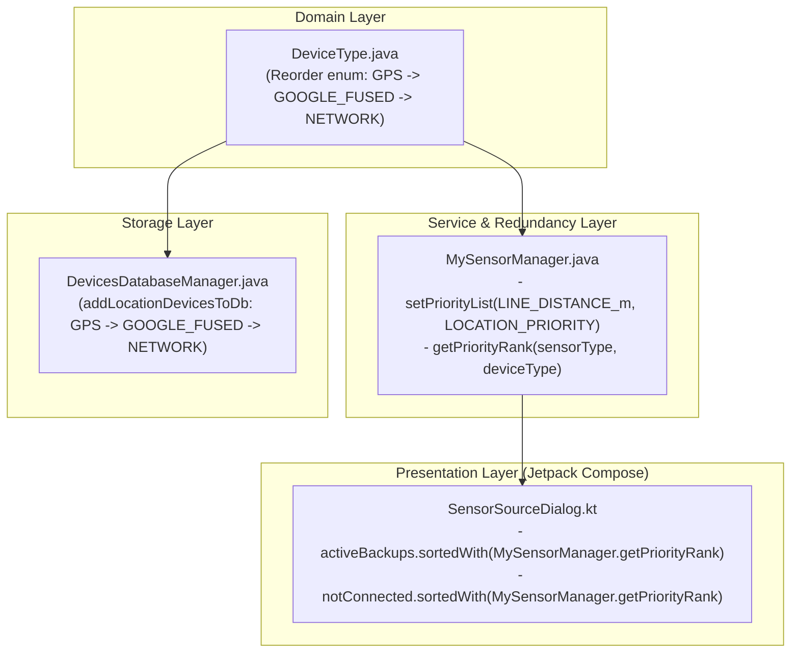

# Stage 3: Implementation Plan - ATT-4375: Align location and sensor priority order across DeviceType, MySensorManager, DevicesDatabaseManager, and SensorSourceDialog

**Ticket**: [ATT-4375](https://rainerblind.atlassian.net/browse/ATT-4375)  
**Sub-task**: [ATT-4379](https://rainerblind.atlassian.net/browse/ATT-4379) (`[Impl-Plan]`)  
**Parent Epic**: [ATT-355](https://rainerblind.atlassian.net/browse/ATT-355) (*Good and consistent UI*)  
**Target Release**: `TBD (Set on Completion per Rule 14)`  
**Active Sprint**: `2026-43.2`  
**Requirement Mapping**: `REQ-TRK-024` (*Google Fused Location Provider Inclusion in MySensorManager.SPEED_PRIORITY, Enum Declaration Alignment & LINE_DISTANCE_m Priority*), `REQ-UI-268` (*Truthful Live Sensor Connection Status and Canonical Priority Sorting in SensorSourceDialog*)  
**Test Mapping**: `TST-TRK-016` (Suite), `TST-UI-227` (Suite)  
**Branch**: `feature/ATT-4375`  
**Author**: AI Agent 1 (Implementer)  
**Date**: 2026-10-20  

---

## 1. Problem Description & Background

While [`MySensorManager.java`](file:///home/rainer/AndroidStudioProjects/aTrainingTracker/app/src/main/java/com/atrainingtracker/banalservice/sensor/MySensorManager.java) explicitly defines `SPEED_PRIORITY`, `ALTITUDE_PRIORITY`, and `LOCATION_PRIORITY` with the canonical location priority hierarchy:
$$\text{GPS} \longrightarrow \text{GOOGLE\_FUSED} \longrightarrow \text{NETWORK}$$
forensic analysis in Stage 1 (`docs/engineering/analysis/ATT-4375_analysis.md`) uncovered three architectural and UI ordering discrepancies across domain models, service dispatch, SQLite storage, and Jetpack Compose UI:

1. **`DeviceType.java` Enum Declaration Order & Missing `LINE_DISTANCE_m` Priority in `MySensorManager.java`**:
   - In [`DeviceType.java`](file:///home/rainer/AndroidStudioProjects/aTrainingTracker/app/src/main/java/com/atrainingtracker/banalservice/devices/DeviceType.java#L45-L47), `SPEED_AND_LOCATION_NETWORK` is declared *before* `SPEED_AND_LOCATION_GOOGLE_FUSED`.
   - In [`MySensorManager.java`](file:///home/rainer/AndroidStudioProjects/aTrainingTracker/app/src/main/java/com/atrainingtracker/banalservice/sensor/MySensorManager.java#L107-L110), `setPriorityList(..., LOCATION_PRIORITY)` is called for `ACCURACY`, `BEARING`, `LATITUDE`, and `LONGITUDE`, but **`SensorType.LINE_DISTANCE_m` was omitted**.
   - Because `mAllSensorsMapMap` is an `EnumMap<DeviceType, ...>`, when `priorityList == null`, `getBestSensor()` falls back to `EnumMap.keySet()` which iterates strictly in `DeviceType` enum declaration order (`ordinal()`). As a result, `getBestSensor(SensorType.LINE_DISTANCE_m)` mistakenly selects `SPEED_AND_LOCATION_NETWORK` over `SPEED_AND_LOCATION_GOOGLE_FUSED` when both sensors are active.

2. **Database Insertion Order in `DevicesDatabaseManager.java` (`NETWORK` Before `GOOGLE_FUSED`)**:
   - In [`DevicesDatabaseManager.java`](file:///home/rainer/AndroidStudioProjects/aTrainingTracker/app/src/main/java/com/atrainingtracker/banalservice/database/DevicesDatabaseManager.java#L1184-L1208) (`addLocationDevicesToDb`), smartphone location devices are inserted in the order `GPS`, `NETWORK`, `GOOGLE_FUSED` instead of `GPS`, `GOOGLE_FUSED`, `NETWORK`.
   - Consequently, SQLite assigns a lower autoincrement row ID (`_id`) to Network than to Google Fused. Lists ordered by DB row ID (such as the `Not connected` section in `SensorSourceDialog` when both are disconnected) present `Network` above `Google Fused`.

3. **`SensorSourceDialog.kt` Does Not Sort `activeBackups` or `notConnected` by `MySensorManager` Priority**:
   - In [`SensorSourceDialog.kt`](file:///home/rainer/AndroidStudioProjects/aTrainingTracker/app/src/main/java/com/atrainingtracker/trainingtracker/ui/tracking/controltracking/SensorSourceDialog.kt#L74-L80), `activeBackups` and `notConnected` are not sorted according to `MySensorManager`'s `DeviceType` priority hierarchy for the given `sensorType`.
   - `activeBackups` preserves the order of `allTelemetry` (where remote devices from `DeviceManager.getRemoteDeviceList()` iterate over a `ConcurrentHashMap` with non-deterministic order).
   - `notConnected` preserves the order of `allDevices` (database cursor query order), showing Network above Google Fused.
   - This causes visual disorder and contradicts `MySensorManager`'s actual operational fallback logic.

---

## 2. Traceability & Requirements Mapping

* **Primary Requirements**:
  * `REQ-TRK-024` (*Google Fused Location Provider Inclusion in MySensorManager.SPEED_PRIORITY, Enum Declaration Alignment & LINE_DISTANCE_m Priority*):
    * `REQ-TRK-024.1`: `SPEED_PRIORITY` ordering invariant (`RUN_SPEED` $\to$ `BIKE_SPEED` $\to$ `BIKE_SPEED_AND_CADENCE` $\to$ `BIKE_POWER` $\to$ `GPS` $\to$ `GOOGLE_FUSED` $\to$ `NETWORK`).
    * `REQ-TRK-024.2`: `ProxySensor` retention & dynamic source upgrade/downgrade.
    * `REQ-TRK-024.3`: `DeviceType.java` enum declaration order alignment (`SPEED_AND_LOCATION_GPS` $\to$ `SPEED_AND_LOCATION_GOOGLE_FUSED` $\to$ `SPEED_AND_LOCATION_NETWORK`).
    * `REQ-TRK-024.4`: `LINE_DISTANCE_m` location priority registration in `MySensorManager`.
    * `REQ-TRK-024.5`: Canonical priority rank helper `MySensorManager.getPriorityRank(SensorType, DeviceType)`.
    * `REQ-TRK-024.6`: `DevicesDatabaseManager.java` location device insertion sequence alignment.
  * `REQ-UI-268` (*Truthful Live Sensor Connection Status and Canonical Priority Sorting in SensorSourceDialog*):
    * `REQ-UI-268.1`–`REQ-UI-268.4`: `DeviceStatusRow` connection parameterization & backward compatibility.
    * `REQ-UI-268.5`: Canonical priority sorting in `SensorSourceDialog.kt` for `activeBackups` and `notConnected`.

* **Test Mapping**:
  * `TST-TRK-016` (Suite: *Verification of Location and Speed Sensor Priority Hierarchy & Dynamic Source Switching*):
    * `TST-TRK-016.1`: `DeviceType` enum declaration order invariant test (`DeviceTypeEnumOrderTest.kt`) $\implies$ Maps to `REQ-TRK-024.3`.
    * `TST-TRK-016.2`: `MySensorManager.LINE_DISTANCE_m` priority mapping & best sensor test (`MySensorManagerPriorityTest.kt`) $\implies$ Maps to `REQ-TRK-024.4`.
    * `TST-TRK-016.3`: `MySensorManager.getPriorityRank` canonical priority helper test (`MySensorManagerPriorityTest.kt`) $\implies$ Maps to `REQ-TRK-024.5`.
    * `TST-TRK-016.4`: `DevicesDatabaseManager` location device insertion order test (`DevicesDatabaseManagerOrderingTest.kt`) $\implies$ Maps to `REQ-TRK-024.6`.
    * `TST-TRK-016.5`: Clean-room full test suite regression pass (`./gradlew testDebugUnitTest`) $\implies$ Maps to `REQ-PRO-001`, `REQ-TRK-024`.
  * `TST-UI-227` (Suite: *Truthful Live Sensor Connection Status and Priority Sorting in SensorSourceDialog*):
    * `TST-UI-227.1`: `SensorSourceDialog` active backups canonical priority sorting test (`SensorSourceDialogPriorityTest.kt`) $\implies$ Maps to `REQ-UI-268.5`.
    * `TST-UI-227.2`: `SensorSourceDialog` disconnected devices canonical priority sorting test (`SensorSourceDialogPriorityTest.kt`) $\implies$ Maps to `REQ-UI-268.5`.
    * `TST-UI-227.3`: Clean-room full test suite regression pass (`./gradlew testDebugUnitTest`) $\implies$ Maps to `REQ-PRO-001`, `REQ-UI-268`.
    * `TST-UI-227.4`: `SensorSourceDialogContractTest.kt` live telemetry propagation & parameterization $\implies$ Maps to `REQ-UI-268.1`–`REQ-UI-268.4`.

---

## 3. System Invariants & Preserved Behavior

1. **Zero Database Schema Migration**:
   - SQLite table `devices` stores `deviceType` as text (`DeviceType.name()`), so enum constant reordering has zero impact on deserialization.
   - In-memory priority sorting in `SensorSourceDialog` dynamically fixes display order for both existing and new installations without database migration or version bump.
2. **Strict Fallback Priority Consistency**:
   - For any given `SensorType`, `MySensorManager.getBestSensor()` and `SensorSourceDialog` rendering must strictly agree on priority rank:
     - Location & Line Distance: $\text{GPS (0)} > \text{GOOGLE\_FUSED (1)} > \text{NETWORK (2)}$
     - Speed & Distance: $\text{RUN\_SPEED (0)} > \text{BIKE\_SPEED (1)} > \text{BIKE\_SPEED\_AND\_CADENCE (2)} > \text{BIKE\_POWER (3)} > \text{GPS (4)} > \text{GOOGLE\_FUSED (5)} > \text{NETWORK (6)}$
     - Altitude: $\text{ALTITUDE\_FROM\_PRESSURE (0)} > \text{GPS (1)} > \text{GOOGLE\_FUSED (2)} > \text{NETWORK (3)}$
     - Cadence: $\text{BIKE\_CADENCE (0)} > \text{BIKE\_SPEED\_AND\_CADENCE (1)} > \text{BIKE\_POWER (2)} > \text{RUN\_CADENCE (3)}$
3. **Thread Safety & Dispatcher Affinity**:
   - The canonical priority ranking helper `getPriorityRank` is a pure static function operating on immutable/static priority definitions, with zero locking, zero allocation, and thread-safe execution across any thread dispatcher.
   - Database operations in `DevicesDatabaseManager` remain isolated to designated single-thread SQLite operations.
4. **Non-Location Sensor Hierarchy Invariance**:
   - Dedicated sensors (HRM, Bike Power, Environment, etc.) maintain single-source semantics without alteration.
5. **No Intermediate Commit (Core Rule 8)**:
   - Stage 3 and Stage 4 changes remain uncommitted on branch `feature/ATT-4375` until the single atomic squash commit at Stage 5.
6. **Subtask Self-Sufficiency & Direct Completion (Core Rule 3)**:
   - Subtask `[Impl-Plan]` transitions directly to `Erledigt` upon passing Gate 3 audit via `freigabe`, advancing parent ticket `ATT-4375` to `Implementation`.
7. **Parent Human Gate Invariance (Core Rule 3)**:
   - Moving parent ticket `ATT-4375` to `Erledigt` is reserved exclusively for the human user in `Final Review (Human)`.

---

## 4. Proposed Architectural Changes



### Component 1: `DeviceType.java` (Domain Layer)
* **File**: `app/src/main/java/com/atrainingtracker/banalservice/devices/DeviceType.java`
* **Changes**:
  - Reorder lines 45–47 so `SPEED_AND_LOCATION_GOOGLE_FUSED` is declared before `SPEED_AND_LOCATION_NETWORK`:
    ```java
    SPEED_AND_LOCATION_GPS(SensorType.SPEED_mps, BSportType.UNKNOWN, 1),
    SPEED_AND_LOCATION_GOOGLE_FUSED(SensorType.SPEED_mps, BSportType.UNKNOWN, 1),
    SPEED_AND_LOCATION_NETWORK(SensorType.SPEED_mps, BSportType.UNKNOWN, 1),
    ```
  - **Rationale**: `java.lang.Enum.ordinal()` natural ordering dictates iteration in `EnumMap.keySet()` and `EnumSet`. Placing `GOOGLE_FUSED` before `NETWORK` ensures that any fallback iteration without an explicit priority array selects `GOOGLE_FUSED` ahead of `NETWORK`.

### Component 2: `MySensorManager.java` (Service & Redundancy Layer)
* **File**: `app/src/main/java/com/atrainingtracker/banalservice/sensor/MySensorManager.java`
* **Changes**:
  1. In `MySensorManager(Context context)` constructor, register `SensorType.LINE_DISTANCE_m`:
     ```java
     setPriorityList(SensorType.ACCURACY, LOCATION_PRIORITY);
     setPriorityList(SensorType.BEARING, LOCATION_PRIORITY);
     setPriorityList(SensorType.LATITUDE, LOCATION_PRIORITY);
     setPriorityList(SensorType.LONGITUDE, LOCATION_PRIORITY);
     setPriorityList(SensorType.LINE_DISTANCE_m, LOCATION_PRIORITY);
     ```
  2. Implement static helper `getPriorityArray(SensorType sensorType)`:
     ```java
     public static DeviceType[] getPriorityArray(SensorType sensorType) {
         if (sensorType == null) {
             return null;
         }
         switch (sensorType) {
             case SPEED_mps:
             case PACE_spm:
             case DISTANCE_m:
             case DISTANCE_m_LAP:
                 return SPEED_PRIORITY;
             case CADENCE:
                 return CADENCE_PRIORITY;
             case ALTITUDE:
                 return ALTITUDE_PRIORITY;
             case ACCURACY:
             case BEARING:
             case LATITUDE:
             case LONGITUDE:
             case LINE_DISTANCE_m:
                 return LOCATION_PRIORITY;
             default:
                 return null;
         }
     }
     ```
  3. Implement public static canonical priority ranking method `getPriorityRank(SensorType sensorType, DeviceType deviceType)`:
     ```java
     public static int getPriorityRank(SensorType sensorType, DeviceType deviceType) {
         if (deviceType == null) {
             return Integer.MAX_VALUE;
         }
         DeviceType[] priority = getPriorityArray(sensorType);
         if (priority != null) {
             for (int i = 0; i < priority.length; i++) {
                 if (priority[i] == deviceType) {
                     return i;
                 }
             }
         }
         return 1000 + deviceType.ordinal();
     }
     ```

### Component 3: `DevicesDatabaseManager.java` (Storage Layer)
* **File**: `app/src/main/java/com/atrainingtracker/banalservice/database/DevicesDatabaseManager.java`
* **Changes**:
  - In `addLocationDevicesToDb(SQLiteDatabase db)` (lines 1184–1208), adjust insertion sequence so `SPEED_AND_LOCATION_GOOGLE_FUSED` is inserted before `SPEED_AND_LOCATION_NETWORK`:
    ```java
    private void addLocationDevicesToDb(SQLiteDatabase db) {
        // 1. GPS
        ContentValues contentValues = new ContentValues();
        contentValues.put(PROTOCOL, Protocol.SMARTPHONE.name());
        contentValues.put(DEVICE_TYPE, DeviceType.SPEED_AND_LOCATION_GPS.name());
        contentValues.put(PAIRED, true);
        contentValues.put(NAME, mContext.getString(R.string.devices_location_GPS));
        contentValues.put(MANUFACTURER_NAME, Build.BRAND);
        db.insert(DEVICES, null, contentValues);

        // 2. GOOGLE_FUSED
        contentValues = new ContentValues();
        contentValues.put(PROTOCOL, Protocol.SMARTPHONE.name());
        contentValues.put(DEVICE_TYPE, DeviceType.SPEED_AND_LOCATION_GOOGLE_FUSED.name());
        contentValues.put(PAIRED, true);
        contentValues.put(NAME, mContext.getString(R.string.devices_location_GoogleFused));
        contentValues.put(MANUFACTURER_NAME, Build.BRAND);
        db.insert(DEVICES, null, contentValues);

        // 3. NETWORK
        contentValues = new ContentValues();
        contentValues.put(PROTOCOL, Protocol.SMARTPHONE.name());
        contentValues.put(DEVICE_TYPE, DeviceType.SPEED_AND_LOCATION_NETWORK.name());
        contentValues.put(PAIRED, false);
        contentValues.put(NAME, mContext.getString(R.string.devices_location_Network));
        contentValues.put(MANUFACTURER_NAME, Build.BRAND);
        db.insert(DEVICES, null, contentValues);
        ...
    ```

### Component 4: `SensorSourceDialog.kt` (Presentation Layer)
* **File**: `app/src/main/java/com/atrainingtracker/trainingtracker/ui/tracking/controltracking/SensorSourceDialog.kt`
* **Changes**:
  1. Add import:
     ```kotlin
     import com.atrainingtracker.banalservice.sensor.MySensorManager
     ```
  2. Update `activeBackups` sorting to order by `MySensorManager.getPriorityRank(sensorType, ...)`:
     ```kotlin
     val activeBackups = remember(allActiveTelemetries, sourceDevice, allDevices, sensorType) {
         allActiveTelemetries
             .filter { it.deviceId != sourceDevice?.id }
             .sortedWith(
                 compareBy<DeviceTelemetry> { telemetry ->
                     val dev = allDevices.find { it.id == telemetry.deviceId }
                     MySensorManager.getPriorityRank(sensorType, dev?.deviceType)
                 }
                 .thenBy { telemetry ->
                     allDevices.find { it.id == telemetry.deviceId }?.deviceName ?: ""
                 }
                 .thenBy { it.deviceId }
             )
     }
     ```
  3. Update `notConnected` sorting to order by `MySensorManager.getPriorityRank(sensorType, ...)`:
     ```kotlin
     val notConnected = remember(allDevices, activeDeviceIds, potentialTypes, sensorType) {
         allDevices
             .filter { potentialTypes.contains(it.deviceType) && !activeDeviceIds.contains(it.id) }
             .sortedWith(
                 compareBy<DeviceUiData> { MySensorManager.getPriorityRank(sensorType, it.deviceType) }
                     .thenBy { it.deviceName }
                     .thenBy { it.id }
             )
     }
     ```

### UI Consistency (Rule 23 — mandatory if UI is added or changed)
* **Reference screen / component**: `SensorSourceDialog` bottom sheet (`ui/tracking/controltracking/SensorSourceDialog.kt`) hosted on `ControlTrackingScreen`.
* **Reused components**: `AppModalBottomSheet`, `DeviceIdentityBlock`, `DeviceStatusRow`, `MetricLayout`, `HorizontalDivider`.
* **Theme tokens**:
  - Shapes: `RoundedCornerShape(12.dp)` for cards and dialog containers (`MaterialTheme.shapes.medium`).
  - Spacing: `4.dp`, `8.dp`, `16.dp` per `docs/design_guidelines.md` Section 5.2.
  - Colors: `MaterialTheme.colorScheme.onSurface`, `onSurfaceVariant`, `outlineVariant`, `TTColor.RouteSelected`, `TTColor.RouteUnselected`.
* **New one-off styles & justification**: None. The layout and visual presentation remain completely unchanged; modifications are strictly confined to deterministic in-memory sorting of device items within their respective sections.

---

## 5. Step-by-Step Implementation Sequence (Stage 4 Construction)

### Step 1: `DeviceType.java` Enum Declaration Order Alignment (`REQ-TRK-024.3`)
* **Target File**: `app/src/main/java/com/atrainingtracker/banalservice/devices/DeviceType.java`
* **Changes**:
  - Swap declarations of `SPEED_AND_LOCATION_NETWORK` and `SPEED_AND_LOCATION_GOOGLE_FUSED` so the declaration sequence is `GPS`, `GOOGLE_FUSED`, `NETWORK`.
* **Targeted Verification**:
  ```bash
  ./gradlew testDebugUnitTest --tests "com.atrainingtracker.banalservice.devices.DeviceTypeEnumOrderTest"
  ```

### Step 2: `MySensorManager.java` Line Distance Registration & Canonical Priority Rank Helper (`REQ-TRK-024.4`, `REQ-TRK-024.5`)
* **Target File**: `app/src/main/java/com/atrainingtracker/banalservice/sensor/MySensorManager.java`
* **Changes**:
  - Register `setPriorityList(SensorType.LINE_DISTANCE_m, LOCATION_PRIORITY);` in `MySensorManager` constructor.
  - Expose `public static DeviceType[] getPriorityArray(SensorType sensorType)`.
  - Expose `public static int getPriorityRank(SensorType sensorType, DeviceType deviceType)`.
* **Targeted Verification**:
  ```bash
  ./gradlew testDebugUnitTest --tests "com.atrainingtracker.banalservice.sensor.MySensorManagerPriorityTest"
  ```

### Step 3: `DevicesDatabaseManager.java` Location Device Insertion Order (`REQ-TRK-024.6`)
* **Target File**: `app/src/main/java/com/atrainingtracker/banalservice/database/DevicesDatabaseManager.java`
* **Changes**:
  - In `addLocationDevicesToDb`, insert `SPEED_AND_LOCATION_GOOGLE_FUSED` before `SPEED_AND_LOCATION_NETWORK`.
* **Targeted Verification**:
  ```bash
  ./gradlew testDebugUnitTest --tests "com.atrainingtracker.banalservice.database.DevicesDatabaseManagerOrderingTest"
  ```

### Step 4: `SensorSourceDialog.kt` Canonical Priority Sorting (`REQ-UI-268.5`)
* **Target File**: `app/src/main/java/com/atrainingtracker/trainingtracker/ui/tracking/controltracking/SensorSourceDialog.kt`
* **Changes**:
  - Import `MySensorManager`.
  - Sort `activeBackups` using `MySensorManager.getPriorityRank(sensorType, dev?.deviceType)`.
  - Sort `notConnected` using `MySensorManager.getPriorityRank(sensorType, it.deviceType)`.
* **Targeted Verification**:
  ```bash
  ./gradlew testDebugUnitTest --tests "com.atrainingtracker.trainingtracker.ui.tracking.controltracking.SensorSourceDialog*"
  ```

### Step 5: Comprehensive Automated Unit Test Authoring
* **Target Files**:
  1. `app/src/test/java/com/atrainingtracker/banalservice/devices/DeviceTypeEnumOrderTest.kt`:
     - Test `locationEnumOrder_gpsPrecedesGoogleFusedPrecedesNetwork` (`TST-TRK-016.1`).
  2. `app/src/test/java/com/atrainingtracker/banalservice/sensor/MySensorManagerPriorityTest.kt`:
     - Test `lineDistancePriority_prioritizesGoogleFusedOverNetwork` (`TST-TRK-016.2`).
     - Test `getPriorityRank_returnsCanonicalIndicesAcrossAllSensorTypes` (`TST-TRK-016.3`).
  3. `app/src/test/java/com/atrainingtracker/banalservice/database/DevicesDatabaseManagerOrderingTest.kt`:
     - Test `testAddLocationDevicesToDb_insertionOrder_gpsThenGoogleFusedThenNetwork` (`TST-TRK-016.4`).
  4. `app/src/test/java/com/atrainingtracker/trainingtracker/ui/tracking/controltracking/SensorSourceDialogPriorityTest.kt`:
     - Test `activeBackups_sortedByPriority_googleFusedBeforeNetwork` (`TST-UI-227.1`).
     - Test `notConnected_sortedByPriority_googleFusedBeforeNetwork` (`TST-UI-227.2`).
* **Targeted Verification Command**:
  ```bash
  ./gradlew testDebugUnitTest --tests "com.atrainingtracker.banalservice.devices.DeviceTypeEnumOrderTest" \
                              --tests "com.atrainingtracker.banalservice.sensor.MySensorManagerPriorityTest" \
                              --tests "com.atrainingtracker.banalservice.database.DevicesDatabaseManagerOrderingTest" \
                              --tests "com.atrainingtracker.trainingtracker.ui.tracking.controltracking.SensorSourceDialogPriorityTest" \
                              --tests "com.atrainingtracker.trainingtracker.ui.tracking.controltracking.SensorSourceDialogContractTest"
  ```

### Step 6: Clean-Room Full Test Suite Regression Pass (`TST-TRK-016.5`, `TST-UI-227.3`)
* **Command**:
  ```bash
  ./gradlew testDebugUnitTest
  ```
* **Success Criteria**: 100% passing rate across all 3,100+ unit and integration tests with zero regressions.

---

## 6. Verification & Rollback Plan

### Verification Strategy
* **Targeted Incremental Testing**: Verify each atomic step with its corresponding targeted unit test during construction.
* **Contract Tests**: Validate architectural guarantees using `SensorSourceDialogContractTest` and `DeviceStatusRowContractTest`.
* **Clean-Room Regression**: Execute `./gradlew testDebugUnitTest` in Stage 5 clean room before merge.
* **On-Device / Robolectric Checks**: Verify UI rendering in `SensorSourceDialog` ensuring Google Fused appears above Network in both "Aktive Backups" and "Nicht verbunden".

### Rollback Strategy
* All modifications are completely isolated on branch `feature/ATT-4375`.
* If unforeseen issues or regressions emerge, changes can be cleanly discarded via `git restore .` without affecting the `develop` baseline branch.
