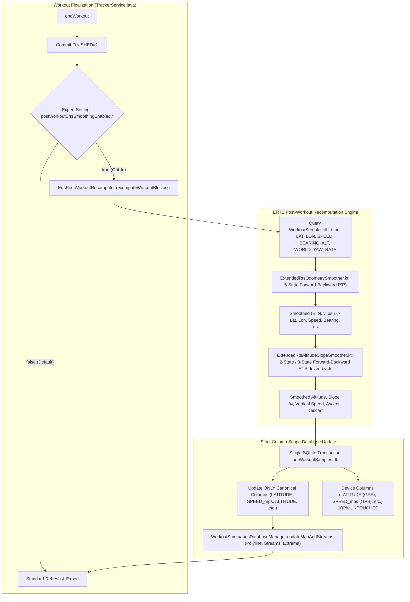

# ATT-7750: Stage 3 Implementation Plan — Extended Rauch-Tung-Striebel (ERTS/RTS) Smoother

**Epic**: ATT-166 (*Filtering to improve sensor values (especially locations)*)  
**Ticket**: ATT-7750 (*Post-workout forward-backward Extended RTS (ERTS) zero-phase track, speed & altitude smoothing reusing ATT-131 & ATT-6279 models (with Expert Settings toggle)*)  
**Requirement Mapping**: `REQ-FIL-017` (`REQ-FIL-017.1`..`REQ-FIL-017.5`)  
**Test Suite**: `TST-FIL-017` (`TST-FIL-017.1`..`TST-FIL-017.6`)

---

## 1. Architectural Architecture & Component Design

---

## 2. Atomic Implementation Blueprint for Flash Agent (`bf4810d9`)

### Step 1: Core Extended RTS Smoother Engines (SWE.2 / SWE.3)
1. **`ExtendedRtsOdometrySmoother.kt`**:
   - Location: `app/src/main/java/com/atrainingtracker/banalservice/odometry/ExtendedRtsOdometrySmoother.kt`
   - Implement pure Kotlin 5x5 matrix inversion via Gauss-Jordan elimination with partial pivoting.
   - Run forward pass on 5-state unicycle model $[E, N, v, \psi, b_{\omega_z}]^T$, recording discrete state transitions $k \to k+1$.
   - Run backward RTS recursion:
     $$C_k = P_{k|k} F_k^T (P_{k+1|k})^{-1}$$
     $$x_{k|N} = x_{k|k} + C_k (x_{k+1|N} - x_{k+1|k})$$
     $$P_{k|N} = P_{k|k} + C_k (P_{k+1|N} - P_{k+1|k}) C_k^T$$
     with heading angle differences wrapped to $[-\pi, \pi)$ via `UnicycleOdometryEkf.normalizeAngle`.
   - Propagate tunnel-exit and open-sky GNSS fixes backward through outages without cutting hairpins.
   - Benchmark: Ensure 14,400 samples execute in $< 50\text{ ms}$.

2. **`ExtendedRtsAltitudeSlopeSmoother.kt`**:
   - Location: `app/src/main/java/com/atrainingtracker/banalservice/odometry/ExtendedRtsAltitudeSlopeSmoother.kt`
   - Implement 2-State $[h, g]^T$ and 3-State $[h, g, b_{baro}]^T$ forward-backward smoother driven by smoothed horizontal displacements $\Delta s_{k|N} = v_{k|N} \cdot \Delta t_k$.
   - Standstill clamping ($v < 0.3\text{ m/s} \implies Q_g = 0, dh = 0$).
   - Output zero-phase elevation, terrain slope %, vertical speed $v_z$, cumulative ascent, and cumulative descent.

### Step 2: Database Recomputation Runner & Column Scope Invariant
3. **`ErtsPostWorkoutRecomputer.kt`**:
   - Location: `app/src/main/java/com/atrainingtracker/trainingtracker/database/ErtsPostWorkoutRecomputer.kt`
   - Implement `suspend fun recomputeWorkout(context: Context, workoutId: Long): Boolean` and `@JvmStatic fun recomputeWorkoutBlocking(context: Context, workoutId: Long): Boolean`.
   - Read samples from `WorkoutSamples.db` for table `getTableName(baseFileName)`.
   - Filter/dispatch to `ExtendedRtsOdometrySmoother` and `ExtendedRtsAltitudeSlopeSmoother`.
   - Execute batch SQLite update inside a single transaction updating *only* canonical unsuffixed columns (`LATITUDE`, `LONGITUDE`, `SPEED_mps`, `PACE_spm`, `DISTANCE_m`, `BEARING`, `ALTITUDE`, `SLOPE`, `VERTICAL_SPEED`, `ASCENT`, `DESCENT`).
   - Guard: Verify no column containing `" ("` is ever targeted for update.
   - Recompute encoded polyline via `PolyUtil.encode` and update streams via `WorkoutSummariesDatabaseManager.updateMapAndStreams`.

### Step 3: Settings Preference & UI Controls
4. **`TuningPreferencesDataStore.kt` & `TuningPreferencesDefaults.kt`**:
   - Declare `KEY_POST_WORKOUT_ERTS_SMOOTHING = booleanPreferencesKey("tuning_post_workout_erts_smoothing")`.
   - Declare `DEFAULT_POST_WORKOUT_ERTS_SMOOTHING_ENABLED = false`.
   - Add `postWorkoutErtsSmoothingEnabled` to `TuningConfig`.
   - Add preference Flow and mutator methods.

5. **`SensorsGpsFilterSection.kt` & `AdvancedTuningScreen.kt`**:
   - Add `TuningToggleItem` under `SensorsGpsFilterSection` with title `tuning_post_workout_erts_smoothing_title` and summary `tuning_post_workout_erts_smoothing_desc`.
   - Bind to `postWorkoutErtsSmoothingEnabled` in `AdvancedTuningScreen.kt` and `AdvancedTuningDialog.kt`.

6. **9-Language String Localization**:
   - Add strings across all 9 locales (`values/strings.xml`, `values-de`, `values-es`, `values-fr`, `values-it`, `values-ja`, `values-pt`, `values-ru`, `values-uk`).

### Step 4: TrackerService Finalization Lifecycle Hook
7. **`TrackerService.java`**:
   - In `endWorkout(snapshot, workoutId, baseFileName, liveSession)`:
     Within the asynchronous post-workout recomputation block, inspect `TuningPreferencesDataStore.postWorkoutErtsSmoothingEnabled`.
     If true, invoke `ErtsPostWorkoutRecomputer.recomputeWorkoutBlocking(appContext, finalWorkoutId)` before invoking `refreshWorkout(finalWorkoutId)`.

### Step 5: Targeted Unit & Integration Tests (Stage 5 Verification)
8. **Test Suites**:
   - `ExtendedRtsOdometrySmootherTest.kt`: Curved tunnel outage, Doppler dropout, 14,400 sample speed test (< 100 ms).
   - `ExtendedRtsAltitudeSlopeSmootherTest.kt`: Delayed DEM lock, standstill clamping, zero climb accumulation during stops.
   - `ErtsPostWorkoutRecomputerTest.kt`: Strict column scope invariant, device-attributed columns untouched, polyline re-encoding.
   - `TrackerServiceErtsFinalizationTest.kt`: Toggle enabled vs disabled lifecycle verification.
   - `AdvancedTuningErtsContractTest.kt`: UI contract and 9-language localization parity (`TranslationParityTest`).

---

## 3. Governance Invariants & Verification Plan
- **Zero Live Overhead**: Smoother executes exclusively post-workout in background. Live tracking performance is unaffected.
- **Strict Column Scope Invariant**: Per-device columns (`LATITUDE (GPS)`, `SPEED_mps (att_fused)`, etc.) remain 100% untouched.
- **Matrix Independence**: Zero external matrix libraries; pure Kotlin 5x5 algebra.
- **Living Documentation**: `REQ-FIL-017` / `TST-FIL-017` maintained and synchronized at 100% parity.
- **Clean-Room Verification**: All tests passing via `python3 tools/parallel_sprint_lock.py -- ./gradlew testDebugUnitTest`.
