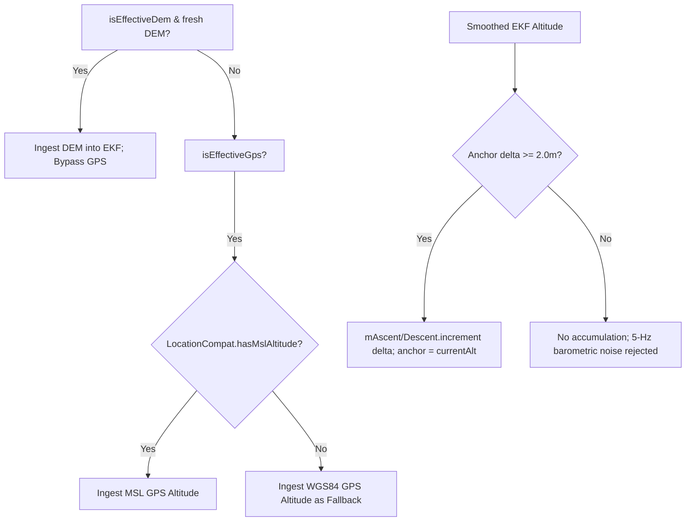

# Stage 3: Implementation Plan - ATT-8081: MSL Normalization & Ascent Hysteresis in ATT Fused Altitude

**Ticket**: [ATT-8081](https://rainerblind.atlassian.net/browse/ATT-8081)  
**Parent Epic**: [ATT-166](https://rainerblind.atlassian.net/browse/ATT-166) (*Filtering to improve sensor values (especially locations)*)  
**Target Release**: `V5.0.0` | **Active Sprint**: `Sprint 2026-47.2` | **Branch**: `feature/ATT-8081`  
**Requirement Mapping**: `REQ-FIL-020` (`REQ-FIL-020.1`..`REQ-FIL-020.3`)  
**Test Mapping**: `TST-FIL-020` (`TST-FIL-020.1`..`TST-FIL-020.5`)  
**Author**: AI Agent 1 (Implementer, Lane 1 Flash) | **Date**: 2026-11-16  

---

## 1. Problem Description & Root Cause Summary
`AltitudeAndSlopeDevice_ATTFused` experienced a +11 m vertical offset and ~4.5x inflated ascent/descent due to:
1. Ingesting both DEM (MSL) and GPS (WGS84, sitting $N \approx +47.5\text{ m}$ higher in Central Europe) as reference altitudes simultaneously, creating opposing Kalman innovations and slope swings (-28% .. +13%).
2. Accumulating raw altitude differences on every ~5 Hz hardware pressure event without a hysteresis deadband, rectifying barometric noise into phantom climbing.
3. Returning localized strings from `getName()`, creating locale-dependent columns in `WorkoutSamples.db`.

---

## 2. Traceability & Requirements Mapping
* **`REQ-FIL-020.1`**: Reference precedence (DEM over unnormalized GPS) & MSL normalization -> `TST-FIL-020.1`.
* **`REQ-FIL-020.2`**: 2.0 m anchor-based elevation hysteresis deadband for cumulative ascent/descent -> `TST-FIL-020.2`, `TST-FIL-020.3`.
* **`REQ-FIL-020.3`**: Locale-invariant technical DB identifier (`att_fused_altitude_slope`) & UI compatibility -> `TST-FIL-020.4`.
* **`REQ-FIL-016` / Invariants**: Standstill clamping, 2-State / 3-State EKF mode switching, and living doc parity -> `TST-FIL-020.5`.

---

## 3. System Invariants & Preserved Behavior
1. **Standstill Clamping Invariance**: Standstill clamping ($v < 0.3\text{ m/s}$) freezes vertical climb ($dh = 0, Q_g = 0$), accumulating 0.0 m drift.
2. **UI & Device Display Name Parity**: `DevicesDatabaseManager` retains localized display names across all 9 supported locales; only technical sample column attribution uses `att_fused_altitude_slope`.
3. **Legacy Column Compatibility**: `WorkoutSamplesDatabaseManager` and `ErtsPostWorkoutRecomputer` retain legacy column recognition for previously recorded workouts.

---

## 4. Proposed Architectural Changes

---

## 5. Step-by-Step Implementation Sequence (Stage 4 Construction)

### Step 1: Reference Precedence & MSL Normalization (`AltitudeAndSlopeDevice_ATTFused.kt`, `SpeedAndLocationDevice.java`)
* In `SpeedAndLocationDevice.java:777`: Use `LocationCompat.hasMslAltitude(location) ? LocationCompat.getMslAltitudeMeters(location) : location.getAltitude()` when publishing `mAltitudeSensor`.
* In `AltitudeAndSlopeDevice_ATTFused.kt`: In `checkReferenceAltitudeFromSensors()`, establish DEM precedence: if `isEffectiveDem` and fresh DEM was received within 15 seconds, skip ingesting raw GPS altitude into EKF.

### Step 2: Anchor-Based 2.0 m Elevation Hysteresis (`AltitudeAndSlopeDevice_ATTFused.kt`)
* Define `const val ASCENT_DESCENT_HYSTERESIS_METERS = 2.0`.
* Add `private var mAscentDescentAnchorAltitude = Double.NaN`. Reset on `shutDown()`.
* In `publishAltitudeAndMetrics()`: Replace raw per-callback summation with anchor-based hysteresis deadband ($\ge 2.0\text{ m}$ threshold), rejecting 5-Hz barometric micro-ripples.

### Step 3: Technical Identifier & Legacy Aliasing (`AltitudeAndSlopeDevice_ATTFused.kt`)
* Override `getName(): String = "att_fused_altitude_slope"`.
* Ensure legacy reader aliases in `WorkoutSamplesDatabaseManager.java` and `ErtsPostWorkoutRecomputer.kt` recognize both `att_fused_altitude_slope` and localized legacy column names.

### Step 4: Targeted Unit Testing & Governance Verification (`TST-FIL-020`)
* Implement unit tests in `AltitudeAndSlopeDevice_ATTFusedTest.kt` verifying DEM precedence, 5-Hz noise hysteresis rejection, real climb accumulation, and technical name persistence.
* Run `./gradlew testDebugUnitTest --tests "*AltitudeAndSlopeDevice*"` and `python3 tools/verify_requirement_governance.py`.

---

## 6. Verification & Rollback Plan
* **Verification**: Targeted unit tests and living doc governance verification.
* **Rollback**: Atomic Git revert of `feature/ATT-8081`.
