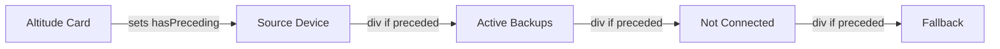

# Stage 3: Implementation Plan - ATT-8107: Remove Superfluous Top Divider in SensorSourceDialog

**Ticket**: [ATT-8107](https://rainerblind.atlassian.net/browse/ATT-8107)  
**Parent Epic**: [ATT-1286](https://rainerblind.atlassian.net/browse/ATT-1286) (*Cycling Rearview Radar*)  
**Target Release**: `V5.0.0` | **Active Sprint**: `Schicht 2026-11-16_02_Spät` | **Branch**: `feature/ATT-8107`  
**Requirement Mapping**: `REQ-UI-2781` (`REQ-UI-2781.1`, `REQ-UI-2781.2`)  
**Test Mapping**: `TST-UI-2781` (`TST-UI-2781.1`..`TST-UI-2781.3`)  
**Author**: AI Agent 1 (Implementer, Lane 1 Flash) | **Date**: 2026-11-16  

---

## 1. Problem Description & Root Cause Summary
When an athlete taps a sensor icon in `SensorStatus` with no active connected devices, `SensorSourceDialog` renders an orphaned `HorizontalDivider` at the top of the dialog body above "Nicht verbunden".
* **Root Cause**: `SensorSourceDialog.kt:254, 284, 315` unconditionally emits `HorizontalDivider` without checking if a preceding section actually rendered, and emits an unconditional trailing divider after altitude calibration.

---

## 2. Traceability & Requirements Mapping
* **`REQ-UI-2781.1`**: Preceding-section divider guarding (no leading divider) -> `TST-UI-2781.1`.
* **`REQ-UI-2781.2`**: Trailing and stacked divider elimination -> `TST-UI-2781.2`.
* **`REQ-UI-049`, `REQ-UI-051` / Invariants**: Semantic colors, priority sorting, zero regressions -> `TST-UI-2781.3`.

---

## 3. System Invariants & Preserved Behavior
1. **Multi-Tier Hierarchy**: Telemetry tiers (Altitude Calibration, Source Device, Active Backups, Not Connected, Internal Fallback) retain existing ordering and spacing.
2. **Visual Consistency**: `HorizontalDivider(thickness = 0.5.dp, color = MaterialTheme.colorScheme.outlineVariant)` preserved.
3. **Canonical Priority Sorting**: `REQ-UI-268.5` sorting order for active backups and disconnected devices is unaltered.

---

## 4. Proposed Architectural Changes
* **UI Consistency (`docs/design_guidelines.md`)**: Reuses `HorizontalDivider`, `DeviceIdentityBlock`, `MaterialTheme.colorScheme.outlineVariant`, `0.5.dp` thickness, `16.dp` column spacing. Zero new styles.

---

## 5. Step-by-Step Implementation Sequence (Stage 4 Construction)

### Step 1: Preceding-Section Divider Guarding in `SensorSourceDialog.kt`
* Remove unconditional trailing `HorizontalDivider` at end of Altitude Calibration block (`line 254`).
* Track `var hasPrecedingSection = false` at top of dialog `Column`.
* If Altitude Calibration renders: set `hasPrecedingSection = true`.
* For each subsequent section (Source Device, Active Backups, Not Connected, Internal Fallback): if `hasPrecedingSection`, emit `HorizontalDivider`; render section content; set `hasPrecedingSection = true`.

### Step 2: Unit & Contract Verification in `SensorSourceDialogContractTest.kt`
* Add `testSensorSourceDialog_conditionalDividersAvoidTopOrDuplicateSeparators()` (`TST-UI-2781.1`, `TST-UI-2781.2`).
* Validate zero leading dividers when `sourceDevice == null && activeBackups.isEmpty()`.
* Validate single divider separation when Altitude Calibration is present.
* Render Light/Dark screenshot to `docs/engineering/walkthroughs/img/ATT-8107_sensor_status_empty.png` for Stage 5 audit.

### Step 3: Targeted Verification & Governance (`TST-UI-2781.3`)
* Run `./gradlew testDebugUnitTest --tests "*SensorSourceDialog*" --tests "*SensorStatus*" --max-workers=2`.
* Verify `python3 tools/verify_requirement_governance.py`.

---

## 6. Verification & Rollback Plan
* **Verification**: Targeted unit tests and `verify_requirement_governance.py`.
* **Rollback**: Atomic Git revert of `feature/ATT-8107`.
