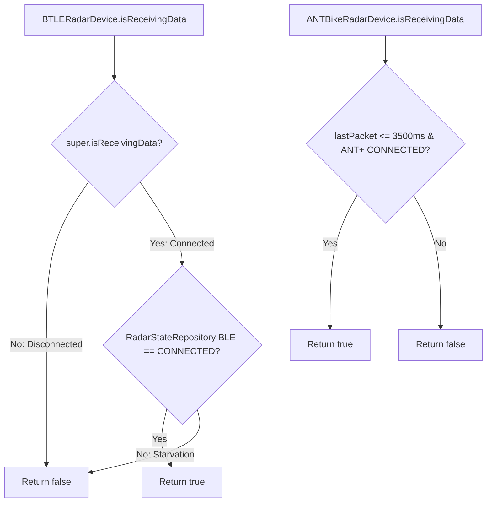

# Stage 3: Implementation Plan - ATT-8109: Instance-Isolated Radar Connection State

**Ticket**: [ATT-8109](https://rainerblind.atlassian.net/browse/ATT-8109)  
**Parent Epic**: [ATT-1286](https://rainerblind.atlassian.net/browse/ATT-1286) (*Cycling Rearview Radar*)  
**Target Release**: `V5.0.0` | **Active Sprint**: `Schicht 2026-11-16_02_Spät` | **Branch**: `feature/ATT-8109`  
**Requirement Mapping**: `REQ-CON-044` (`REQ-CON-044.1`..`REQ-CON-044.3`)  
**Test Mapping**: `TST-CON-044` (`TST-CON-044.1`..`TST-CON-044.4`)  
**Author**: AI Agent 1 (Implementer, Lane 1 Flash) | **Date**: 2026-11-16  

---

## 1. Problem Description & Root Cause Summary
When multiple BLE or ANT+ radar peripherals are paired in `DeviceManager`, connecting to one radar causes the Start screen and Cockpit headers to falsely report all paired radars as active.
* **Root Cause**: `BTLERadarDevice.isReceivingData()` in `BTLERadarDevice.java:174-176` checked only the global transport singleton `RadarStateRepository.getState(RadarSource.BLE).getConnectionState() == CONNECTED`, bypassing `MyBTLEDevice`'s per-instance connection state (`super.isReceivingData()`). Similarly, `ANTBikeRadarDevice.kt:226-227` checked only `RadarSource.ANT_PLUS` without evaluating instance-level packet reception.

---

## 2. Traceability & Requirements Mapping
* **`REQ-CON-044.1`**: Per-instance BLE GATT qualification (`super.isReceivingData() && ...`) -> `TST-CON-044.1`.
* **`REQ-CON-044.2`**: Fail-safe watchdog packet starvation disconnect retention -> `TST-CON-044.2`.
* **`REQ-CON-044.3`**: Per-instance ANT+ packet reception gating within watchdog window -> `TST-CON-044.3`.
* **`REQ-CON-041` / Invariants**: Cross-protocol source isolation and single-device behavioral parity -> `TST-CON-044.4`.

---

## 3. System Invariants & Preserved Behavior
1. **Watchdog Fail-Safe Retention**: Packet starvation (3.5s timeout) continues to report `isReceivingData() == false` even if GATT remains open.
2. **Cross-Protocol Isolation**: Active ANT+ radar streams do not cause BLE radars to report active, and vice versa.
3. **Single-Device Operation**: Single paired radar workflows remain 100% identical in behavior and latency.

---

## 4. Proposed Architectural Changes

---

## 5. Step-by-Step Implementation Sequence (Stage 4 Construction)

### Step 1: Per-Instance GATT Gating in `BTLERadarDevice.java`
* In `BTLERadarDevice.java:174`: Update `isReceivingData()`:
  `return super.isReceivingData() && RadarStateRepository.getState(RadarSource.BLE).getConnectionState() == RadarConnectionState.CONNECTED;`

### Step 2: Per-Instance Packet Gating in `ANTBikeRadarDevice.kt`
* In `ANTBikeRadarDevice.kt`: Add `@Volatile private var lastPacketReceivedRealtimeMs = 0L`.
* In `decodeBroadcastData()`: Update `lastPacketReceivedRealtimeMs = SystemClock.elapsedRealtime()`.
* In `onWatchdogTimeout()` and `shutDown()`: Reset `lastPacketReceivedRealtimeMs = 0L`.
* In `isReceivingData()`: Check `(lastPacketReceivedRealtimeMs > 0L && SystemClock.elapsedRealtime() - lastPacketReceivedRealtimeMs <= WATCHDOG_TIMEOUT_MS) && RadarStateRepository.getState(RadarSource.ANT_PLUS).connectionState == RadarConnectionState.CONNECTED`.

### Step 3: Multi-Instance Unit Tests in `BTLERadarDeviceTest.kt`
* Add `testMultiInstanceBleRadar_disconnectedDeviceReturnsFalse()` (`// TST-CON-044.1`).
* Assert existing `testIsReceivingData_returnsFalseOnWatchdogTimeoutEvenIfGattConnected()` (`// TST-CON-044.2`) passes.

### Step 4: Multi-Instance Unit Tests in `ANTBikeRadarDeviceTest.kt`
* Add `testMultiInstanceAntRadar_silentDeviceReturnsFalse()` (`// TST-CON-044.3`).

### Step 5: Verification & Governance (`TST-CON-044.4`)
* Run `./gradlew testDebugUnitTest --tests "*BTLERadarDeviceTest*" --tests "*ANTBikeRadarDeviceTest*" --tests "*RadarStateRepositoryTest*" --max-workers=2`.
* Verify `python3 tools/verify_requirement_governance.py`.

---

## 6. Verification & Rollback Plan
* **Verification**: Targeted unit tests and `verify_requirement_governance.py`.
* **Rollback**: Atomic Git revert of `feature/ATT-8109`.
