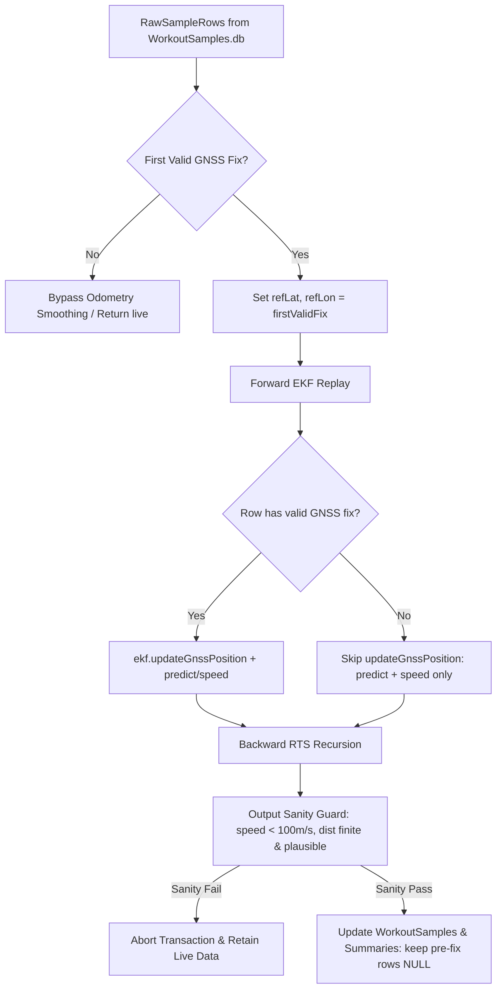

# Stage 3: Implementation Plan - ATT-8337: Post-Workout ERTS Smoother GNSS Fix Gating & Origin Anchoring

**Ticket**: [ATT-8337](https://rainerblind.atlassian.net/browse/ATT-8337)  
**Parent Epic**: [ATT-166](https://rainerblind.atlassian.net/browse/ATT-166) (*Filtering to improve sensor values (especially locations)*)  
**Target Release**: `V5.0.0` | **Active Sprint**: `Sprint 2026-47.2` | **Branch**: `feature/ATT-8337`  
**Requirement Mapping**: `REQ-FIL-019` (`REQ-FIL-019.1`..`REQ-FIL-019.4`)  
**Test Mapping**: `TST-FIL-019` (`TST-FIL-019.1`..`TST-FIL-019.5`)  
**Author**: AI Agent 1 (Implementer, Lane 1 Flash) | **Date**: 2026-11-16  

---

## 1. Problem Description & Root Cause Summary
Leading workout samples recorded prior to satellite lock have `LATITUDE = NULL, LONGITUDE = NULL`. `ErtsPostWorkoutRecomputer.kt` coerced `null` to `0.0`, causing `ExtendedRtsOdometrySmoother.kt` to set its tangent-plane origin at Null Island `(0.0, 0.0)` and update the EKF at `(0.0, 0.0)`. The subsequent arrival of the first genuine fix (~5,500 km away) produced a 477 km/s shock wave, corrupting `WorkoutSamples.db`, `WorkoutSummaries.db` (10,196 km total distance), exports, and route clusters.

---

## 2. Traceability & Requirements Mapping
* **`REQ-FIL-019.1`**: Nullable coordinate preservation in `RawOdometrySample` / `ErtsPostWorkoutRecomputer` -> `TST-FIL-019.1`, `TST-FIL-019.3`.
* **`REQ-FIL-019.2`**: Reference origin from first valid GNSS fix & fix-gated EKF updates -> `TST-FIL-019.1`, `TST-FIL-019.2`.
* **`REQ-FIL-019.3`**: SQLite `NULL` preservation for no-fix rows & exclusion of `(0.0, 0.0)` / `null` from `mapPolyline` -> `TST-FIL-019.3`.
* **`REQ-FIL-019.4`**: Output sanity guard in `ErtsPostWorkoutRecomputer` with live metric fallback -> `TST-FIL-019.4`.
* **`REQ-FIL-017` / Invariants**: Continuous SWE.2 preservation of column whitelist and opt-in settings -> `TST-FIL-019.5`.

---

## 3. System Invariants & Preserved Behavior
1. **Strict Column Scope Invariant**: Per-device columns (`<SensorType> (<SourceName>)`) remain 100% byte-for-byte untouched; only canonical unsuffixed columns are modified.
2. **Zero Null Island Ingestion/Emission**: `(0.0, 0.0)` is never treated as a valid location, never fed into `ekf.updateGnssPosition()`, and never encoded into `mapPolyline`.
3. **Rollback & Live Telemetry Safety**: If smoothed distance/speed fails sanity checks, the transaction aborts cleanly, preserving live tracking data.

---

## 4. Proposed Architectural Changes

---

## 5. Step-by-Step Implementation Sequence (Stage 4 Construction)

### Step 1: Nullable Coordinates & Fix Validity Guard (`ExtendedRtsOdometrySmoother.kt`)
* Change `RawOdometrySample.latitude` and `longitude` to `Double? = null`.
* Implement `hasValidGnssFix(lat: Double?, lon: Double?): Boolean` (`!lat.isNaN() && !lon.isNaN() && abs(lat) > 1e-6 || abs(lon) > 1e-6` within `[-90, 90]` / `[-180, 180]`).
* In `smoothSamples()`:
  * Select `refLat`/`refLon` from `samples.firstOrNull { it.hasValidGnssFix() }`. If null, return `emptyList()`.
  * In forward loop, invoke `ekf.updateGnssPosition()` strictly when `sample.hasValidGnssFix()`.

### Step 2: Database Recomputation, NULL Preservation & Sanity Guard (`ErtsPostWorkoutRecomputer.kt`)
* In `runOdometrySmoothing()`: Map `RawOdometrySample` preserving `row.latitude` and `row.longitude` as nullable (`latitude = row.latitude`, `longitude = row.longitude`, removing `?: 0.0`).
* In `updateSamplesDatabase()`: For rows where `rawRows[i].latitude == null || rawRows[i].longitude == null`, bind `stmt.bindNull()` to canonical `LATITUDE` and `LONGITUDE`.
* In `updateWorkoutSummaries()`: Filter out points without valid coordinates when constructing `mapPolyline` and `startPos`/`endPos`.
* In `recomputeWorkout()`: Implement `isSmoothedOutputSane(rawRows, smoothedOdometry)` before `updateSamplesDatabase()`. Abort transaction and log warning if distance > 1,000 km, speed > 100 m/s, or values are non-finite.

### Step 3: Targeted Unit & Regression Test Suite (`TST-FIL-019`)
* Add `ExtendedRtsOdometrySmootherTest.kt` tests for leading `NULL` GNSS fixes, mid-workout gaps, and all-null fixtures.
* Add `ErtsPostWorkoutRecomputerTest.kt` tests for leading `NULL` DB preservation and sanity guard divergence abort.
* Verify via `./gradlew testDebugUnitTest --tests "*ExtendedRts*" --tests "*ErtsPostWorkout*"`.

---

## 6. Verification & Rollback Plan
* **Verification**: Targeted unit tests and `python3 tools/verify_requirement_governance.py`.
* **Rollback**: Atomic Git branch revert of `feature/ATT-8337`.
