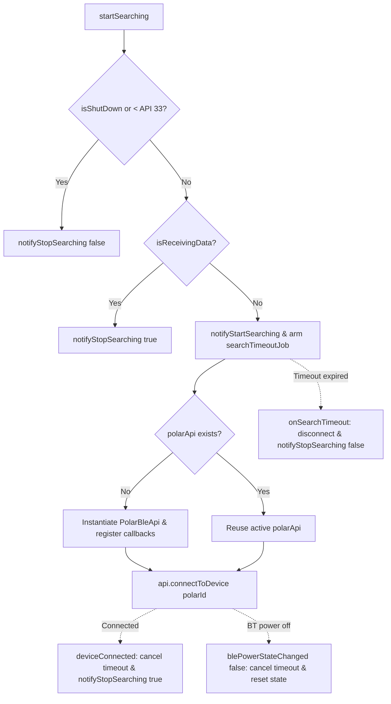

# Stage 3: Implementation Plan — ATT-8451: Polar Online Streaming Bridge Search Timeout & GATT Contention Recovery

**Ticket**: [ATT-8451](https://issue-tracker/ATT-8451) (`2 SP`) | **Parent Epic**: `ATT-5910` | **Target Release**: `V5.0.0`  
**Active Sprint**: `2026-11-16_03_Nacht` | **Branch**: `feature/ATT-8451` | **Author**: `agent1` (`subagent_pro`)  
**Requirement Mapping**: `REQ-CON-045` (`REQ-CON-045.1`..`REQ-CON-045.4`) | **Test Mapping**: `TST-CON-045` (`TST-CON-045.1`..`TST-CON-045.4`)  

---

## 1. Problem Description & Root Cause Summary
`PolarOnlineStreamingBridge.startSearching()` dispatched `notifyStartSearching()` without scheduling a search timeout. When a Polar sensor is powered off, out of range, or advertisement-starved by a concurrent Polar Flow GATT connection, Polar SDK's advertisement scan hangs indefinitely. Because `notifyStopSearching(false)` is never sent, `DeviceManager.mSearchQueue` halts forever, blocking subsequent paired sensors (radar, powermeters). Furthermore, `connectPersistentSession()` executed `if (polarApi != null) return`, silently stranding repeated search attempts and post-disconnect / post-BT-restart retries in an unresolvable searching state (`ATT-8451`, extending `REQ-SET-112.2` and `REQ-CON-004`).

---

## 2. Traceability & Requirements Mapping
* **`REQ-CON-045.1`**: Deterministic search timeout watchdog (`TrainingApplication.getBtleSearchPeriodMs()`) calling `notifyStopSearching(false)` and disconnect $\rightarrow$ `TST-CON-045.1`.
* **`REQ-CON-045.2`**: Idempotent re-connect / re-search on existing `polarApi` $\rightarrow$ `TST-CON-045.2`.
* **`REQ-CON-045.3`**: `deviceConnected` cancels search timeout and emits `notifyStopSearching(true)` $\rightarrow$ `TST-CON-045.3`.
* **`REQ-CON-045.4`**: `blePowerStateChanged(false)` and `shutDown()` cancel timeout jobs and clear state $\rightarrow$ `TST-CON-045.4`.

---

## 3. System Invariants & Preserved Behavior
1. **Search Queue Liveness**: `DeviceManager.mSearchQueue` unconditionally progresses to subsequent sensors upon timeout expiry.
2. **Offline & IMU Arbitration**: `PolarOfflineGattCoordinator` session sharing (`REQ-SET-112.3`) and cadence priority (`REQ-SET-112.4`) remain intact.
3. **Active Bridges Registry**: `activeBridges` registry and frame dispatch (`ATT-8019`) remain strictly preserved.
4. **Zero String Regressions**: No UI string changes; 100% localization parity across all 9 languages preserved.

---

## 4. Proposed Architectural Flow

---

## 5. Step-by-Step Implementation Sequence (Stage 4 Construction)

### Step 1: Injectable Search Timeout Watchdog in `PolarOnlineStreamingBridge.kt`
* Add constructor parameter `searchTimeoutMsProvider: () -> Long = { TrainingApplication.getBtleSearchPeriodMs() }` (`@JvmOverloads`) and `private var searchTimeoutJob: Job? = null`.
* Implement `armSearchTimeoutWatchdog()` and `onSearchTimeout()`.
* In `startSearching()`: if `isReceivingData()`, return `notifyStopSearching(true)`. Otherwise, broadcast `notifyStartSearching()`, arm watchdog, and invoke `connectPersistentSession()`.

### Step 2: Idempotent Reconnection on Existing `polarApi` in `PolarOnlineStreamingBridge.kt`
* Remove silent early return `if (polarApi != null) return`. If `polarApi == null`, initialize API, set callbacks and register with `PolarOfflineGattCoordinator`.
* Always invoke `api.connectToDevice(polarId)`. Catch exceptions, cancel watchdog, and broadcast `notifyStopSearching(false)`.

### Step 3: Search Watchdog Cancellation on Connection & Lifecycle Teardown
* In `sdkCallback.deviceConnected()`: cancel `searchTimeoutJob = null` prior to `notifyStopSearching(true)`.
* In `sdkCallback.blePowerStateChanged(powered: Boolean)`: if `!powered`, clear connection flag, cancel jobs, release ACC lock, unregister sensors, and if searching, cancel watchdog and call `notifyStopSearching(false)`.
* In `shutDown()`: cancel `searchTimeoutJob`.

### Step 4: Unit Test Suite Expansion in `PolarOnlineStreamingBridgeTest.kt`
* `testSearchTimeout_triggersNotifyStopSearchingFalse_andDisconnects()` (`// Traces to: REQ-CON-045.1, TST-CON-045.1`).
* `testStartSearching_withExistingPolarApi_reconnectsAndArmsTimeout()` & `testStartSearching_whenAlreadyConnected()` (`// Traces to: REQ-CON-045.2, TST-CON-045.2`).
* `testDeviceConnected_cancelsSearchTimeoutWatchdog()` (`// Traces to: REQ-CON-045.3, TST-CON-045.3`).
* `testBlePowerStateChanged_false_cancelsSearchTimeoutAndResetsState()` & `testShutDown_cancelsTimeout()` (`// Traces to: REQ-CON-045.4, TST-CON-045.4`).

### Step 5: Verification & Governance
* Run targeted unit tests: `./gradlew testDebugUnitTest --tests "*PolarOnlineStreamingBridgeTest*" --max-workers=2`.
* Run `python3 tools/verify_requirement_governance.py`.

---

## 6. Verification & Rollback Plan
* **Verification**: Targeted Robolectric unit test execution (`PolarOnlineStreamingBridgeTest`) asserting timeout and queue progression.
* **Rollback**: Atomic Git revert of `feature/ATT-8451`.
