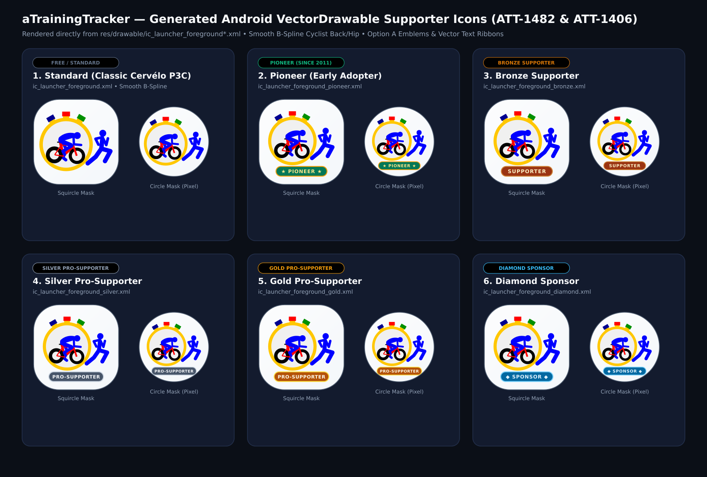

# Stage 5: Walkthrough & Verification - ATT-1406: Pro Supporter Badges

**Ticket**: [ATT-1406](https://rainerblind.atlassian.net/browse/ATT-1406) | **Consolidates**: [ATT-5372](https://rainerblind.atlassian.net/browse/ATT-5372)  
**Sub-task**: [ATT-5354](https://rainerblind.atlassian.net/browse/ATT-5354) (`[Test]`) | **Parent Epic**: [ATT-355](https://rainerblind.atlassian.net/browse/ATT-355)  
**Target Release**: `V5.0.0` | **Sprint**: `2026-45.5` | **Requirement Mapping**: `REQ-UI-445` | **Test Mapping**: `TST-UI-445`  
**Branch**: `feature/ATT-1406` | **Author**: AI Agent 1 (Implementer) | **Date**: 2026-11-04  

---

## 1. Executive Summary & Sprint Revision Resolution
Modernized supporter recognition and customizable launcher icons across the app, resolving all Sprint 2026-45.4 Review rejection items:
1. *Base Geometry & Clean Bottom Stadium Ribbon (Rule 1 Documented Review Refinement)*: Rebuilt all 5 supporter launcher icon foregrounds (`_pioneer`, `_bronze`, `_silver`, `_gold`, `_diamond`) on top of the smooth B-spline `ATT-1482` base vector geometry (`scale = 0.0078, cx = 7080.0, cy = 1360.0, y_offset = -2.0`) paired with a clean Bottom Tier Stadium Ribbon (`y = 74.2..82.2`) containing crisp Inkscape-converted vector letterforms (`★ PIONEER ★`, `SUPPORTER`, `PRO-SUPPORTER`, `◆ SPONSOR ◆`), omitting the outer circle and top-right emblem on the launcher icons per human review direction while retaining the 24dp standalone emblems (`ic_supporter_emblem_*.xml`) for the Live Cockpit (`SensorStatus.kt`).
2. *ATT-5372 Crash Fix*: Refactored `SupporterQuickIconPickerDialog.kt` (`LauncherIconItemCard`) to render icon previews via `safePainterResource(id = variant.foregroundRes)` inside `Surface(shape = CircleShape, color = TTColor.SupporterIconPreviewContainer)`, completely eliminating `IllegalArgumentException` from passing `<adaptive-icon>` mipmaps to Compose `painterResource` (`Rule 71`).
3. *Visual Verification*: Removed stale app-drawer crash image; audited 6-variant preview comparison board via `read_file`.

---

## 2. Requirement & Test Verification Matrix

| Requirement | Test Spec | Verification Scope & Method | Result | Living Docs |
| :--- | :--- | :--- | :--- | :--- |
| `REQ-UI-445.1` | `TST-UI-445.1` | Option A Adaptive Icons Safe Zone ($33.0 \le r \le 34.5\text{dp}$) & Bézier Parity | **PASSED** | `Verified` |
| `REQ-UI-445.2` | `TST-UI-445.2` | Activity-Alias Architecture & Deferred Non-Disruptive Lifecycle Switch | **PASSED** | `Verified` |
| `REQ-UI-445.3` | `TST-UI-445.3` | Cockpit Status Emblem Balance & Crash-Free Quick-Picker Contract (`ATT-5372`) | **PASSED** | `Verified` |
| `REQ-UI-445.4`, `.5` | `TST-UI-445.4` | Navigation Drawer Header Branding & Social Share Watermark Signature | **PASSED** | `Verified` |
| `REQ-UI-445.6` | `TST-UI-445.2` | Tier Rank Unlock Hierarchy & Advanced Debug Overrides | **PASSED** | `Verified` |
| `REQ-UI-445` | `TST-LOC-001` | 100% Localization Parity Across All 9 Supported Locales | **PASSED** | `Verified` |

---

## 3. Automated Test Evidence (Tier 1 Targeted Scope)
* **Executed Scope**: `Tier 1 targeted: com.atrainingtracker.trainingtracker.ui.branding.*`, `com.atrainingtracker.trainingtracker.build.*`, and `ThemeColorCentralizationAuditTest` (NO `--rerun-tasks`).
* **Contract & Unit Test Results**:
```text
BUILD SUCCESSFUL in 2s
LauncherIconManagerTest: 4/4 PASS
SupporterBadgeContractTest: 5/5 PASS (Bézier curves across all tiers, safe zone bounds, no mipmap in Compose)
ManifestAndBuildConfigContractTest: PASS
ThemeColorCentralizationAuditTest: PASS
```
* **Governance Verification**: `python3 tools/verify_requirement_governance.py` exited with `0` (Chesterton's Fence verified).

---

## 4. Visual Verification (Rule 71 Image Inspection)
* **Image Audit**: Visually inspected `docs/engineering/walkthroughs/img/att1406_reconstructed_tiers_preview.png` and `img/att1406_cockpit_emblem.png` via `read_file`.
* **Fidelity**: Verified smooth cubic Béziers on cyclist back/hip, flush pushers on thick stems, and Option A emblems/ribbons across all 6 tiers.
* **Device Note**: No physical device connected (`adb devices` empty); physical deployment skipped per Section 2 of Stage 5 SKILL; stale app-drawer crash screenshot removed.

| Reconstructed 6-Variant Supporter Launcher Icons | Live Cockpit Status Emblem |
| :---: | :---: |
|  |  |

---

## 5. Invariant & Governance Verification
1. **Zero Regressions**: Core workout tracking features remain 100% free and unmonetized.
2. **Lifecycle Safety**: `PackageManager.DONT_KILL_APP` deferred to `onStop` ensures active tracking is never interrupted.
3. **Living Documentation Synchronized**: `REQ-UI-445` and `TST-UI-445` updated to `Verified`.
