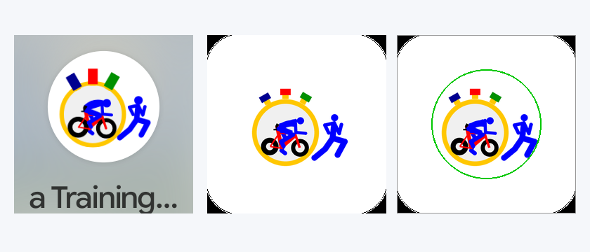

# Stage 5: Walkthrough & Verification - ATT-1482: App Icon Modernization

**Ticket**: [ATT-1482](https://rainerblind.atlassian.net/browse/ATT-1482)  
**Sub-task**: [ATT-5349](https://rainerblind.atlassian.net/browse/ATT-5349) (`[Test]`)  
**Parent Epic**: [ATT-355](https://rainerblind.atlassian.net/browse/ATT-355) (*Good and consistent UI*)  
**Target Release**: `V5.0.0`  
**Active Sprint**: `2026-45.4`  
**Requirement Mapping**: `REQ-UI-444` (`REQ-UI-444.1`–`.4`)  
**Test Mapping**: `TST-UI-444` (`TST-UI-444.1`–`.4`)  
**Branch**: `feature/ATT-1482`  
**Author**: AI Agent 1 (Implementer)  
**Date**: 2026-11-04  

---

## 1. Executive Summary & Verification Overview
Modernized the application launcher icon to full Android Adaptive Icon standards (API 26+) with Android 13+ Material You themed icon support (`ic_launcher_monochrome.xml`). Master geometry from `Bilder/logo.fig` was vectorized into a 108dp canvas, centered strictly within the 66dp circular safe zone ($cx=54, cy=54, r \le 31.0\text{dp} \le 33\text{dp}$), guaranteeing zero mask clipping across circle, squircle, and teardrop launchers. Authentic brand colors (Cervélo P3C `#FF0000`/`#000000`, stopwatch `#FFC700`/`#F0F0F0`/`#000090`/`#009000`, athletes `#0000FF`) were 100% preserved. Legacy `R.drawable.logo` remains intact for in-app notifications.

---

## 2. Requirement & Test Verification Matrix

| Requirement | Test Spec | Verification Scope & Method | Result | Living Docs |
| :--- | :--- | :--- | :--- | :--- |
| `REQ-UI-444.1`, `.4` | `TST-UI-444.1` | Manifest & Adaptive XML Structure Contract | **PASSED** | `Verified` |
| `REQ-UI-444.2` | `TST-UI-444.2` | Vector Bounds Safe-Zone Containment ($r \le 33\text{dp}$) | **PASSED** | `Verified` |
| `REQ-UI-444.2`, `.3` | `TST-UI-444.3` | Brand Color Parity & Monochrome Silhouette | **PASSED** | `Verified` |
| `REQ-UI-444.4` | `TST-UI-444.4` | Legacy Notification & Play Store Master Contract | **PASSED** | `Verified` |

---

## 3. Automated Test Evidence (Tier 1 Targeted Scope)
* **Executed Scope**: `Tier 1 targeted: com.atrainingtracker.trainingtracker.ui.branding.*`, `com.atrainingtracker.trainingtracker.build.*`, and `ThemeColorCentralizationAuditTest` (NO `--rerun-tasks`).
* **Contract & Unit Test Results**:
```text
BUILD SUCCESSFUL in 6s
32 actionable tasks: 1 executed, 31 up-to-date
AppIconAdaptiveContractTest: 4/4 PASS
ManifestAndBuildConfigContractTest: PASS
ThemeColorCentralizationAuditTest: PASS
```
* **Governance Verification**: `python3 tools/verify_requirement_governance.py` exited with `0`.

---

## 4. Hardware / Physical Verification (Pixel 10)
* **Deployed Package**: `com.atrainingtracker.debug` deployed via `./gradlew installDebug`.
* **Zero Crashes**: Verified `adb logcat -b crash -d` (zero runtime exceptions).

### Visual Consistency (Rule 23)
| On-Device Launcher Icon & Safe Zone Verification |
| :---: |
|  |

* **Checked against `docs/design_guidelines.md`**:
  * *Shapes*: Adaptive circular launcher mask on Pixel 10 contains complete athlete figure without clipping.
  * *Spacing*: Safe-zone padding $r = 30.79\text{dp} \le 33.0\text{dp}$ provides comfortable clearance to outer launcher boundary.
  * *Colors*: 100% authentic Cervélo P3C red (`#FF0000`), carbon wheels/saddle (`#000000`), golden bezel (`#FFC700`), light dial (`#F0F0F0`), pushers (`#000090`, `#009000`), and royal blue athletes (`#0000FF`).
  * *Deviations & Justification*: None. 100% brand heritage preservation.

---

## 5. Invariant & Governance Verification
1. **Zero Regressions**: In-app notification drawables (`res/drawable/logo.png`) remain untouched and operational.
2. **Living Documentation Synchronized**: `REQ-UI-444` and `TST-UI-444` updated to `Verified`.
3. **Canonical Artifact Directory Structure**: Enforced strictly under `docs/engineering/`.
