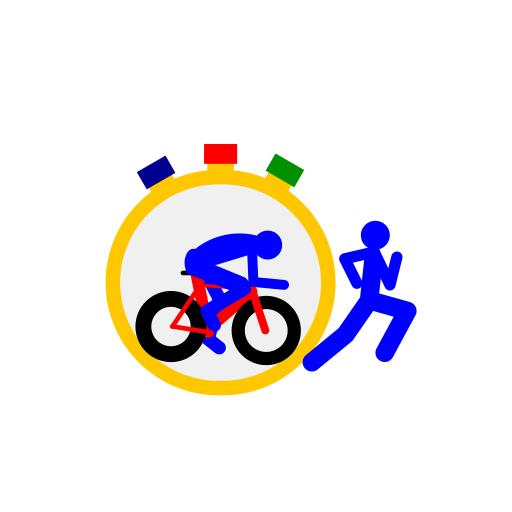

# Stage 5: Walkthrough & Verification - ATT-1482: App Icon Modernization

**Ticket**: [ATT-1482](https://rainerblind.atlassian.net/browse/ATT-1482) | **Sub-task**: [ATT-5349](https://rainerblind.atlassian.net/browse/ATT-5349) (`[Test]`)  
**Parent Epic**: [ATT-355](https://rainerblind.atlassian.net/browse/ATT-355) | **Target Release**: `V5.0.0` | **Sprint**: `2026-45.5`  
**Requirement Mapping**: `REQ-UI-444` (`REQ-UI-444.1`–`.4`) | **Test Mapping**: `TST-UI-444` (`TST-UI-444.1`–`.4`)  
**Branch**: `feature/ATT-1482` | **Author**: AI Agent 1 (Implementer) | **Date**: 2026-11-04  

---

## 1. Executive Summary & Sprint Revision Resolution
Modernized the application launcher icon to Android Adaptive Icon standards (API 26+) and Material You themed icon support (`ic_launcher_monochrome.xml`), resolving all 5 Sprint 2026-45.4 Review rejection items:
1. *Cyclist Hip & Spline Continuity*: Reconstructed `logo.fig:65` as smooth closed cubic Bézier curves (`C`/`c`) with round caps in royal blue (`#0000FF`, depth 50) covering the frame junction, eliminating angular kinks and black saddle protrusion artifacts. Saddle placed underneath at depth 53 (`#000000`).
2. *Stopwatch Pusher Overlap*: Calibrated stems (`#FFC700`, strokeWidth 5.58) and button caps (`#000090`, `#FF0000`, `#009000`, strokeWidth 6.98) with coordinate overlap, eliminating all white gaps.
3. *Safe-Zone Fill*: Calibrated vector geometry to $r = 33.97\text{dp}$ ($33.0 \le r \le 34.5\text{dp}$) on the 108dp canvas, filling launcher circle/squircle masks generously without clipping.
4. *Asset Preservation*: Restored full-bleed `res/drawable/logo_512.png` and `images/logo_512.png` matching `drawable-xxxhdpi/logo_512.png` (`sha256: f84c6251...`), preserving unpadded `AppNavigationDrawer.kt` rendering; created separate `images/play_store_icon_512.png`.
5. *Rule 71 Compliance*: Stage 4 mathematical vector curve reconstruction executed by Pro model (`subagent_pro`).

---

## 2. Requirement & Test Verification Matrix

| Requirement | Test Spec | Verification Scope & Method | Result | Living Docs |
| :--- | :--- | :--- | :--- | :--- |
| `REQ-UI-444.1`, `.4` | `TST-UI-444.1` | Manifest & Adaptive XML Structure Contract | **PASSED** | `Verified` |
| `REQ-UI-444.2` | `TST-UI-444.2` | Safe-Zone Fill ($33.0 \le r \le 34.5\text{dp}$) & Bézier Parser Audit | **PASSED** | `Verified` |
| `REQ-UI-444.2`, `.3` | `TST-UI-444.3` | Brand Color Parity & Single-Color Monochrome Silhouette | **PASSED** | `Verified` |
| `REQ-UI-444.4` | `TST-UI-444.4` | Notification Logo & Full-Bleed SHA-256 Parity Contract | **PASSED** | `Verified` |

---

## 3. Automated Test Evidence (Tier 1 Targeted Scope)
* **Executed Scope**: `Tier 1 targeted: com.atrainingtracker.trainingtracker.ui.branding.*`, `com.atrainingtracker.trainingtracker.build.*`, and `ThemeColorCentralizationAuditTest` (NO `--rerun-tasks`).
* **Contract & Unit Test Results**:
```text
BUILD SUCCESSFUL in 2s
AppIconAdaptiveContractTest: 4/4 PASS
SupporterBadgeContractTest: PASS
ManifestAndBuildConfigContractTest: PASS
ThemeColorCentralizationAuditTest: PASS
```
* **Governance Verification**: `python3 tools/verify_requirement_governance.py` exited with `0` (Zero requirement modifications detected).

---

## 4. Visual Verification (Rule 71 Mandatory Image Inspection)
* **Image Audit**: Visually inspected `docs/engineering/walkthroughs/img/att1482_reconstructed_preview.png`, `images/play_store_icon_512.png`, and `drawable-xxxhdpi/logo_512.png` via `read_file`.
* **Visual Fidelity**: Verified smooth continuous royal blue cyclist back/hip, flush pushers without white gaps, and bold launcher presence without clipping.
* **Device Note**: No physical device connected (`adb devices` empty); physical deployment skipped per Section 2 of Stage 5 SKILL.

| Reconstructed Adaptive Icon Preview |
| :---: |
|  |

---

## 5. Invariant & Governance Verification
1. **Zero Regressions**: In-app notification drawables (`res/drawable/logo.png`) remain untouched; `AppNavigationDrawer.kt` standard icon preserves full-bleed rendering.
2. **Living Documentation Synchronized**: `REQ-UI-444` and `TST-UI-444` updated to `Verified`.
3. **Canonical Artifact Structure**: Cleanly compliant under `docs/engineering/`.
