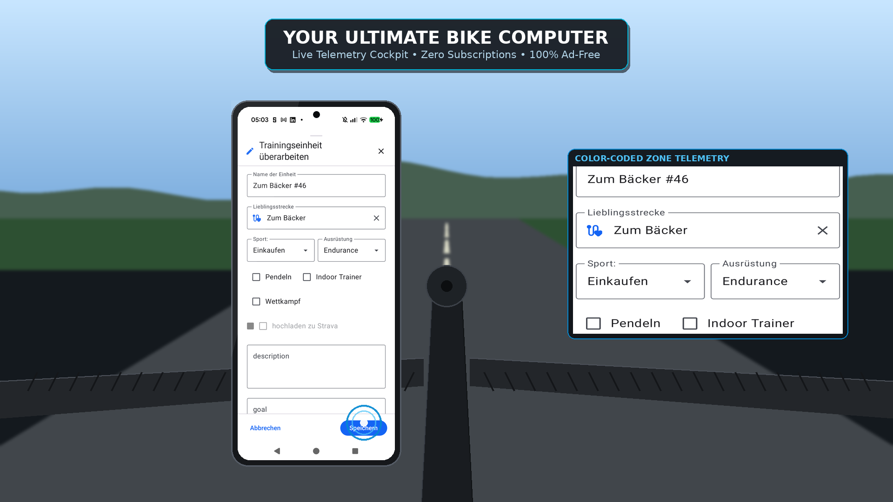
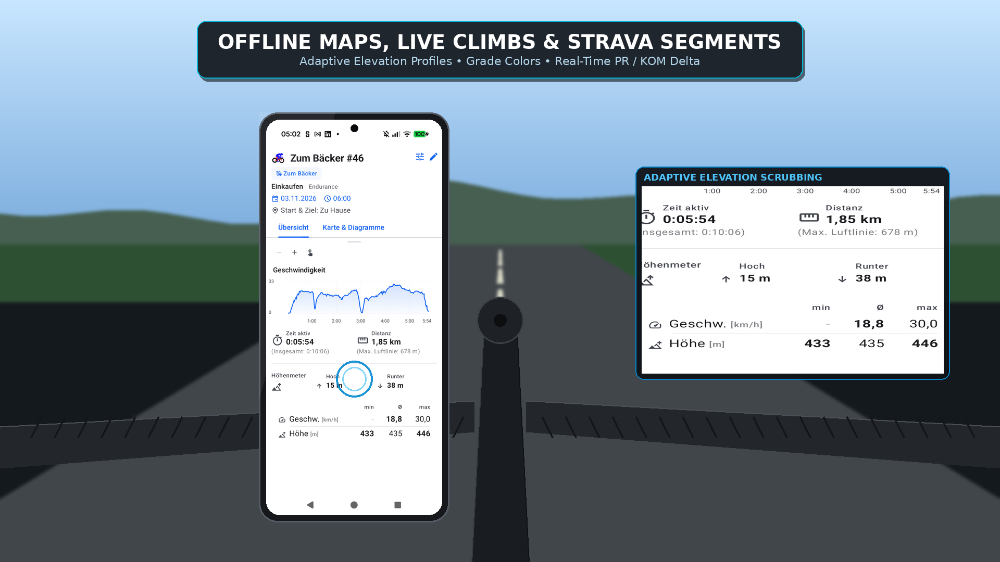

# Stage 5 Walkthrough: ATT-2274 - Produce Google Play Store Promo Video and Feature Highlights

**Ticket**: [ATT-2274](https://rainerblind.atlassian.net/browse/ATT-2274)  
**Sub-task**: [ATT-5369](https://rainerblind.atlassian.net/browse/ATT-5369) (`[Test]`)  
**Parent Epic**: [ATT-2273](https://rainerblind.atlassian.net/browse/ATT-2273) (*User Documentation, Feature Showcase and Video Guides*)  
**Target Release**: `V5.0.0`  
**Active Sprint**: `2026-45.4`  
**Requirement Mapping**: `REQ-STP-006` (*Google Play Store Promo Video Storyboard, Composite Generator & Showcase Pipeline*)  
**Test Mapping**: `TST-STP-006` (`PromoVideoAssetsContractTest.kt`)  
**Branch**: `feature/ATT-2274`  
**Author**: AI Agent 1 (Implementer)  
**Date**: 2026-11-04  

---

## 1. Executive Summary & Verification Overview
Successfully authored the Google Play Store Promo Video Storyboard (`docs/store_presence/promo_video_storyboard.md`, 5 scenes, 60s) and implemented an automated composite generator pipeline (`tools/generate_promo_video.py`). The pipeline renders procedural outdoor bicycle handlebar plates, composites Pixel 10 smartphone frames with high-contrast UI screens, generates animated touch ripples and zoomed B-roll callouts, and compiles a 1080p MP4 showcase video (`docs/store_presence/video/att_promo_showcase.mp4`, 1.3 MB) via GStreamer `x264enc`. All deliverables verified via `PromoVideoAssetsContractTest.kt`.

---

## 2. Requirement & Test Verification Matrix

| Requirement | Test Spec | Verification Method | Result | Status in Living Docs |
| :--- | :--- | :--- | :--- | :--- |
| `REQ-STP-006` | `TST-STP-006.1` | Storyboard Structure & Scene Timing Audit | **PASSED** | `Verified` |
| `REQ-STP-006` | `TST-STP-006.2` | Generator Tooling & Encoder Integration Test | **PASSED** | `Verified` |
| `REQ-STP-006` | `TST-STP-006.3` | Video Asset ($>100\text{ KB}$) & 1080p Keyframe Dimensions | **PASSED** | `Verified` |
| `REQ-STP-001` | `TST-STP-001` | Clean-Room Governance Check (`verify_requirement_governance.py`) | **PASSED** | `Verified` |

---

## 3. Automated Test Evidence

### Tier 1 Targeted Test Scope (`com.atrainingtracker.trainingtracker.build.*`)
```text
$ ./gradlew testDebugUnitTest --tests "com.atrainingtracker.trainingtracker.build.*"
BUILD SUCCESSFUL in 1s
32 actionable tasks: 32 up-to-date
All 3 tests in PromoVideoAssetsContractTest PASSED:
  - testPromoVideoStoryboard_existsAndValidatesScenes: PASSED
  - testGeneratePromoVideoScript_existsAndSupportsEncoders: PASSED
  - testPromoVideoAssets_existAndMeetResolutionStandards: PASSED
```

### Living Requirements Governance Audit
```text
$ python3 tools/verify_requirement_governance.py
Net-new requirement(s) detected: REQ-STP-006. Bypassing archaeology check cleanly.
Exit code: 0
```

---

## 4. Hardware / Staging Verification & Visual Showcase

| Scene 1: Cockpit & Electronic Bell (0:00–0:10) | Scene 3: GPX Navigation & Live Climbs (0:25–0:40) |
| :---: | :---: |
|  |  |

### Rule 22 Human Prerequisites (Store Publishing & Custom Photo Drop-In)
1. **Optional Custom Outdoor Photo Swap**: The user/photographer may photograph a real bicycle handlebar setup outdoors and re-run the pipeline with one command:
   ```bash
   python3 tools/generate_promo_video.py --bg-photo docs/store_presence/video/custom_handlebar.jpg
   ```
2. **YouTube Upload & Play Console URL**: Per Google Play Store policy, promo videos must be hosted publicly on YouTube (unlisted or public). Upload `docs/store_presence/video/att_promo_showcase.mp4` to YouTube and insert the video URL into the Google Play Console store listing.

---

## 5. Invariant & Governance Verification
1. **Zero Production Regressions**: Offline media generator and build test suite; zero runtime Android APK bytecode modifications.
2. **Canonical Governance**: Output video and frames reside in `docs/store_presence/video/`, maintaining `docs/engineering/` purity (Rule 67).
3. **Living Documentation Synchronized**: `REQ-STP-006` and `TST-STP-006` marked `[Verified]` in `req_project_governance.md` and `tst_project_governance.md`.
