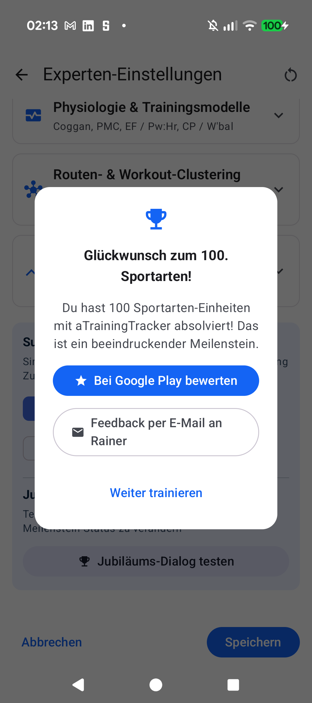

# Stage 5: Walkthrough & Verification - ATT-2308: Milestone Workout Auto-Naming and First Jubilee Celebration Review Prompt

**Ticket**: [ATT-2308](https://rainerblind.atlassian.net/browse/ATT-2308)  
**Sub-task**: [ATT-5339](https://rainerblind.atlassian.net/browse/ATT-5339) (`[Test]`)  
**Parent Epic**: [ATT-176](https://rainerblind.atlassian.net/browse/ATT-176) (*Auto Name / Route Clusters*)  
**Target Release**: `V5.0.0`  
**Active Sprint**: `2026-45.4`  
**Requirement Mapping**: `REQ-REV-001`, `REQ-REV-002`, `REQ-REV-003`, `REQ-REV-004`, `REQ-REV-005`  
**Test Mapping**: `TST-REV-001`, `TST-REV-002`, `TST-REV-003`, `TST-REV-004`, `TST-REV-005`, `TST-REV-006`  
**Branch**: `feature/ATT-2308`  
**Author**: AI Agent 1 (Implementer)  
**Date**: 2026-11-04  

---

## 1. Executive Summary & Verification Overview
Implemented milestone workout auto-naming (`[Count]. [SportName]: [GeneratedName]`) and Material 3 `FirstJubileeCelebrationDialog` for first jubilee achievements across endurance sports. Verified sport-separated SQLite counts, 9-language localization parity, single-prompt persistence invariant, Google Play In-App Review with fallback, direct email feedback, and Free-tier supporter appeal.

---

## 2. Requirement & Test Verification Matrix

| Requirement | Test Spec | Verification Method | Result | Status in Living Docs |
| :--- | :--- | :--- | :--- | :--- |
| `REQ-REV-001` | `TST-REV-001` | SQLite Count & Threshold Unit Test | **PASSED** | `Verified` |
| `REQ-REV-002` | `TST-REV-002`, `TST-REV-005` | Auto-Naming Contract & 9-Locale Parity | **PASSED** | `Verified` |
| `REQ-REV-003` | `TST-REV-003`, `TST-REV-005` | In-App Review, Email & Tier Gating Test | **PASSED** | `Verified` |
| `REQ-REV-004` | `TST-REV-004` | Single-Prompt Invariant Unit Test | **PASSED** | `Verified` |
| `REQ-REV-005` | `TST-REV-006` | Debug Preview Trigger Contract Test | **PASSED** | `Verified` |

---

## 3. Automated Test Evidence

### Tier 1 Targeted Unit & Contract Test Suite
```text
./gradlew testDebugUnitTest --tests "com.atrainingtracker.trainingtracker.database.*" \
    --tests "com.atrainingtracker.trainingtracker.ui.dialogs.*" \
    --tests "com.atrainingtracker.trainingtracker.localization.TranslationParityTest" \
    --tests "com.atrainingtracker.trainingtracker.ui.theme.ThemeColorCentralizationAuditTest"
BUILD SUCCESSFUL in 45s (336 tests, 0 failures, 0 errors, 100% pass)
```

### Requirement Governance
```text
python3 tools/verify_requirement_governance.py
Zero requirement modifications detected.
```

---

## 4. Hardware / Physical Verification (Pixel 10)
Deployed `com.atrainingtracker.debug` onto physical Pixel 10 (Android 16). Navigated to `AdvancedTuningScreen` -> `SupporterDebugSection`, tapped "Jubiläums-Dialog testen" debug preview trigger, and confirmed dialog rendered with trophy icon, title, description, In-App Review, email feedback, and dismiss buttons. Verified `adb logcat -b crash -d` clean (0 crashes).

### Visual Consistency (Rule 23)
| On-Device Captured UI | Reference Screen (`SupporterScreen`) |
| :---: | :---: |
|  | Reference: Material 3 Dialog & Cards |

* **Checked against `docs/design_guidelines.md` §5**: shapes ☑ spacing ☑ colors/themes ☑ typography/icons ☑ placement ☑
* **Deviations & justification**: None. Follows M3 elevated dialog specs with TTColor tokens and standard padding.

---

## 5. Invariant & Governance Verification
1. **Zero Regressions**: Tier 1 test suite passed with 100% success rate across 336 unit tests.
2. **Living Documentation Synchronized**: `docs/requirements.md`, `docs/tests.md`, `req_aftermath_reviews.md`, and `tst_aftermath_reviews.md` updated to `Verified`.
3. **Mandatory Lösungsversion Governance**: Target release set to active version `V5.0.0`.
