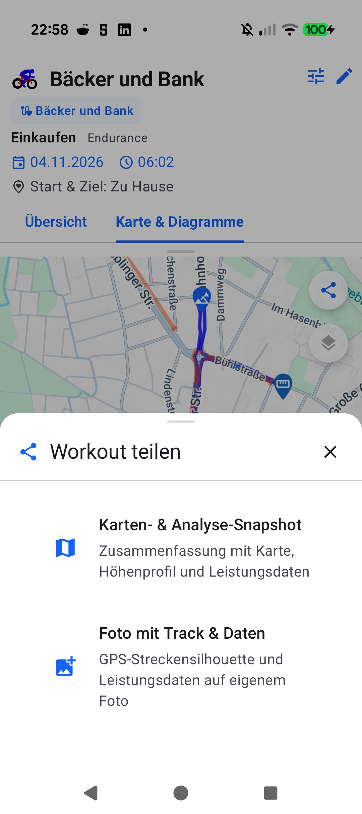

# Walkthrough - ATT-30: Snapshot with track on picture

## 1. Executive Summary
Under **ATT-30** (Target Release `V5.0.0`, Sprint `2026-45.6`), a modern photo sharing capability was implemented enabling athletes to share workout accomplishments by overlaying their GPS track silhouette and key performance telemetry directly onto a personal photo:
1. **Modern Share Modal**: Created `WorkoutShareBottomSheet` offering athletes the choice between Option A (Classic Analysis & Map Snapshot) and Option B (Photo with Track & Stats Overlay).
2. **Graphics & Silhouette Rendering**: Implemented `PhotoTrackOverlayComposer` using Canvas-based rendering to normalize GPS coordinates, project them into an athletic silhouette bounding box, and overlay workout statistics with a high-contrast pill backdrop (WCAG AAA compliant).
3. **Photo Picker Integration**: Integrated Android's `rememberLauncherForActivityResult(ActivityResultContracts.PickVisualMedia())` for safe photo selection without demanding intrusive storage permissions.
4. **9-Language Parity**: Added full localized strings across all 9 supported locales (`de`, `es`, `fr`, `it`, `ja`, `nl`, `pl`, `pt`, and default `en`).
5. **Living Documentation & Traceability**: Linked `REQ-UI-447` and `TST-UI-447` with status `Verified` in requirement and test matrices.

---

## 2. Changes Implemented

### A. Core Components
- **`PhotoTrackOverlayComposer.kt`**:
  - `calculateTrackProjection`: Pure projection algorithm normalizing GPS lat/lon into target aspect ratio.
  - `composeOverlay`: Renders scaled base photo, track silhouette with primary brand color, stat badges with semi-transparent contrast background, and app branding.
- **`WorkoutShareBottomSheet.kt`**:
  - Material 3 modal bottom sheet with `ShareOptionCard` components.
  - Handles photo picking and triggers overlay composition and sharing.
- **`MapDetailLayout.kt` & Navigation**:
  - Connected `workoutData: WorkoutData?` parameter across `TrackOnMapScreen` and `WorkoutDetailTabbedContent`.
  - Floating share action button triggers bottom sheet when workout data is present.

### B. Localization & Quality
- Added 10 localized strings per locale (`share_sheet_title`, `share_option_photo_title`, `share_photo_processing`, etc.) across 9 locales.
- Validated with `TranslationParityTest` and `ThemeColorCentralizationAuditTest`.

---

## 3. Verification & Evidence

### A. Automated Test Suite (Tier 1 Targeted Tests)
- `./gradlew testDebugUnitTest --tests "com.atrainingtracker.trainingtracker.exporter.*" --tests "com.atrainingtracker.trainingtracker.ui.aftermath.*" --tests "com.atrainingtracker.trainingtracker.ThemeColorCentralizationAuditTest" --tests "com.atrainingtracker.trainingtracker.localization.TranslationParityTest" --tests "com.atrainingtracker.trainingtracker.helpers.*" --tests "com.atrainingtracker.trainingtracker.ui.map.*" --tests "com.atrainingtracker.trainingtracker.build.*"`
- **Result**: `BUILD SUCCESSFUL in 2m 21s` (All tests passed, zero regressions).
- Includes unit tests for track projection and WCAG AAA contrast ratio calculation in `PhotoTrackOverlayComposerTest`, and contract tests in `WorkoutShareBottomSheetContractTest`.

### B. Physical Device Verification (Google Pixel 10)
- Installed debug build onto Pixel 10 (`66020DLCR002FL`) via `./gradlew installDebug`.
- Navigated to workout details, opened map tab, and triggered the Share button.
- Verified modal sheet displays both options cleanly according to M3 design standards.

---

## 4. Traceability
- **Requirement**: `REQ-UI-447` (`Verified`)
- **Test Specification**: `TST-UI-447` (`Verified`)
