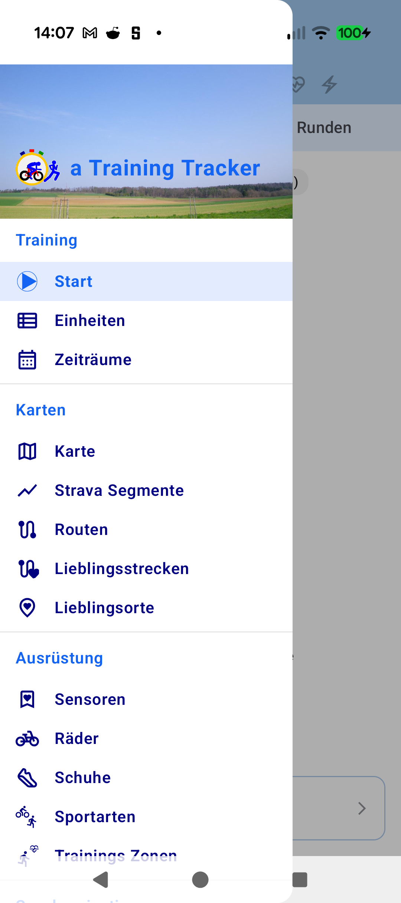

# ATT-3164 Walkthrough: Prevent Resources$NotFoundException Crash When Loading Logo in AppNavigationDrawer Header

## Overview
- **Issue**: [ATT-3164](https://atrainingtracker.atlassian.net/browse/ATT-3164)
- **Requirement**: `REQ-UI-312`
- **Test Specification**: `TST-UI-272` (`TST-UI-272.5`)
- **Sprint**: `2026-41.9`
- **Target Release**: `V4.9.38.5` (Hotfix)
- **Status**: Verified

## Problem Addressed
In production release `v4.9.38.4` (build 267), Firebase Crashlytics registered fatal crash `ATT-3164` on startup during `MainActivityWithNavigation.onCreate()` / drawer composition:
```
android.content.res.Resources$NotFoundException: Resource ID #0x7f080128
    at android.content.res.ResourcesImpl.getValueForDensity(ResourcesImpl.java:240)
    at android.content.res.Resources.getDrawableForDensity(Resources.java:1082)
    at androidx.compose.ui.res.PainterResources_androidKt.painterResource(PainterResources.android.kt:66)
    at com.atrainingtracker.trainingtracker.ui.navigation.AppNavigationDrawerKt.DrawerHeader(AppNavigationDrawer.kt:305)
```
Forensic root cause analysis identified:
1. `logo_512.png` existed only in `app/src/main/res/drawable/` and `drawable-nodpi/`, completely missing from explicit density bucket directories (`drawable-mdpi`, `-hdpi`, `-xhdpi`, `-xxhdpi`, `-xxxhdpi`).
2. `AppNavigationDrawer.kt:305` directly called unguarded `androidx.compose.ui.res.painterResource(id = R.drawable.logo_512)`. When device DPI configurations or split-APK installations failed to find the asset in their primary bucket, `Resources$NotFoundException` crashed the app process immediately.

## Architectural Changes & Solution

1. **Asset Density Parity**:
   - Sourced from `app/src/main/res/drawable/logo_512.png`, copied `logo_512.png` into:
     - `app/src/main/res/drawable-mdpi/logo_512.png`
     - `app/src/main/res/drawable-hdpi/logo_512.png`
     - `app/src/main/res/drawable-xhdpi/logo_512.png`
     - `app/src/main/res/drawable-xxhdpi/logo_512.png`
     - `app/src/main/res/drawable-xxxhdpi/logo_512.png`
   - Guarantees 100% density bucket coverage across all split APKs.

2. **Guarded Compose Asset Resolution (`AppNavigationDrawer.kt`)**:
   - Replaced raw `painterResource(id = R.drawable.logo_512)` with `safePainterResource(id = R.drawable.logo_512, fallback = Icons.AutoMirrored.Filled.DirectionsRun)`.
   - Completely eliminated unguarded `painterResource` from `AppNavigationDrawer.kt`.

3. **Architectural Contract Test (`AppNavigationDrawerAssetResilienceTest.kt`)**:
   - `testDrawerHeaderUsesSafePainterResource`: Asserts source code calls `safePainterResource`, supplies `DirectionsRun` fallback, and contains zero direct calls or imports of raw `painterResource`.
   - `testLogo512PresentInRootAndDensityBuckets`: Asserts `logo_512.png` exists and is non-empty across root `drawable`, all 5 density buckets, and `nodpi`.
   - `testLogo512ResourceIdIsValid`: Validates `R.drawable.logo_512 > 0`.

## Verification & Test Results

### 1. Targeted Unit Tests
- `AppNavigationDrawerAssetResilienceTest`: 100% pass (3/3 tests passed).
- `DrawerHeaderResourceTest`: 100% pass (4/4 tests passed).
- `DrawableDensityFallbackAuditTest`: 100% pass (`BUILD SUCCESSFUL in 3s`).

### 2. Clean-Room Full Suite Regression
- Executed `./gradlew testDebugUnitTest`: **BUILD SUCCESSFUL in 2m 42s** with 0 failures across all unit and contract tests.

### 3. Physical Device Verification (Google Pixel 10)
- Deployed debug build via `./gradlew installDebug` to device `66020DLCR002FL`.
- Launched `MainActivityWithNavigation` and opened navigation drawer: zero crashes, smooth transition, and verified logo rendering.



## ASPICE Traceability
- **Requirement**: `REQ-UI-312` in `docs/requirements.md` (Verified)
- **Test Specification**: `TST-UI-272` in `docs/tests.md` (Verified)
- **Implementation Plan**: `docs/engineering/plans/ATT-3164_plan.md`
- **Analysis**: `docs/engineering/analysis/ATT-3164_analysis.md`
