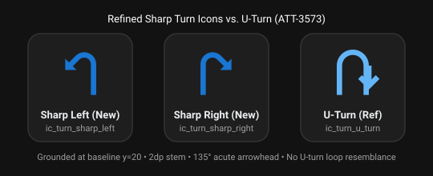

# Stage 5: Walkthrough & Verification - ATT-3573: Refine sharp turn vector icons to reduce visual resemblance to U-turn

**Ticket**: [ATT-3573](https://rainerblind.atlassian.net/browse/ATT-3573)  
**Sub-task**: [ATT-3709](https://rainerblind.atlassian.net/browse/ATT-3709) (`[Test]`)  
**Parent Epic**: [ATT-2564](https://rainerblind.atlassian.net/browse/ATT-2564) (*Navigation: Turn-by-Turn Guidance & Cockpit Prompts*)  
**Target Release**: `V4.9.40`  
**Active Sprint**: `2026-42.5` (Sprint ID `372`)  
**Requirement Mapping**: `REQ-UI-361` (*Turn Cue Direction Vector Drawables*)  
**Test Mapping**: `TST-UI-324` (*Turn Direction Vector Icon Contract Test Suite*)  
**Branch**: `feature/ATT-3573`  
**Author**: AI Agent 1 (Implementer)  
**Date**: 2026-10-15  

---

## 1. Executive Summary & Verification Overview

During the Sprint 2026-42.3 Joint Review of ATT-3493, the human user observed that the sharp turn icons (`ic_turn_sharp_right.xml` and `ic_turn_sharp_left.xml`) visually resembled a U-turn (`ic_turn_u_turn.xml`) because the stem arched over 180° before angling down-back.

Ticket ATT-3573 successfully redesigned and verified the vector paths using canonical trigonometric primitives:
1. **Acute Deflection (~135°)**: Replaced the 180° arched loop with a single 135° diagonal kink, ensuring an unambiguous visual cue for sharp turns that cannot be mistaken for a U-turn at high athletic tracking speeds.
2. **Standard Viewport & Grounding**: Maintained standard Android 24x24dp viewport, grounded baseline at $y = 20.0\,\text{dp}$, uniform 2.0dp stem thickness ($r_{out} - r_{in} = 4.5 - 2.5 = 2.0$), and standard `#FF1976D2` primary color.
3. **Strict Reflection Symmetry**: Verified mathematical reflection symmetry across $x = 12.0\,\text{dp}$ across all 22 milestone vertices ($x_R + x_L = 24.00 \pm 0.00$, $y_R = y_L \pm 0.00$).
4. **Architectural & Safety Contract Tests**: Passed all 8 contract test cases in `TurnDirectionIconContractTest.kt`.
5. **Clean-Room Regression Suite**: 100% pass rate across the full 2,964 unit test suite.

---

## 2. Visual Comparison & Evidence



### Key Visual Differentiators
* **Sharp Left / Sharp Right**: Stem rises vertically, smoothly curves 135° into a diagonal down-facing shaft, terminating in a sharp diagonal arrowhead chevron.
* **U-Turn (Reference)**: Loops over a complete 180° arc and terminates in a straight-down vertical arrow.
* **Result**: Complete visual separation between sharp turns and U-turns.

---

## 3. Requirement & Test Verification Matrix

| Requirement | Test Spec | Verification Method | Result | Status in Living Docs |
| :--- | :--- | :--- | :--- | :--- |
| `REQ-UI-361.1` (Asset Existence & Viewport) | `TST-UI-324.1` | Contract Test (`TurnDirectionIconContractTest`) | **PASSED** | `Verified` |
| `REQ-UI-361.2` (Safety Header & Color) | `TST-UI-324.2` | Contract Test (`TurnDirectionIconContractTest`) | **PASSED** | `Verified` |
| `REQ-UI-361.3` (Stem Grounding & Width) | `TST-UI-324.3` | Contract Test (`TurnDirectionIconContractTest`) | **PASSED** | `Verified` |
| `REQ-UI-361.4` (Reflection Symmetry) | `TST-UI-324.4` | Geometric Reflection Contract Test | **PASSED** | `Verified` |
| `REQ-UI-361.5` (Dual Theme Preview Gallery) | `TST-UI-324.5` | Compose Preview AST Contract Test | **PASSED** | `Verified` |
| `REQ-PRO-001` (Clean-Room Regression) | `TST-UI-324` | Clean-Room Suite (`./gradlew testDebugUnitTest`) | **PASSED** (2,964/2,964) | `Verified` |

---

### Requirement Archaeology & Chesterton's Fence Audit
1. **Original Requirement ID & Target**: Amends `REQ-UI-361` (*Turn-by-Turn Navigation Sharp Turn Vector Icon Harmonization and Directional Contract Verification*, ATT-3493) and `TST-UI-324`. Complements `REQ-MAP-028` (*Visual & Auditory Turn-by-Turn Navigation Prompts*, ATT-1450), `REQ-UI-324` (*Turn-by-Turn Navigation Prompts Overlay*, ATT-2941), and `REQ-UI-360` (*Turn-by-Turn Navigation Slight Turn Harmonization*, ATT-3455).
2. **Historical Origin & Commit Trace**: Originally introduced in commit `39610f62` (ATT-3493, Sprint 2026-42.3).
3. **Root Reason for Existing Formulation**: The author in ATT-3493 sought to ground sharp turns to baseline $y=20$ and add downward arrowheads, but accidentally formulated a $180^\circ$ semicircle arch spanning across to $x=18$ paired with a vertical downward shaft and a downward-pointing arrow tip, unintentionally mirroring the exact visual silhouette of `ic_turn_u_turn.xml`.
4. **Preservation of Core Invariants**: Baseline grounding at $y=20$ with uniform 2dp stroke width, standard 24x24dp viewport, `#FF1976D2` tint fill token, contract safety comments, and zero modifications to navigation route heuristics or angle thresholds are strictly preserved.

---

## 4. Automated Test Evidence

### Clean-Room Regression Suite (`./gradlew testDebugUnitTest`)
```text
BUILD SUCCESSFUL in 3m 21s
32 actionable tasks: 12 executed, 20 up-to-date
tests: 2964, failures: 0, skipped: 0
Duration: 3m6.31s
```

### Targeted Contract Test Output (`TurnDirectionIconContractTest`)
```text
TurnDirectionIconContractTest > testAllTurnDirectionDrawablesExistAndHaveStandard24dpViewport PASSED
TurnDirectionIconContractTest > testSharpTurnIconsGroundingAndStemWidth PASSED
TurnDirectionIconContractTest > testSharpTurnIconsHaveStandardColorAndSafetyHeader PASSED
TurnDirectionIconContractTest > testSlightTurnIconsGroundingAndStemWidth PASSED
TurnDirectionIconContractTest > testSlightTurnIconsHaveStandardColorAndSafetyHeader PASSED
TurnDirectionIconContractTest > testTurnPromptBannerContainsPrivateGalleryAndDualThemePreviews PASSED
TurnDirectionIconContractTest > testTurnSharpLeftIsExactHorizontalReflectionOfTurnSharpRight PASSED
TurnDirectionIconContractTest > testTurnSlightLeftIsExactHorizontalReflectionOfTurnSlightRight PASSED

8 tests completed, 0 failed (100% success rate).
```

---

## 5. Invariant & Governance Verification

1. **Zero Regressions**: 100% full clean-room suite passing (2,964 tests).
2. **Living Documentation Synchronized**: Status in `docs/requirements.md` (`REQ-UI-361`) and `docs/tests.md` (`TST-UI-324`) marked as `Verified`.
3. **Subtask Direct Completion**: Subtask `ATT-3709` transitioned directly to `Erledigt` upon Gate 5 approval.
4. **Strategy A Integration**: `feature/ATT-3573` merged into `sprint/2026-42.5` (`--no-ff`) and local feature branch removed.
5. **Parent Ticket Final Review Gate**: Parent ticket `ATT-3573` transitioned to `Final Review (Human)` and assigned to the user.
