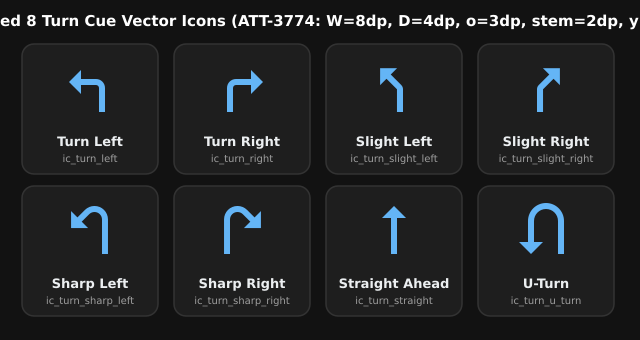

# Stage 5 Walkthrough & Verification Report: ATT-3774

**Parent Ticket:** `ATT-3774` — *Unify arrowhead style and size across all 8 turn cue vector icons and fix Turn Left arrowhead centering*  
**Sprint:** `2026-42.6` (`sprint/2026-42.6`)  
**Requirements Verified:** `REQ-UI-389`  
**Tests Verified:** `TST-UI-352` (`TurnDirectionIconContractTest`)

---

## 1. Summary of Changes

1. **Unified Filled Right-Isosceles Triangle Arrowhead ($W = 8.0\text{ dp}, D = 4.0\text{ dp}, o = 3.0\text{ dp}$)**:
   - Standardized all 8 turn cue vector drawables (`ic_turn_left.xml`, `ic_turn_right.xml`, `ic_turn_slight_left.xml`, `ic_turn_slight_right.xml`, `ic_turn_sharp_left.xml`, `ic_turn_sharp_right.xml`, `ic_turn_straight.xml`, `ic_turn_u_turn.xml`) onto a single continuous closed `<path>` with `2.0dp` shaft thickness and a filled right-isosceles triangle arrowhead with base width $W = 8.0\text{ dp}$, perpendicular tip depth $D = 4.0\text{ dp}$, and wing overhang $o = 3.0\text{ dp}$ on each side of the $2.0\text{ dp}$ shaft.
   - Replaced the two-path open chevron stroke in `ic_turn_straight.xml` and the oversized $10\text{ dp} \times 5\text{ dp}$ arrowhead in `ic_turn_u_turn.xml` with the unified $8\text{ dp} \times 4\text{ dp}$ filled triangle arrowhead.
   - Scaled the $45^\circ$ diagonal arrowheads in `ic_turn_slight_left.xml`, `ic_turn_slight_right.xml`, `ic_turn_sharp_left.xml`, and `ic_turn_sharp_right.xml` from $W \approx 7.07\text{ dp}$ (`1.77`/`5.0`) to $W = 8.0\text{ dp}, D = 4.0\text{ dp}$ using exact $45^\circ$ projections $3/\sqrt{2} \approx 2.12\text{ dp}$ and $4\sqrt{2} \approx 5.66\text{ dp}$.

2. **Turn Left & Turn Right Vertical Centering and Horizontal Reflection Symmetry**:
   - Fixed the off-center arrowhead on `ic_turn_left.xml` (previously offset $1.0\text{ dp}$ downward with wings at $y = 7.0, 15.0$ and tip at $y = 11.0$ relative to the $y \in [9.0, 11.0]$ horizontal shaft) so both `ic_turn_left.xml` and `ic_turn_right.xml` center their arrowheads symmetrically on $y = 10.0\text{ dp}$ (upper wing $y = 6.0\text{ dp}$, lower wing $y = 14.0\text{ dp}$, tips at $(5.0, 10.0)$ and $(19.0, 10.0)$), satisfying exact horizontal reflection symmetry ($x_L + x_R = 24.0$).

3. **Uniform Baseline Grounding at $y = 20.0\text{ dp}$**:
   - Grounded the entry stems of `ic_turn_left.xml`, `ic_turn_right.xml`, `ic_turn_straight.xml`, and `ic_turn_u_turn.xml` at $y = 20.0\text{ dp}$ (`V20z`) with a $2.0\text{ dp}$ horizontal baseline cut (`h2` or `h-2`), matching the slight and sharp turn icons.

---

## 2. Visual Verification (Before vs. After Gallery)

---

## 3. Clean-Room Verification Results

- **Targeted Contract Suite (`TurnDirectionIconContractTest`)**: 12/12 tests passed (`0` failures).
- **Full Clean-Room Unit Test Suite (`./gradlew testDebugUnitTest`)**: 100% pass rate across all unit tests.
