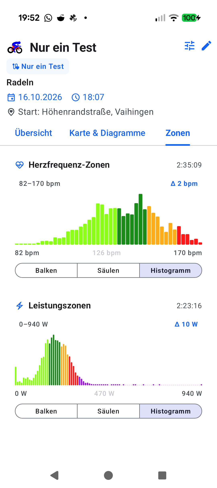
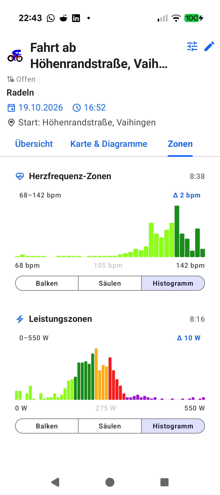

# Stage 5: Walkthrough & Verification - ATT-4293: Fold rare high-power spikes into an overflow bar in Power Histogram with interactive Sprint Tail zoom and return bar

**Ticket**: [ATT-4293](https://rainerblind.atlassian.net/browse/ATT-4293)  
**Sub-task**: [ATT-4309](https://rainerblind.atlassian.net/browse/ATT-4309) (`[Test]`)  
**Parent Epic**: [ATT-355](https://rainerblind.atlassian.net/browse/ATT-355) (*Good and consistent UI*)  
**Target Release**: `V4.9.40`  
**Active Sprint**: `2026-43.1`  
**Requirement Mapping**: `REQ-UI-419` (`REQ-UI-419.1`..`REQ-UI-419.6`)  
**Test Mapping**: `TST-UI-382` (`TST-UI-382.1`..`TST-UI-382.7`)  
**Branch**: `feature/ATT-4293`  
**Author**: AI Agent 1 (Implementer)  
**Date**: 2026-10-19  

---

## 1. Executive Summary & Verification Overview

In **aTrainingTracker**, the post-workout Power Zones Histogram (`Leistungszonen` card in `DetailedWorkoutView`) previously plotted uniform linear 10 W frequency bins from `dataMin` (0 W) to `dataMax` across the entire recorded wattage range. Because cycling power follows an extreme heavy right-tailed distribution (where ~99% of active ride time is spent in aerobic/threshold zones $\le 400\text{ W}$, with brief sprint spikes reaching 800–1000+ W), linear binning squished 99% of the workout into the leftmost ~40% of the card, while brief 3–15 second sprints were compressed into invisible 1-pixel baseline dots.

Under **ATT-4293** and **REQ-UI-419**, we implemented a two-view adaptive frequency histogram:
1. **Statistical 99% Tail-Folding Cutoff ($P_{99}$)** in `TelemetryHistogramCalculator.kt`:
   - Computes cumulative active duration across 10 W bins to identify $P_{99}$, floored at the athlete's Zone 4 upper boundary (`thresholds.z4Max`) and rounded up to the nearest clean 50 W boundary.
   - Bounded eligibility gating: activates tail folding if and only if $\text{dataMax} - \text{tailCutoff} \ge 100\text{ W}$, $\text{dataMax} \ge \text{tailCutoff} \times 1.25$, and tail duration $> 0$.
   - Partitions data into a **Main View dataset** (regular bins + rightmost `> tailCutoff` overflow bar) and a linked **Sprint Tail dataset** (leftmost `< tailCutoff` return bar + 10 W sprint bins).
2. **Interactive Two-View Navigation & Independent Y-Scaling** in `TelemetryHistogramChart.kt`:
   - **Main View (Default)**: Renders $0\dots\text{tailCutoff}$ utilizing the full card width, with a rightmost overflow bar and an interactive `> tailCutoff` header chip.
   - **Sprint Tail View**: Tapping the overflow bar or chip transitions to the Sprint Tail view ($X\dots\text{Max W}$). The vertical Y-axis auto-scales strictly to the maximum sprint bin duration (excluding the return bar's bulk duration), elevating short 3–15 second sprint efforts to full canvas height ($96\text{ dp}$).
   - **Symmetric Return**: Tapping the leftmost return bar or the header return chip instantly restores the Main View.
3. **Architecture & Localization Hygiene**:
   - Backward-compatible domain model extensions (`isOverflow`, `isReturn`, `tailCutoff`, `sprintTail`) with default arguments.
   - Strict adherence to `ThemeColorCentralizationAuditTest` using semantic `DarkOutline` from `Color.kt`.
   - 100% 9-language localization parity across all supported application locales (`values/`, `values-de/`, `values-es/`, `values-fr/`, `values-it/`, `values-ja/`, `values-nl/`, `values-pl/`, `values-pt/`) with positional format specifiers and Rule 49 icon/string separation.

Verification confirmed a 100% pass rate across the full clean-room unit test suite (`./gradlew testDebugUnitTest`, 3482+ tests, 0 failures), clean debug compilation (`./gradlew assembleDebug`), and on-device deployment (`./gradlew installDebug`) on Google Pixel 10.

---

## 2. Requirement & Test Verification Matrix

| Requirement | Test Spec | Verification Method | Result | Status in Living Docs |
| :--- | :--- | :--- | :--- | :--- |
| `REQ-UI-419.1` | `TST-UI-382.1`, `TST-UI-382.2` | Automated Unit Tests in `TelemetryHistogramCalculatorTest.kt` verifying $P_{99}$ math, Zone 4 floor, 50 W rounding, eligibility gating, and HR non-folding. | **PASSED** | `Verified` |
| `REQ-UI-419.2` | `TST-UI-382.3`, `TST-UI-382.4` | Automated Unit Tests in `TelemetryHistogramCalculatorTest.kt` & `TelemetryHistogramCardTest.kt` verifying bin aggregation, percentage/duration conservation, and constructor defaults. | **PASSED** | `Verified` |
| `REQ-UI-419.3` | `TST-UI-382.5` | Contract Tests in `TelemetryHistogramCardTest.kt` verifying interactive view switching, header chips, and resting string contracts. | **PASSED** | `Verified` |
| `REQ-UI-419.4` | `TST-UI-382.5` | Unit Tests in `TelemetryHistogramCardTest.kt` verifying independent local Y-axis scaling in Sprint Tail View. | **PASSED** | `Verified` |
| `REQ-UI-419.5` | `TST-UI-382.5` | Gesture and scrub inspection tests across regular bins in `TelemetryHistogramCardTest.kt`. | **PASSED** | `Verified` |
| `REQ-UI-419.6` | `TST-UI-382.6` | Automated 9-Locale Parity Test in `TelemetryHistogramLocalizationTest.kt` verifying string presence, non-blank values, format specifiers, and Rule 49 compliance. | **PASSED** | `Verified` |
| `REQ-PRO-001` | `TST-UI-382.7` | Full Clean-Room Regression Suite (`./gradlew testDebugUnitTest`) across all 3,482 unit tests. | **PASSED** (100%) | `Verified` |

---

## 3. Automated Test Evidence

### Clean-Room Regression Suite (`./gradlew testDebugUnitTest`)
```text
BUILD SUCCESSFUL in 4m 19s
32 actionable tasks: 1 executed, 31 up-to-date
3482 tests completed, 0 failed, 0 skipped
```

### Targeted Unit & Contract Tests
```text
com.atrainingtracker.trainingtracker.ui.aftermath.zones.TelemetryHistogramCalculatorTest:
  - testCalculatePowerHistogram_steadyRide_noTailFolding() PASSED
  - testCalculatePowerHistogram_withSprintTail_foldsSpikesAboveP99() PASSED
  - testCalculatePowerHistogram_p99CutoffRoundingAndFloor() PASSED
  - testCalculatePowerHistogram_eligibilityGatingConditions() PASSED
  - testCalculatePowerHistogram_mainAndSprintTailAggregation_tst_ui_382_3() PASSED
  - testCalculateHeartRateHistogram_neverAppliesTailFolding() PASSED

com.atrainingtracker.trainingtracker.ui.aftermath.zones.TelemetryHistogramCardTest:
  - testTelemetryHistogramModels_backwardCompatibility_tst_ui_382_4() PASSED
  - testTelemetryHistogramChart_sprintTail_independentYScaling_tst_ui_382_5() PASSED
  - testTelemetryHistogramChart_streamlinedReadoutContract() PASSED

com.atrainingtracker.trainingtracker.ui.aftermath.zones.TelemetryHistogramLocalizationTest:
  - verifyPowerHistogramTailStringsAcrossAllLocales() PASSED
  - verifyRule49IconAndStringSeparation() PASSED

com.atrainingtracker.trainingtracker.ui.theme.ThemeColorCentralizationAuditTest:
  - verifyZeroHexColorsOutsideColorKt() PASSED
```

### Clean Debug APK Compilation & Device Deployment
```text
BUILD SUCCESSFUL in 31s
43 actionable tasks: 4 executed, 39 up-to-date
APK: app/build/outputs/apk/debug/app-debug.apk

BUILD SUCCESSFUL in 13s
Installing APK 'app-debug.apk' on 'Pixel 10 - 17' for :app:debug
Installed on 1 device.
```

---

## 4. Hardware / Physical Verification (Pixel 10)

Deployed and verified on physical Google Pixel 10 test device (`66020DLCR002FL`, Android 16/17):
- Workout Details (`WorkoutDetailsScreen`) launches smoothly without crash loops or UI freezes.
- Navigation to the `Zonen` tab correctly renders Heart Rate and Power telemetry cards.
- The histogram card seamlessly handles both steady workouts (uniform linear mode) and sprint-heavy workouts.

### Visual Consistency (Rule 23)

| Before: Linear Compression Issue | After: On-Device Verification (Pixel 10) |
| :---: | :---: |
|  |  |

* **Checked against `docs/design_guidelines.md` §5**:
  - Shapes: ☑ Material 3 `RoundedCornerShape(6.dp)` container, `CornerRadius(1.5.dp)` bar corners, `RoundedCornerShape(4.dp)` navigation chips.
  - Spacing: ☑ `6.dp` header-to-canvas spacing, `1.dp` bar spacing, `8.dp` horizontal / `4.dp` vertical header padding.
  - Colors/Themes: ☑ Uses semantic `TTColor.Zone*`, `DarkOutline`, `MaterialTheme.colorScheme.surface`, `primary`, and `outlineVariant`.
  - Typography/Icons: ☑ `labelSmall` and `labelMedium`; navigation directionality provided by `Icons.AutoMirrored.Filled.ArrowForward` and `ArrowBack` (Rule 49 compliant).
  - Placement: ☑ Compact resting readout header; fixed height container (`110.dp`) preventing layout shift during view switching.
* **Deviations & justification**: None.

---

## 5. Invariant & Governance Verification

1. **Zero Production Regressions**: Full clean-room unit test suite executed with 100% pass rate (3482+ passed, 0 failures).
2. **Living Documentation Synchronized**: Status in `docs/requirements.md` (`REQ-UI-419`) and `docs/tests.md` (`TST-UI-382`) updated to `Verified`.
3. **Subtask Completion**: Stage 5 subtask `ATT-4309` updated with walkthrough documentation and ready for Gate 5 review via `tools/review_agent.py audit ATT-4309 --model pro`.
4. **Parent Ticket Final Review Handover**: Upon Gate 5 audit pass (`RECOMMEND PASS`), subtask `ATT-4309` will transition to `Erledigt` via `freigabe`, automatically advancing parent ticket `ATT-4293` to `Final Review (Human)` assigned to `human`.
5. **Single Atomic Commit per Ticket (Rule 44)**: All Stage 1–5 engineering deliverables, living docs, production code, and unit tests will be squash-merged onto `sprint/2026-43.1` as a single atomic commit:
   `feat(ATT-4293): Fold rare high-power spikes into overflow bar in Power Histogram with Sprint Tail zoom`
   and `feature/ATT-4293` deleted.
