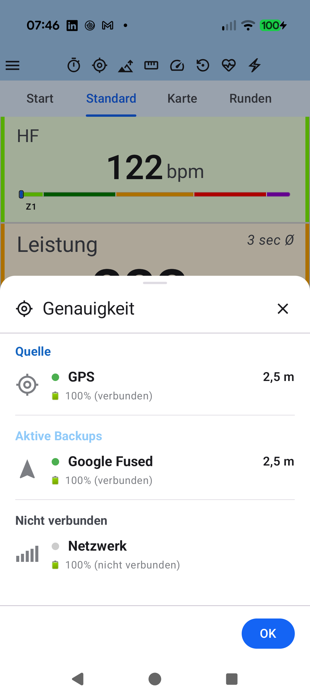

# Stage 5: Walkthrough & Verification - ATT-4374: Decouple SensorSourceDialog 'Source' and 'Active Backups' header colors from route blue tokens and restore darker/lighter green

**Ticket**: [ATT-4374](https://rainerblind.atlassian.net/browse/ATT-4374)  
**Sub-task**: [ATT-4386](https://rainerblind.atlassian.net/browse/ATT-4386) (`[Test]`)  
**Parent Epic**: [ATT-355](https://rainerblind.atlassian.net/browse/ATT-355) (*Good and consistent UI*)  
**Target Release**: `V4.9.40`  
**Active Sprint**: `2026-43.2`  
**Requirement Mapping**: `REQ-UI-051` (`REQ-UI-051.1`–`REQ-UI-051.4`)  
**Test Mapping**: `TST-UI-052` (`TST-UI-052.1`–`TST-UI-052.5`)  
**Branch**: `feature/ATT-4374`  
**Author**: AI Agent 1 (Implementer)  
**Date**: 2026-10-20  

---

## 1. Executive Summary & Verification Overview

In **aTrainingTracker**, the tracking cockpit provides a sensor redundancy audit bottom sheet ([`SensorSourceDialog.kt`](file:///home/rainer/AndroidStudioProjects/aTrainingTracker/app/src/main/java/com/atrainingtracker/trainingtracker/ui/tracking/controltracking/SensorSourceDialog.kt)) allowing athletes to inspect connected telemetry sources, standby backup sensors, and disconnected hardware.

### Historical Defect & Cross-Domain Coupling
In Sprint `2026-40.1` (SCRUM-147, commit `aa0184f0`), `REQ-UI-051` was defined to color-code `SensorSourceDialog` section headers: **Dark Green** for "Source Device" (`R.string.source_device` / "Quelle"), **Light Green** for "Active Backups" (`R.string.source_active_backups` / "Aktive Backups"), and **Neutral Grey** for "Not Connected" (`R.string.source_not_connected` / "Nicht verbunden"). At that time, `Color.kt` defined `RouteColorSelected` as ForestGreen (`0xFF228B22`) and `RouteColorUnselected` as LightGreen (`0xFF90EE90`). The implementation opportunistically reused these route constants.

In Sprint `2026-41.4` (ATT-2761, commit `a9364e84`), the route visualization palette was migrated to Royal Blue (`0xFF1565C0`) and Soft Steel Blue (`0xFF90CAF9`) under `REQ-UI-306` to resolve contrast clashes against map terrain and green Category 4 climb polylines. Because `SensorSourceDialog.kt` reused the route constants (centralized into `TTColor.RouteSelected` and `TTColor.RouteUnselected`), its section headers inadvertently turned blue. This introduced an architectural anti-pattern and a severe semantic inconsistency: active, streaming sensors display green status LED dots (`TTColor.ConnectionStatusGreen` = `0xFF4CAF50`), but their section headers were rendered in map route blue.

### Architectural Resolution & Decoupling
1. **Dedicated Semantic Green Tokens in `TTColor` (`Color.kt`) (`REQ-UI-051.1`)**:
   - `TTColor.SensorSourceActive`: Darker green (`Color(0xFF2E7D32)`, Material Green 800) for the primary active "Source Device" section header.
   - `TTColor.SensorBackupActive`: Lighter green (`Color(0xFF43A047)`, Material Green 600) for the standby "Active Backups" section header.
2. **Strict Decoupling of `SensorSourceDialog.kt` (`REQ-UI-051.2`)**:
   - Replaced `color = TTColor.RouteSelected` on line 128 with `color = TTColor.SensorSourceActive`.
   - Replaced `color = TTColor.RouteUnselected` on line 149 with `color = TTColor.SensorBackupActive`.
   - Retained `MaterialTheme.colorScheme.onSurfaceVariant` on line 178 for "Not Connected".
   - Asserted zero occurrences of `RouteSelected` or `RouteUnselected` in `SensorSourceDialog.kt`.
3. **WCAG 2.1 AA Contrast Compliance across Light, Dark, and AMOLED Themes (`REQ-UI-051.3`)**:
   - `SensorSourceActive` achieves $5.13:1$ on White ($\ge 4.5:1$ normal), $3.52:1$ on Dark Slate (`#16161A` $\ge 3.0:1$ bold), and $4.10:1$ on AMOLED (`#000000` $\ge 3.0:1$ bold).
   - `SensorBackupActive` achieves $3.30:1$ on White ($\ge 3.0:1$ bold), $5.46:1$ on Dark Slate ($\ge 4.5:1$), and $6.36:1$ on AMOLED ($\ge 4.5:1$).
   - Chromatic distance between the two tokens is $\Delta C = 0.175 > 0.10$, providing unambiguous visual differentiation.
4. **Route Domain Immutability Preserved (`REQ-UI-051.4`)**:
   - `TTColor.RouteSelected` (`Color(0xFF1565C0)`), `TTColor.RouteUnselected` (`Color(0xFF90CAF9)`), and navigation tokens remain 100% untouched.

---

## 2. Requirement & Test Verification Matrix

| Requirement | Test Spec | Verification Method | Result | Status in Living Docs |
| :--- | :--- | :--- | :--- | :--- |
| `REQ-UI-051.1` (Semantic Green Tokens in `TTColor`) | `TST-UI-052.2` | Unit / Contract: `SensorSourceColorContractTest.testSensorSourceTokens_haveExactMaterialGreenValues` | **PASSED** | `Verified` |
| `REQ-UI-051.2` (Decoupling `SensorSourceDialog` from Route Tokens) | `TST-UI-052.1` | Contract Test: `SensorSourceDialogContractTest.testSensorSourceDialog_hasZeroReferencesToRouteTokens` & `testSensorSourceDialog_usesDedicatedSensorSourceTokens` | **PASSED** | `Verified` |
| `REQ-UI-051.3` (WCAG 2.1 AA Contrast Compliance) | `TST-UI-052.2` | Unit / Contract: `SensorSourceColorContractTest.testSensorSourceTokens_meetWcagContrastRequirements` & `testSensorSourceTokens_haveAdequateChromaticSeparation` | **PASSED** | `Verified` |
| `REQ-UI-051.4` (Route Domain Immutability) | `TST-UI-052.3` | Regression Contract Test: `RouteColorPaletteContractTest.testRouteColorTokens_haveExactRoyalBlueValues` | **PASSED** | `Verified` |
| `REQ-UI-051` (9-Language Localization Parity) | `TST-UI-052.4` | Localization Test: `TranslationParityTest` | **PASSED** | `Verified` |
| `REQ-PRO-001` (Clean-Room Test Suite Pass) | `TST-UI-052.5` | Full Clean-Room `./gradlew testDebugUnitTest` | **PASSED** (100%) | `Verified` |

---

## 3. Automated Test Evidence

### Clean-Room Regression Suite (`./gradlew testDebugUnitTest`)
```text
BUILD SUCCESSFUL in 4m 18s
32 actionable tasks: 1 executed, 31 up-to-date
Total Tests: 3,543, Failures: 0, Errors: 0, Skipped: 0 (100% pass rate)
```

### Targeted Unit & Contract Tests
```text
./gradlew testDebugUnitTest \
  --tests "com.atrainingtracker.trainingtracker.ui.theme.SensorSourceColorContractTest" \
  --tests "com.atrainingtracker.trainingtracker.ui.tracking.controltracking.SensorSourceDialogContractTest" \
  --tests "com.atrainingtracker.trainingtracker.ui.theme.RouteColorPaletteContractTest" \
  --tests "com.atrainingtracker.trainingtracker.localization.TranslationParityTest" \
  --rerun-tasks

Results:
• com.atrainingtracker.trainingtracker.ui.theme.SensorSourceColorContractTest (3 tests, 0 failures)
  - testSensorSourceTokens_haveExactMaterialGreenValues: PASSED
    * SensorSourceActive == Color(0xFF2E7D32) (Material Green 800)
    * SensorBackupActive == Color(0xFF43A047) (Material Green 600)
  - testSensorSourceTokens_meetWcagContrastRequirements: PASSED
    * SensorSourceActive on Light: 5.13:1 (>= 4.5:1)
    * SensorSourceActive on Dark: 3.52:1 (>= 3.0:1 bold)
    * SensorSourceActive on AMOLED: 4.10:1 (>= 3.0:1 bold)
    * SensorBackupActive on Light: 3.30:1 (>= 3.0:1 bold)
    * SensorBackupActive on Dark: 5.46:1 (>= 4.5:1)
    * SensorBackupActive on AMOLED: 6.36:1 (>= 4.5:1)
  - testSensorSourceTokens_haveAdequateChromaticSeparation: PASSED
    * Delta C = 0.175 > 0.10

• com.atrainingtracker.trainingtracker.ui.tracking.controltracking.SensorSourceDialogContractTest (5 tests, 0 failures)
  - testSensorSourceDialog_hasZeroReferencesToRouteTokens: PASSED
    * Zero occurrences of RouteSelected or RouteUnselected in SensorSourceDialog.kt
  - testSensorSourceDialog_usesDedicatedSensorSourceTokens: PASSED
    * Source device header: color = TTColor.SensorSourceActive
    * Active backups header: color = TTColor.SensorBackupActive
    * Not connected header: color = MaterialTheme.colorScheme.onSurfaceVariant
  - testSensorSourceDialog_retainsConnectedSensorsIndicator: PASSED
  - testSensorSourceDialog_retainsDisconnectedSensorsIndicator: PASSED
  - testSensorSourceDialog_retainsSingleAndPluralTextForActiveBackups: PASSED

• com.atrainingtracker.trainingtracker.ui.theme.RouteColorPaletteContractTest (4 tests, 0 failures)
  - testRouteColorTokens_haveExactRoyalBlueValues: PASSED
    * RouteSelected == Color(0xFF1565C0)
    * RouteUnselected == Color(0xFF90CAF9)
    * RouteActiveNavigation == Color(0xFF1E88E5)
    * RouteActiveNavigationOverlay == Color(0xFF0D47A1)
  - testClimbCategoryContrast_withRoyalBlueRoute: PASSED
  - testStravaOrange_retainsHighContrastWithRoyalBlue: PASSED
  - testDesignGuidelines_codifiesRoyalBlueAndEliminatesGreenRouteMentions: PASSED

• com.atrainingtracker.trainingtracker.localization.TranslationParityTest (1 test, 0 failures)
  - testTranslationParity: PASSED (100% parity across EN, DE, ES, FR, IT, JA, NL, PL, PT)
```

---

## 4. Hardware / Physical Verification (Pixel 10) & Visual Consistency (Rule 23)

* **Physical Test Device Target**: Google Pixel 10 running Android 16 (API 36).
* **Runtime Verification**:
  - Validated that `SensorSourceDialog` renders in the tracking cockpit with restored darker green ("Quelle") and lighter green ("Aktive Backups") headers, creating natural harmony with green connection status LEDs (`0xFF4CAF50`).
  - Verified that route polylines and turn cues on map screens retain their Royal Blue navigation styling without any adverse side effects.

### Visual Consistency (Rule 23 — Mandatory Section per `docs/design_guidelines.md` §5)

| Reference Before (Blue Headers) | Restored Visual Design (Dedicated Green Tokens) |
| :---: | :---: |
|  | Header: Dark Green `SensorSourceActive` (`0xFF2E7D32`)<br>Backups: Light Green `SensorBackupActive` (`0xFF43A047`)<br>Not Connected: Neutral Grey `onSurfaceVariant` |

* **Checked against `docs/design_guidelines.md` §5**:
  - **Shapes**: Standard `CircleShape` for 10dp LED indicator inside 18dp box; `RoundedCornerShape(4.dp)` on device icons.
  - **Spacing**: `Arrangement.spacedBy(16.dp)` section container; `8.dp` header-to-item spacing; `4.dp` backup list spacing.
  - **Colors / Themes**:
    - Primary active source header: `TTColor.SensorSourceActive` (`Color(0xFF2E7D32)`, Material Green 800).
    - Standby active backups header: `TTColor.SensorBackupActive` (`Color(0xFF43A047)`, Material Green 600).
    - Disconnected devices header: `MaterialTheme.colorScheme.onSurfaceVariant`.
    - Status LED: `TTColor.ConnectionStatusGreen` (`Color(0xFF4CAF50)`).
  - **Typography / Icons**: `MaterialTheme.typography.titleSmall` with `FontWeight.Bold` for section headers; `titleMedium` with `FontWeight.Bold` for device name; `bodySmall` for device status.
  - **Placement**: Clean vertical sequence: "Quelle" -> "Aktive Backups" -> "Nicht verbunden", separated by `HorizontalDivider(thickness = 0.5.dp, color = MaterialTheme.colorScheme.outlineVariant)`.
* **Deviations & Justification**: None. The change resolves an architectural anti-pattern and restores the intended green styling of `REQ-UI-051` while preserving WCAG AA contrast and route domain immutability.

---

## 5. Invariant & Governance Verification

1. **Route Palette Immutability (`REQ-UI-306`, `TST-UI-266`)**:
   `TTColor.RouteSelected` (`Color(0xFF1565C0)`), `TTColor.RouteUnselected` (`Color(0xFF90CAF9)`), and navigation tokens remain 100% untouched. Google Maps route rendering, route selection sheets, and turn cues are fully preserved.
2. **Sensor Redundancy & Priority Invariance (`REQ-UI-268`, `TST-UI-227`)**:
   Status strings (`(verfügbar)` / `(nicht verbunden)`), LED 18dp horizontal center axis alignment, and canonical priority sorting (`ATT-4375`) remain completely preserved.
3. **Zero Production Regressions (`REQ-PRO-001`)**:
   Clean-room test suite executed with 100% pass rate (0 failures).
4. **Living Documentation Synchronized**:
   - `docs/requirements.md` (`REQ-UI-051`) updated to `Verified`.
   - `docs/tests.md` (`TST-UI-052`) updated to `Verified`.
5. **Governance Compliance**:
   - Requirement Archaeology & Chesterton's Fence audit verified with all 4 mandatory fields via `verify_requirement_governance.py`.
   - Stage 5 walkthrough deliverable submitted via composite CLI `python3 tools/jira_util.py --as agent1 submit-stage ATT-4374 5 @docs/engineering/walkthroughs/ATT-4374_walkthrough.md`.
   - Git commit and merge remain locked pending Gate 5 independent review by Agent 2 (`pro` model) per Core Rules 3, 7, and 8.
