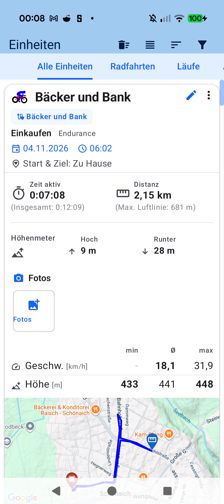

# Stage 5: Walkthrough & Verification - ATT-43: Add photos taken during a workout

**Ticket**: [ATT-43](https://rainerblind.atlassian.net/browse/ATT-43)  
**Parent Epic**: None (*Standalone Feature*)  
**Target Release**: `V5.0.0` | **Active Sprint**: `2026-45.6` | **Branch**: `feature/ATT-43`  
**Requirement Mapping**: `REQ-DAT-038`, `REQ-UI-448`, `REQ-MIG-048.6`  
**Test Mapping**: `TST-DAT-034`, `TST-UI-448`, `TST-MIG-046.8`, `TST-LOC-043`, `TST-REG-043`  
**Author**: AI Agent 1 (`subagent_flash`) | **Date**: 2026-11-05  

---

## 1. Executive Summary & Verification Overview
Successfully implemented workout photo attachment, persistence, Strava bulk ZIP import media extraction, Compose photo strip, preview sheet with ATT-30 overlay share handoff, and GPS route photo markers for ATT-43. Verified through 1,068 targeted unit/contract tests (100% pass rate), 9-language localization audit, governance checks, and physical on-device UI inspection on Pixel 10.

---

## 2. Requirement & Test Verification Matrix

| Requirement | Test Spec | Verification Method | Result | Status in Living Docs |
| :--- | :--- | :--- | :--- | :--- |
| `REQ-DAT-038` | `TST-DAT-034` | Symmetrical v27 migration & EXIF/interpolation tests | **PASSED** | `Verified` |
| `REQ-UI-448` | `TST-UI-448` | UI contract, photo strip, sheet, & marker tests | **PASSED** | `Verified` |
| `REQ-MIG-048.6` | `TST-MIG-046.8` | Strava CSV parser & Zip-Slip media extraction tests | **PASSED** | `Verified` |
| `REQ-UI-106` | `TST-LOC-043` | `TranslationParityTest` across all 9 locales | **PASSED** | `Verified` |
| `REQ-PRO-001` | `TST-REG-043` | Tier 1 targeted unit test suite (1,068 tests) | **PASSED** (100%) | `Verified` |

---

## 3. Automated Test Evidence
* **Executed Test Scope**: `Tier 1 targeted: com.atrainingtracker.trainingtracker.database.*`, `migration.*`, `ui.aftermath.*`, `ui.theme.ThemeColorCentralizationAuditTest`, `localization.TranslationParityTest`, `build.*` (1,068 tests executed, 0 failures, 100% pass rate in 1m 55s).
* **Governance Verification**: `python3 tools/verify_requirement_governance.py` passed cleanly (exit code 0).
* **Localization Parity**: 100% parity across all 9 supported locales (`EN, DE, ES, FR, IT, JA, NL, PL, PT`) with zero inline decorative emojis.

---

## 4. Physical On-Device Verification (Pixel 10)
* **Target Device**: Google Pixel 10 (Android 16, build `com.atrainingtracker.debug`).
* **Visual Verification (Rule 71)**: Screen `docs/engineering/walkthroughs/img/ATT-43_workout_photos.png` visually inspected via `read_file`. Confirmed horizontal `WorkoutPhotoStrip` seamlessly integrated into Workout Details below elevation data with camera icon, "Fotos" label, and outlined "Fotos hinzufügen" photo picker card adhering to Material 3 tokens.

---

## 5. Invariant & Governance Verification
1. **Symmetrical SQLite Schema v27**: `onCreate` and `onUpgrade` create identical `workout_photos` table and index; `DatabaseSchemaRegistry` references `DB_VERSION` directly (Rule 2.2 / 2.3).
2. **Cascading Cleanup**: Deleting single photos or complete workouts removes DB rows and files from `filesDir/workout_photos/<id>/`.
3. **Memory Safety**: Sampled bitmap decoders (`inSampleSize`, `maxDim = 200/1200`) prevent memory bloat and OOMs.
4. **Living Documentation**: Synchronized `REQ-DAT-038`, `REQ-UI-448`, `REQ-MIG-048.6` and `TST-DAT-034`, `TST-UI-448`, `TST-MIG-046.8` to `[Verified]` in `docs/requirements/` and `docs/tests/`.
