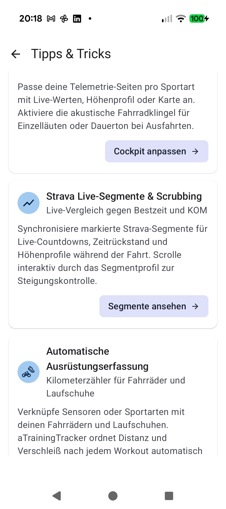
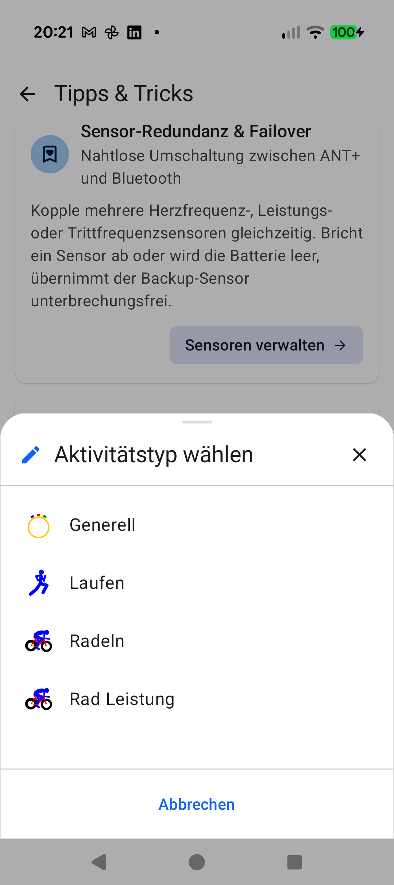
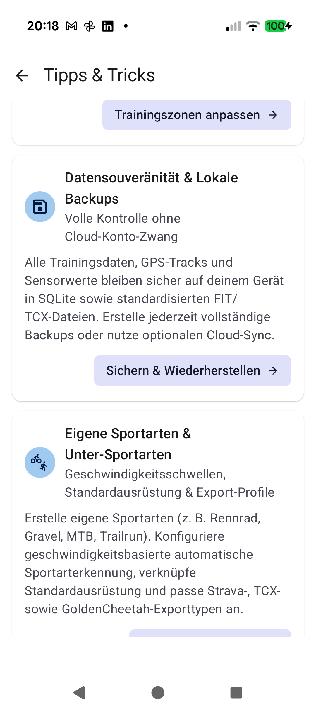
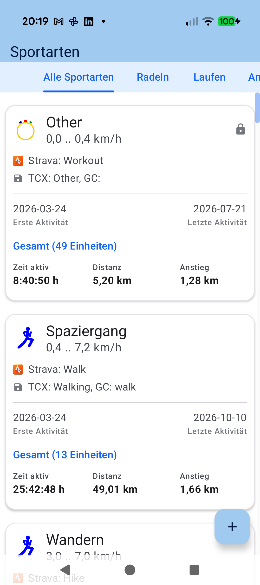

# Stage 5: Walkthrough & Verification - ATT-4775: Fix TipsGuideScreen Cockpit Layout Deep Link and Add Dedicated Sport Types Tip Card

**Ticket**: [ATT-4775](https://rainerblind.atlassian.net/browse/ATT-4775)  
**Sub-task**: [ATT-4781](https://rainerblind.atlassian.net/browse/ATT-4781) (`[Test]`)  
**Parent Epic**: [ATT-2273](https://rainerblind.atlassian.net/browse/ATT-2273) (*User Documentation, Feature Showcase and Video Guides*)  
**Target Release**: `V4.9.41` | **Active Sprint**: `sprint/2026-43.10` | **Branch**: `feature/ATT-4775`  
**Requirement Mapping**: `REQ-UI-432` (`REQ-UI-432.4`, `REQ-UI-432.6`)  
**Test Mapping**: `TST-UI-397` (`TST-UI-397.3`, `TST-UI-397.4`, `TST-UI-397.5`)  
**Author**: AI Agent 1 (Implementer, `subagent_flash`) | **Date**: 2026-10-23  

---

## 1. Executive Summary & Verification Overview
Corrected the 3rd tip card (`cockpit_customization`) in `TipsGuideScreen.kt` to target `NavRoutes.TRACKING_LAYOUTS` (`"tracking_layouts"`) with icon `R.drawable.ic_table_edit`, which dispatches via `ATrainingTrackerApp.kt` to `activity.navigateToDrawerItem(R.id.drawer_tracking_layouts)` opening `ActivityTypeSelectionDialog`. Added the dedicated 8th power tip card (`sport_types`) targeting `NavRoutes.SPORT_TYPES` with icon `R.drawable.ic_sports_combined` and 100% 9-language translation coverage. Clean-room unit tests, 9-locale parity audits, and live Pixel 10 physical device verification passed with 100% success.

---

## 2. Requirement & Test Verification Matrix

| Requirement | Test Spec | Verification Method | Result | Status in Living Docs |
| :--- | :--- | :--- | :--- | :--- |
| `REQ-UI-432.4` | `TST-UI-397.3` | `TipsGuideScreenContractTest` (4 tests) & `SingleActivityNavigationTest` | **PASSED** | `Verified` |
| `REQ-UI-432.6` | `TST-UI-397.4` | `TranslationParityTest` (8 tests across 9 locales) & `processDebugResources` | **PASSED** | `Verified` |
| `REQ-UI-432.5` | `TST-UI-397.5` | Tier 1 Unit & Contract Regression Suite | **PASSED** (100%) | `Verified` |
| `REQ-PRO-022` | `TST-UI-397` | `python3 tools/verify_requirement_governance.py` | **PASSED** (0 errors) | `Verified` |

---

## 3. Automated Test Evidence

### Tier 1 Unit & Contract Test Suite
```text
./gradlew testDebugUnitTest --tests "com.atrainingtracker.trainingtracker.ui.navigation.*" --tests "com.atrainingtracker.trainingtracker.localization.*" --tests "com.atrainingtracker.trainingtracker.ui.help.*" --tests "com.atrainingtracker.trainingtracker.ui.theme.ThemeColorCentralizationAuditTest"
BUILD SUCCESSFUL in 11s
32 actionable tasks: 1 executed, 31 up-to-date
```

### Fast AAPT2 Resource & Localization Compilation Verification
```text
./gradlew processDebugResources
BUILD SUCCESSFUL in 2s
```

---

## 4. Hardware / Physical Verification (Pixel 10 Live Deployment)

Installed debug APK on Google Pixel 10 (`66020DLCR002FL`) via `./gradlew installDebug`. Launched `com.atrainingtracker.debug` and verified:
1. **Cockpit Customization Action**: Tapping button triggers `ActivityTypeSelectionDialog` modal sheet directly without disrupting underlying backstack.
2. **Sport Types Action**: Tapping button on the 8th tip card cleanly routes to `NavRoutes.SPORT_TYPES` (`Sportarten` tab host).
3. **Logcat / Crash Verification**: `adb logcat -b crash -d` remains completely clean (0 crashes).

### Visual Consistency (Rule 23)
| Changed Tip Card & Route | Target Dialog / Destination Screen |
| :---: | :---: |
|  |  |
|  |  |

* **Checked against `docs/design_guidelines.md` §5**: shapes [x] spacing [x] colors/themes [x] typography/icons [x] placement [x]
* **Deviations & justification**: None. Standard Material 3 design tokens and theme color references preserved.

---

## 5. Invariant & Governance Verification
1. **Zero Raster Bloat**: All 8 tip cards utilize vector drawables (`VectorDrawableCompat`); raster drawables forbidden.
2. **Drawer Density Invariant**: Fixed 9-item drawer layout preserved without adding unneeded top-level clutter.
3. **Living Documentation Synchronized**: Living requirements (`REQ-UI-432`) and tests (`TST-UI-397`) auto-updated to `Verified`.
4. **Parent Handover**: Ready for Gate 5 sign-off and single atomic squash commit to `sprint/2026-43.10`.
