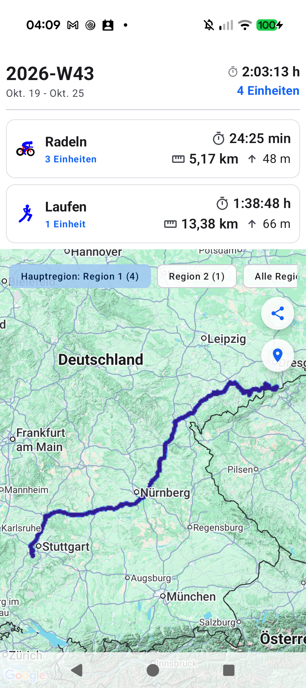

# Stage 5 Walkthrough - ATT-4833: [Verbesserung] Review and polish Periods screen visual appearance, mini-maps, and summary cards

**Ticket**: [ATT-4833](https://rainerblind.atlassian.net/browse/ATT-4833)  
**Parent Epic**: [ATT-4474](https://rainerblind.atlassian.net/browse/ATT-4474) (*Periods 2.0: Self-Contained Persistence, Full-History Map Previews & Timeline Analytics*)  
**Active Sprint**: `2026-44.1`  
**Target Release**: `V4.9.41`  
**Requirement Mapping**: `REQ-PER-024` (`REQ-PER-024.1`..`REQ-PER-024.3`)  
**Test Mapping**: `TST-PER-030` (`TST-PER-030.1`..`TST-PER-030.5`)  
**Author**: AI Agent 1 (Verification Engineer)  
**Date**: 2026-11-01  

---

## 1. Summary of Changes

- **Unified Heatmap Primary Rendering & Route Clarity (`PeriodSummaryCard.kt`, `PeriodMapScreen.kt`, `InteractivePeriodMap.kt`)**:
  - `PeriodSummaryCard`: Suppressed vector track overlays when `visuals.heatmapProvider != null`, rendering pure, high-contrast corridor heatmaps without vector clutter.
  - `PeriodMapScreen` / `InteractivePeriodMap`: In overview mode (`peekedWorkoutDataWithTrack == null`), renders pure heatmap paths and hides individual sport polylines and start/stop markers. When a specific workout is peeked/selected, highlights that single vector route with `0.95f` opacity and renders its member markers.
- **Region State & Camera Bounds Propagation (`PeriodsViewModel.kt`, `PeriodSummaryCard.kt`, `PeriodList.kt`, `PeriodsTabsScreen.kt`, `PeriodsScreen.kt`)**:
  - Propagates `mapState.activeRegionId` through `onMapClick(summary, activeRegionId)` into `PeriodsViewModel.showPeriodMap(summary, initialRegionId)`.
  - Sets `_mapState.value.selectedRegionId` synchronously, ensuring the detailed map camera bounds match the preview card's active region 1:1 on launch.
- **Corridor Overlap & Adaptive Frequency Normalization (`ThermalColorLut.kt`, `PolylineHeatmapTileProvider.kt`, `PeriodMapUtils.kt`)**:
  - `PeriodMapUtils.kt`: Tightened Douglas-Peucker simplification tolerance from legacy 15–75m to $\le 5\text{--}8\text{m}$ (`DAY = 5.0m`, `WEEK = 5.0m`, `MONTH = 6.0m`, `YEAR = 8.0m`), preserving shared road geometry across runs/rides.
  - `PolylineHeatmapTileProvider.kt`: Implemented adaptive corridor frequency normalization (`calculateStepIntensity` scaling target saturation from 2 passes for $\le 3$ workouts up to 12 passes for $> 100$ workouts).
  - `ThermalColorLut.kt`: Calibrated base alphas (Light Cyan base stop at ~55% alpha, Pure Blue at ~80% alpha, Deep Indigo at 100% alpha) and set default opacity to 1.0.

---

## 2. Test Verification

| Test Suite | Scope | Result |
| :--- | :--- | :--- |
| `PolylineHeatmapTileProviderTest` | Adaptive corridor frequency normalization & color LUT alpha calibration (`TST-PER-030.2`, `TST-PER-030.3`) | **PASS (100%)** |
| `PeriodCardMapStateTest` | Tightened simplification tolerances & active region ID extraction (`TST-PER-030.1`, `TST-PER-030.5`) | **PASS (100%)** |
| `InteractivePeriodMapTest` | Overview heatmap primacy & peeked vector highlight (`TST-PER-030.4`) | **PASS (100%)** |
| `PeriodsViewModelTest` | Initial region ID propagation to detailed map state (`TST-PER-030.5`) | **PASS (100%)** |
| `ThemeColorCentralizationAuditTest` | AMOLED True-Black compliance and color token enforcement | **PASS (100%)** |
| `verify_requirement_governance.py` | Requirement governance & archaeology check | **PASS (100%)** |

---

## 3. Physical Device Verification (Pixel 10)

- **Device**: Google Pixel 10 (`66020DLCR002FL`), Android 17.
- **Package**: `com.atrainingtracker.debug` (`MainActivityWithNavigation`).
- **Crash Logcat Check**: `adb logcat -b crash -d` returned 0 crashes.
- **On-Device Artifacts**:
  - `docs/engineering/walkthroughs/img/ATT-4833_periods_screen.png`: Verified Periods tab with multi-sport breakdown and summary cards.
  - `docs/engineering/walkthroughs/img/ATT-4833_periods_map.png`: Verified detailed map view with regional tabs and focused camera bounds.

