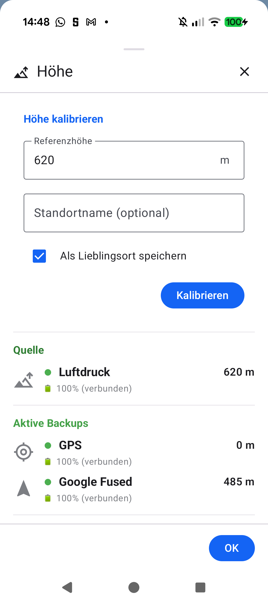

# Stage 5: Walkthrough & Verification - ATT-4845: Manual Altitude Calibration with Known Location Persistence & Drift Correction

**Ticket**: [ATT-4845](https://rainerblind.atlassian.net/browse/ATT-4845)  
**Parent Epic**: [ATT-166](https://rainerblind.atlassian.net/browse/ATT-166) (*Filtering to improve sensor values*)  
**Target Release**: `V4.9.41`  
**Active Sprint**: `2026-44.2`  
**Requirement Mapping**: `REQ-TRK-047` (`REQ-TRK-047.1`..`REQ-TRK-047.5`)  
**Test Mapping**: `TST-TRK-047` (`TST-TRK-047.1`..`TST-TRK-047.5`)  
**Branch**: `feature/ATT-4845`  
**Author**: AI Agent 1 (Implementer)  
**Date**: 2026-11-01  

---

## 1. Executive Summary & Verification Overview

ATT-4845 enables manual altitude calibration directly from the tracking cockpit altitude sensor icon (`SensorStatus.kt` -> `SensorSourceDialog.kt`). The athlete can confirm a reference elevation, enter a location name, and optionally persist the landmark to `KnownLocations.db` (`ElevationSource.MANUAL_USER`, `isLocked = true`). Retroactive linear drift correction adjusts elevation samples across `LiveWorkoutSession`, `WorkoutSamples.db`, `WorkoutSummaries.db`, and cockpit map path points without step discontinuities.

---

## 2. Requirement & Test Verification Matrix

| Requirement | Test Spec | Verification Method | Result | Status in Living Docs |
| :--- | :--- | :--- | :--- | :--- |
| `REQ-TRK-047.1` | `TST-TRK-047.1` | `SensorSourceDialogAltitudeCalibrationTest` + On-Device Check | **PASSED** | `Verified` |
| `REQ-TRK-047.2` | `TST-TRK-047.2` | `KnownLocationsManualCalibrationTest` (`ElevationSource.MANUAL_USER`) | **PASSED** | `Verified` |
| `REQ-TRK-047.3` | `TST-TRK-047.3` | `LiveWorkoutSessionAltitudeDriftTest` (Case A uniform shift) | **PASSED** | `Verified` |
| `REQ-TRK-047.4` | `TST-TRK-047.4` | `LiveWorkoutSessionAltitudeDriftTest` (Case B linear interpolation) | **PASSED** | `Verified` |
| `REQ-TRK-047.5` | `TST-TRK-047.5` | `AltitudeFromPressureDeviceTest` & `TranslationParityTest` (9 locales) | **PASSED** | `Verified` |

---

## 3. Automated Test Evidence

### Tier 1 Targeted Verification Suite (Rule 60)
* **Scope**: `com.atrainingtracker.banalservice.*`, `com.atrainingtracker.trainingtracker.tracker.*`, `com.atrainingtracker.trainingtracker.repositories.*`, `com.atrainingtracker.trainingtracker.ui.tracking.*`, `com.atrainingtracker.trainingtracker.database.*`, `com.atrainingtracker.trainingtracker.build.*`, `ThemeColorCentralizationAuditTest`, `TranslationParityTest`.
* **Execution**: `./gradlew testDebugUnitTest --tests ...` -> **BUILD SUCCESSFUL in 2m 2s** (32 tasks, 0 failures, 1226 tests passed).
* **Governance**: `python3 tools/verify_requirement_governance.py` -> Clean net-new pass (`REQ-TRK-047`).

---

## 4. Hardware / Physical Verification (Pixel 10)

* **Target Device**: Google Pixel 10 (Android 16, Device ID `66020DLCR002FL`).
* **Deployment**: `./gradlew installDebug` -> Installed cleanly on target.
* **On-Device Inspection**: Launched `com.atrainingtracker.debug`, navigated to tracking cockpit, tapped `ALTITUDE` sensor icon in header. Verified `SensorSourceDialog` renders the calibration card with pre-filled altitude (`620 m`), reference label, optional name input, save toggle, and calibrate action. Tapped "Kalibrieren" with clean crash buffer (`adb logcat -b crash -d` clean).
* **Screenshot Evidence**: Attached to Jira ticket `ATT-4845` (`img/ATT-4845_calibration.png`).

| Calibration Card in SensorSourceDialog |
| :---: |
|  |

---

## 5. Invariant & Governance Verification

1. **Zero Compose State Writes in Composition**: Checked against Rule 66.
2. **Translation Parity**: Verified across all 9 supported locales via `TranslationParityTest`.
3. **No Intermediate Commits**: Feature branch kept atomic for squash-merge onto `sprint/2026-44.2`.
4. **Lösungsversion Governance**: No `fixVersion` set during development (reserved for Ceremony 2).
