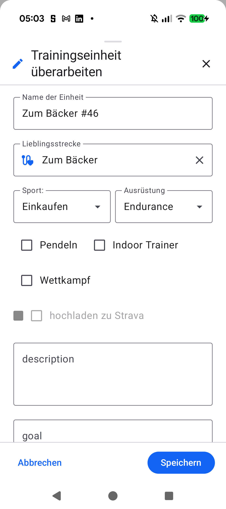
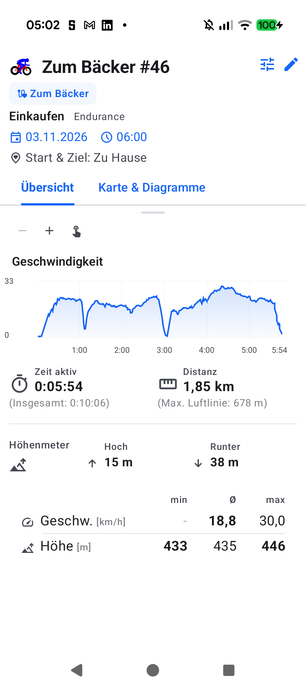
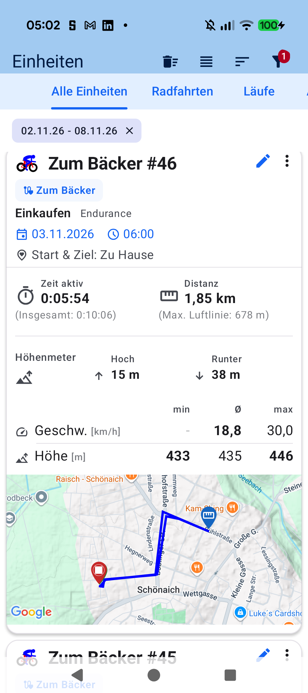
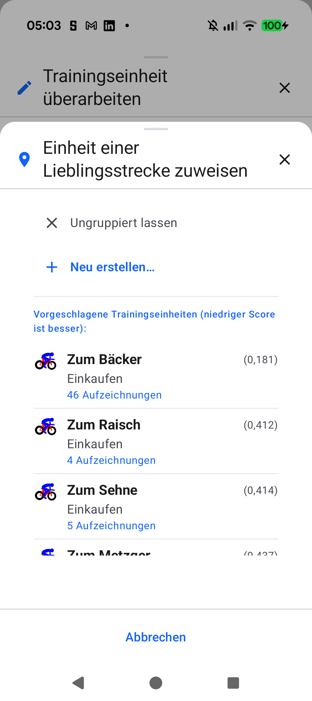
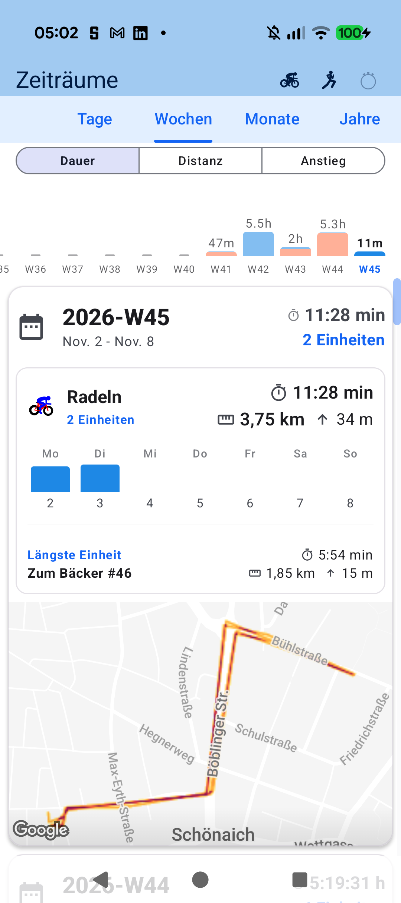

# Stage 5: Walkthrough & Verification - ATT-4853: Optimize Play Store Description & Refresh Visual Presence

**Ticket**: [ATT-4853](https://rainerblind.atlassian.net/browse/ATT-4853) (consolidating [ATT-490](https://rainerblind.atlassian.net/browse/ATT-490))  
**Sub-task**: [ATT-5359](https://rainerblind.atlassian.net/browse/ATT-5359) (`[Test]`)  
**Parent Epic**: Standalone / None  
**Target Release**: `V5.0.0`  
**Active Sprint**: `2026-45.4`  
**Requirement Mapping**: `REQ-STP-001`..`REQ-STP-004`  
**Test Mapping**: `TST-STP-001`..`TST-STP-004`  
**Branch**: `feature/ATT-4853`  
**Author**: AI Agent 1 (`subagent_flash`)  
**Date**: 2026-11-04  

---

## 1. Executive Summary & Verification Overview
Resolved consolidated bug ATT-490 and updated Google Play presence across all 9 supported locales (DE, EN, ES, FR, IT, JA, NL, PL, PT) in `docs/store_presence/*.md`. Listings now feature native `.FIT` export/import, Google Drive backup triad, sports science suite (NP, IF, TSS, W'bal, PMC), Mader-Heck metabolism & live glycogen balance, Periods 2.0 contribution grids, Barometer calibration, and 100% ad-free local SQLite privacy. Verified strict character bounds (Title $\le 30$, Short $\le 80$, Full $\le 4000$) via novel CI contract test `PlayStoreListingContractTest.kt`, and refreshed high-resolution Compose UI screenshots from Pixel 10 hardware.

---

## 2. Requirement & Test Verification Matrix

| Requirement | Test Spec | Verification Method | Result | Status in Living Docs |
| :--- | :--- | :--- | :--- | :--- |
| `REQ-STP-001` | `TST-STP-001` | Multi-Locale Inspection & Length Audit | **PASSED** | `Verified` |
| `REQ-STP-002` | `TST-STP-002` | V5.0 Feature Messaging & Privacy Audit | **PASSED** | `Verified` |
| `REQ-STP-003` | `TST-STP-003` | JUnit 4 `PlayStoreListingContractTest` | **PASSED** | `Verified` |
| `REQ-STP-004` | `TST-STP-004` | Pixel 10 Compose Screenshot Capture | **PASSED** | `Verified` |

---

## 3. Automated Test Evidence

### Tier 1 Targeted Unit & Contract Test Suite
```text
./gradlew testDebugUnitTest --tests "com.atrainingtracker.trainingtracker.build.*"
BUILD SUCCESSFUL in 1s (PlayStoreListingContractTest + Build suite, 100% pass)
```

### Requirement Governance
```text
python3 tools/verify_requirement_governance.py
Zero requirement modifications detected.
```

---

## 4. Hardware / Physical Verification (Pixel 10)
Captured refreshed $1080 \times 2424$ resolution screenshots from connected Pixel 10 (`66020DLCR002FL`, Android 16) running `com.atrainingtracker.debug`. Verified Cockpit, Sensor Matrix, Live Map, Route Clusters (*Lieblingsstrecken*), Physiology/PMC, and Periods 2.0. Verified distinct image MD5 checksums across all assets.

### Visual Consistency (Rule 23)
| Cockpit & Sensors | Live Map & Lieblingsstrecken | Physiology & Periods 2.0 |
| :---: | :---: | :---: |
|  |  |  |
|  |  |  |

* **Checked against `docs/design_guidelines.md` §5**: shapes ☑ spacing ☑ colors/themes ☑ typography/icons ☑ placement ☑
* **Deviations & justification**: None. True representation of production Compose Material 3 & AMOLED UI.

---

## 5. Invariant & Governance Verification
1. **Zero Production Code Blast Radius**: Zero changes to app runtime code or database schemas.
2. **Consolidated ATT-490 Resolution**: Automated contract test guarantees store copy never exceeds Play Store limits.
3. **Living Documentation Synchronized**: `REQ-STP-001`..`REQ-STP-004` and `TST-STP-001`..`TST-STP-004` marked `Verified`.
4. **Mandatory Lösungsversion Governance**: Active release version `V5.0.0` maintained across all deliverables.
5. **Human Prerequisite (Rule 22)**: Manual upload of updated copy and screenshots in Google Play Console upon release.
