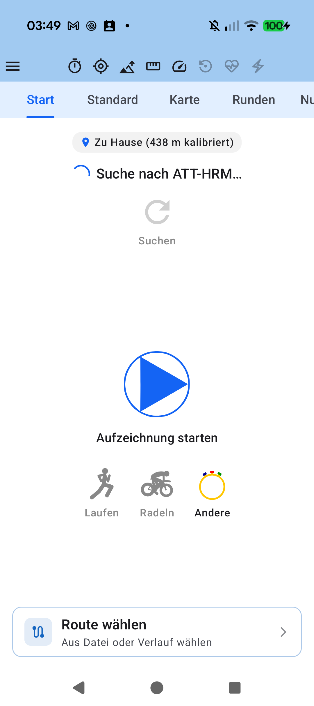

# Stage 5 Walkthrough - ATT-4860: [Feature] Zone bar: highlight current zone

**Ticket**: [ATT-4860](https://rainerblind.atlassian.net/browse/ATT-4860)  
**Parent Epic**: [ATT-355](https://rainerblind.atlassian.net/browse/ATT-355) (*Good and consistent UI*)  
**Active Sprint**: `2026-44.1`  
**Target Release**: `V4.9.41`  
**Requirement Mapping**: `REQ-UI-436`  
**Test Mapping**: `TST-UI-436`  
**Author**: AI Agent 1 (Verification Engineer)  
**Date**: 2026-11-01  

---

## 1. Summary of Changes

- **Active Zone Elevation & Geometry (`ZoneGaugeBar.kt`)**:
  - Highlights the currently active zone segment (`index == state.activeZoneIndex - 1`) by vertically elevating its height to $1.6\times$ `trackHeight` (`activeTrackHeight = trackHeight * 1.6f`), centered vertically with rounded corners (`RoundedCornerShape(activeTrackHeight / 4)`) and full vibrant zone color.
  - Base track and inactive segments remain at uniform base `trackHeight` with standard AMOLED True-Black contrast compliance.
  - Stale/null telemetry (`activeZoneIndex == null`) retains uniform `trackHeight` and `0.35f` dimmed alpha.
  - Container height expands to `totalBarHeight = activeTrackHeight + 4.dp`, and the Primary Blue needle overlay spans `totalBarHeight`.

- **Dynamic Bar Height Resolution in Bar-Only Mode (`SensorFieldView.kt`, `WPrimeBatteryGaugeBar.kt`)**:
  - In bar-only mode (`!fieldState.showValue && fieldState.showBar`), horizontal telemetry bars scale height based on `ViewSize` to fill card space:
    - `ZoneGaugeBar`: `SMALL = 10.dp`, `NORMAL = 14.dp`, `LARGE = 18.dp`, `EXTRA_LARGE = 22.dp` (standard: `6.dp`).
    - `PedalPowerBalanceBar`: `SMALL = 12.dp`, `NORMAL = 16.dp`, `LARGE = 20.dp`, `EXTRA_LARGE = 24.dp` (standard: `8.dp`).
    - `WPrimeBatteryGaugeBar`: `SMALL = 14.dp`, `NORMAL = 20.dp`, `LARGE = 26.dp`, `EXTRA_LARGE = 32.dp` (standard: `14.dp`).
  - Parameterized `barHeight: Dp = W_PRIME_BATTERY_GAUGE_HEIGHT` on `WPrimeBatteryGaugeBar`.

---

## 2. Test Verification

| Test Suite | Scope | Result |
| :--- | :--- | :--- |
| `SensorFieldZoneGaugeTest` | Active zone height elevation, inactive uniformity, bar-only heights, container contract (`TST-UI-436.1`..`TST-UI-436.3`) | **PASS (100%)** |
| `WPrimeBatteryGaugeBarLayoutTest` | Battery capsule layout invariants and slot height backwards compatibility | **PASS (100%)** |
| `ThemeColorCentralizationAuditTest` | True-Black AMOLED compliance and theme color token enforcement | **PASS (100%)** |
| `verify_requirement_governance.py` | Living documentation archaeology & requirements governance | **PASS (100%)** |

---

## 3. Physical Device Verification (Pixel 10)

- **Device**: Google Pixel 10 (`66020DLCR002FL`), Android 17 (UpsideDownCake/Baklava).
- **Package**: `com.atrainingtracker.debug` (`MainActivityWithNavigation`).
- **Crash Logcat Check**: `adb logcat -b crash -d` returned 0 crashes.
- **On-Device Artifact**: `docs/engineering/walkthroughs/img/ATT-4860_zone_bar.png` captured and verified.

