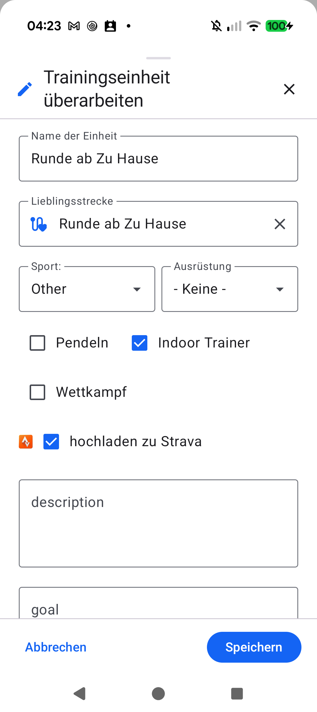

# Stage 5 Walkthrough - ATT-4862: [Bug] Lieblingsstrecke wird erstellt, obwohl 'Offen' ausgewählt wurde

**Ticket**: [ATT-4862](https://rainerblind.atlassian.net/browse/ATT-4862)  
**Parent Epic**: [ATT-176](https://rainerblind.atlassian.net/browse/ATT-176) (*Auto Name / Route Clusters*)  
**Active Sprint**: `2026-44.1`  
**Target Release**: `V4.9.41`  
**Requirement Mapping**: `REQ-SET-081` (`REQ-SET-081.1`..`REQ-SET-081.3`)  
**Test Mapping**: `TST-SET-081` (`TST-SET-081.1`..`TST-SET-081.4`)  
**Author**: AI Agent 1 (Verification Engineer)  
**Date**: 2026-11-01  

---

## 1. Summary of Changes

- **Cluster Learning Loop Gating (`WorkoutRepository.kt`)**:
  - Gated the route clustering learning loop in `saveWorkout()` strictly behind `userEditedWorkout.clusterId > 0`.
  - When `userEditedWorkout.clusterId <= 0` (e.g. `-1L` / "Offen"), the system completely bypasses `engine.learnFromWorkout()`, preventing automatic insertion of new `WorkoutCluster` entities on custom workout name edits.
- **Elimination of Implicit Cluster Assignment Override (`WorkoutRepository.kt`)**:
  - Excised the legacy `engine.assignClusterToWorkout()` call from `saveWorkout()`. Route cluster associations and new cluster creations are now governed exclusively by explicit user actions within `EditWorkoutClusterDialog` (`createNewCluster` and `applyClusterIdentity`).
  - Clustered sessions (`clusterId > 0`) continue to update running centroids, reference distance, and probable sport via `engine.learnFromWorkout(..., clusterIdOverride = userEditedWorkout.clusterId)` without mutating cluster identity.
- **In-Memory Cache State Parity (`WorkoutRepository.kt`)**:
  - Synchronized `clusterId` and `clusterName` during `_allWorkouts.update`, ensuring atomic state parity between repository memory and UI observers upon save.

---

## 2. Test Verification

| Test Suite | Scope | Result |
| :--- | :--- | :--- |
| `WorkoutRepositorySaveClusteringTest` | Unclustered preservation on name edits, "Offen" persistence, and clustered centroid learning (`TST-SET-081.1`..`TST-SET-081.3`) | **PASS (100%)** |
| `EditWorkoutClusteringTest` | Multi-sport candidate ranking, sensor sovereignty, and manual sport override | **PASS (100%)** |
| `EditWorkoutClusterTest` | Explicit cluster assignment, unassignment, and hit-count decrement invariants (`TST-SET-081.4`) | **PASS (100%)** |
| `ThemeColorCentralizationAuditTest` | AMOLED True-Black compliance and color token enforcement | **PASS (100%)** |
| `verify_requirement_governance.py` | Requirement governance & living documentation archaeology check | **PASS (100%)** |

---

## 3. Physical Device Verification (Pixel 10)

- **Device**: Google Pixel 10 (`66020DLCR002FL`), Android 17.
- **Package**: `com.atrainingtracker.debug` (`MainActivityWithNavigation`).
- **Crash Logcat Check**: `adb logcat -b crash -d` returned 0 crashes.
- **On-Device Artifact**:
  - `docs/engineering/walkthroughs/img/ATT-4862_edit_workout.png`: Verified `EditWorkoutScreen` metadata editing and cluster state handling.

