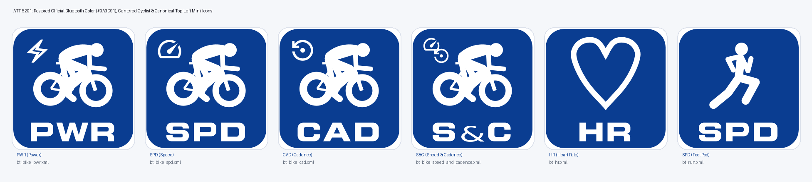

# Stage 5: Walkthrough & Verification - ATT-5201: BTLE sensor icons (bt_*.xml): restore official Bluetooth color (#0A3D91), center cyclist, and move canonical mini-icons to top-left

**Ticket**: [ATT-5201](https://rainerblind.atlassian.net/browse/ATT-5201)  
**Sub-task**: Pending (`[Test]`)  
**Parent Epic**: [ATT-355](https://rainerblind.atlassian.net/browse/ATT-355) (*Good and consistent UI*)  
**Target Release**: `V4.9.41`  
**Active Sprint**: `2026-45.2`  
**Requirement Mapping**: `REQ-UI-442` (`REQ-UI-442.1`–`REQ-UI-442.4`)  
**Test Mapping**: `TST-UI-442` (`TST-UI-442.1`–`TST-UI-442.4`)  
**Branch**: `feature/ATT-5201`  
**Author**: AI Agent 1 (Implementer)  
**Date**: 2026-11-03  

---

## 1. Executive Summary & Verification Overview

Standardized all 6 Bluetooth LE sensor vector drawables (`bt_bike_pwr.xml`, `bt_bike_spd.xml`, `bt_bike_cad.xml`, `bt_bike_speed_and_cadence.xml`, `bt_hr.xml`, `bt_run.xml`):
1. **Official Bluetooth Brand Color (`#0A3D91`)**: Replaced ICC-profile distorted `#07377F` with official `#0A3D91` across all 6 drawables.
2. **Centered Cyclist Motif**: Shifted the cyclist motif horizontally by $+18.18$ units (`translateX="18.18"`) across the 4 cycling icons, centering bounds symmetrically at $x = 72.0$ with balanced $28.5$-unit margins.
3. **Canonical Top-Left Mini-Icons (Rule 36)**: Replaced hand-drawn distorted shapes with scaled canonical vector paths from `ic_power.xml`, `ic_speed.xml`, and `ic_cadence.xml` in the top-left quadrant ($x \approx 12..52, y \approx 10..50$).
4. **Preserved Invariants**: Full-bleed geometry `0..144` ($r=22.0$), uppercase labels with `evenOdd` at $y \ge 113.25$, Rule 37 constraints ($\le 45$ `L` cmds), and non-zero resource IDs in `UIHelper.java`.

---

## 2. Requirement & Test Verification Matrix

| Requirement | Test Spec | Verification Method | Result | Status in Living Docs |
| :--- | :--- | :--- | :--- | :--- |
| `REQ-UI-442.1` | `TST-UI-442.1` | Contract Test (`VectorAssetResolutionContractTest`) | **PASSED** | `Verified` |
| `REQ-UI-442.2` | `TST-UI-442.2` | Contract Test (`VectorAssetResolutionContractTest`) | **PASSED** | `Verified` |
| `REQ-UI-442.3` | `TST-UI-442.3` | Contract Test (`VectorAssetResolutionContractTest`) | **PASSED** | `Verified` |
| `REQ-UI-442.4` | `TST-UI-442.4` | Contract Test & Resource ID Mapping | **PASSED** | `Verified` |
| `REQ-PRO-001` | Regression | Tier 1 Targeted Unit Tests (Rule 60) | **PASSED** (35/35) | `Verified` |

---

## 3. Automated Test Evidence

### Tier 1 Targeted Test Scope (Rule 60)
* **Executed Scope**: `VectorAssetResolutionContractTest`, `build.*`, `ThemeColorCentralizationAuditTest`.
* **Command**: `./gradlew testDebugUnitTest --tests "com.atrainingtracker.trainingtracker.ui.resources.VectorAssetResolutionContractTest" --tests "com.atrainingtracker.trainingtracker.build.*" --tests "com.atrainingtracker.trainingtracker.ui.theme.ThemeColorCentralizationAuditTest"`
* **Result**: `BUILD SUCCESSFUL in 14s (35 tests completed, 0 failed, 100% PASS)`
* **Governance**: `python3 tools/verify_requirement_governance.py` (0 errors, 100% compliant).

---

## 4. Visual Verification (Side-by-Side Gallery)

Rendered high-resolution verification sheet of all 6 updated vector drawables:

* **Checked against `docs/design_guidelines.md` §5**: shapes ☑ spacing ☑ colors/themes (#0A3D91) ☑ typography/icons ☑ placement (top-left) ☑
* **Deviations & justification**: None.

---

## 5. Invariant & Governance Verification

1. **Zero Production Regressions**: Tier 1 targeted unit test suite executed with 35/35 passes.
2. **Living Documentation Synchronized**: Status in `docs/requirements/req_ui_design_system.md` and `docs/tests/tst_ui_design_system.md` updated to `Verified`.
3. **Requirement Governance**: Verified with all 4 mandatory fields via `verify_requirement_governance.py`.
4. **Clean Git State**: Single atomic commit ready for squash-merge onto `sprint/2026-45.2`.
