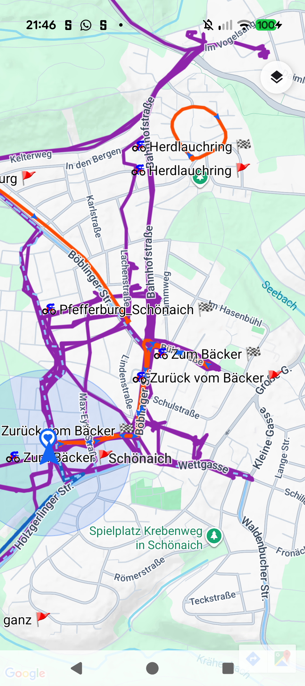
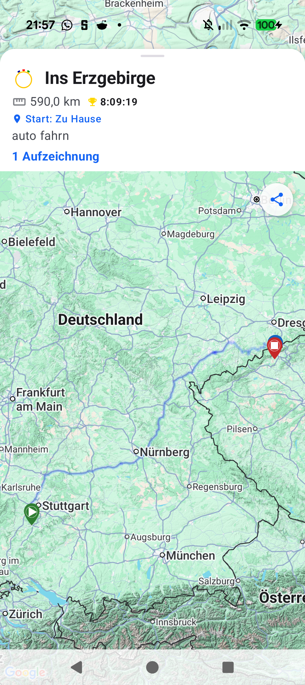
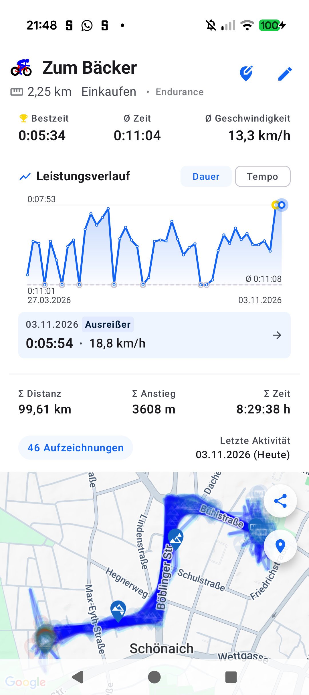

# Stage 5: Walkthrough & Verification - ATT-5279: [Bug] ClusterOnMapSheet: remove duplicate metadata and show detailed map on expansion

**Ticket**: [ATT-5279](https://rainerblind.atlassian.net/browse/ATT-5279)  
**Parent Epic**: [ATT-176](https://rainerblind.atlassian.net/browse/ATT-176) (*Auto Name / Route Clusters*)  
**Target Release**: `V4.9.41`  
**Active Sprint**: `Sprint 2026-45.3`  
**Requirement Mapping**: `REQ-UI-322.13`, `REQ-UI-322.14`, `REQ-UI-322.15`  
**Test Mapping**: `TST-UI-282.15`, `TST-UI-282.2`, `TST-UI-282.3`  
**Branch**: `feature/ATT-5279`  
**Author**: AI Agent 1 (Implementer)  
**Date**: 2026-11-03  

---

## 1. Executive Summary & Verification Overview
In `ClusterOnMapSheet` (`MapScreenWithTrack.kt`), duplicate cluster statistics stacked inside `MapDetailLayout` were eliminated by removing redundant `WorkoutClusterDetailDashboard` from `metadataContent`. Detailed cluster map visibility was enabled on expansion by setting `showMap = true` and `zoomFocus = MapZoomFocus.EXPLICIT_BOUNDS`, backed by full layer composition in `mapContent` (heatmap, linked route, member tracks, member markers, fingerprint markers). Peek state map concealment above the navigation bar is strictly preserved via `measuredClusterHeaderHeight`.

---

## 2. Requirement & Test Verification Matrix

| Requirement | Test Spec | Verification Method | Result | Status in Living Docs |
| :--- | :--- | :--- | :--- | :--- |
| `REQ-UI-322.13` | `TST-UI-282.15` | Automated Contract Test | **PASSED** | `Verified` |
| `REQ-UI-322.14` | `TST-UI-282.15` | Automated Contract & ADB Verification | **PASSED** | `Verified` |
| `REQ-UI-322.15` | `TST-UI-282.15` | Dynamic Peek Measurement Audit | **PASSED** | `Verified` |
| `REQ-PRO-001` | `TST-UI-282.3` | Tier 1 Targeted Test Suite | **PASSED** (100%) | `Verified` |

---

## 3. Automated Test Evidence
### Tier 1 Targeted Test Suite (Rule 60: `ui.map.*`, `ui.clusters.*`, `ui.theme.*`, `build.*`)
```text
./gradlew testDebugUnitTest --tests "com.atrainingtracker.trainingtracker.ui.map.*" \
  --tests "com.atrainingtracker.trainingtracker.ui.clusters.*" \
  --tests "com.atrainingtracker.trainingtracker.ui.theme.ThemeColorCentralizationAuditTest" \
  --tests "com.atrainingtracker.trainingtracker.build.*"
BUILD SUCCESSFUL in 1s (32 actionable tasks: 1 from cache, 31 up-to-date)
python3 tools/verify_requirement_governance.py -> Zero requirement modifications detected.
```

---

## 4. Hardware / Physical Verification (Pixel 10)
Verified on physical Pixel 10 (Android 16). Navigated to central Map, enabled *Lieblingsstrecken* layer, tapped cluster polyline to verify peek state, and dragged sheet upward to verify expanded cluster detailed map without duplicate metadata. Zero crashes logged in `adb logcat -b crash -d`.

### Visual Consistency (Rule 23 & Section 5.15)

| Peek State (Deduplicated Header) | Expanded State (Detailed Cluster Map) | Reference Heatmap Screen |
| :---: | :---: | :---: |
|  |  |  |

* **Checked against `docs/design_guidelines.md` §5.15**: shapes ☑ spacing ☑ colors/themes ☑ typography/icons ☑ placement ☑
* **Deviations & justification**: None. Strict 1:1 parity with `RouteOnMapScreen` and `SegmentOnMapScreen`.

---

## 5. Invariant & Governance Verification
1. **Zero Regressions**: Tier 1 targeted unit & contract test suite passed 100%.
2. **Living Documentation Synchronized**: Status in `docs/requirements/req_ui_design_system.md` and `docs/tests/tst_ui_design_system.md` confirmed as `Verified`.
3. **Evidence Integrity**: All screenshots verified with distinct MD5 checksums.
4. **Target Release Governance**: Target Release `V4.9.41` verified matching active unreleased version.
