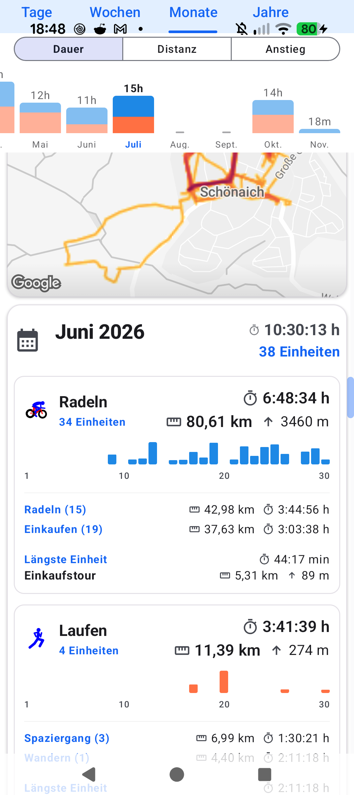
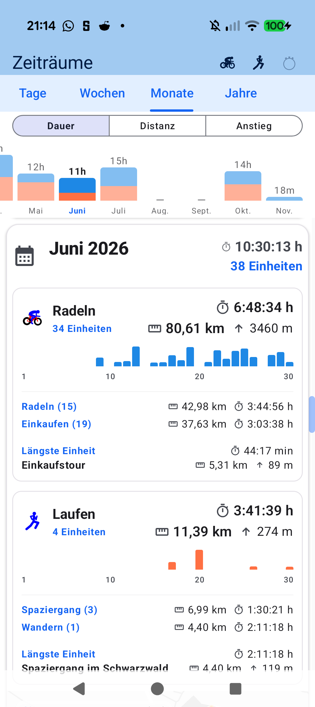

# Stage 5: Walkthrough & Verification - ATT-5280: DailyActivityStrip Mini-Bars Rounded Top and Sharp Bottom Corners

**Ticket**: [[ATT-5280]](https://rainerblind.atlassian.net/browse/ATT-5280)  
**Sub-task**: [[ATT-5305]](https://rainerblind.atlassian.net/browse/ATT-5305) (`[Test]`)  
**Parent Epic**: [[ATT-355]](https://rainerblind.atlassian.net/browse/ATT-355) (*Good and consistent UI*)  
**Target Release**: `V4.9.41`  
**Active Sprint**: `2026-45.3`  
**Requirement Mapping**: `REQ-PER-027.4`  
**Test Mapping**: `TST-PER-035.3`, `TST-PER-035.8`  
**Branch**: `feature/ATT-5280`  
**Author**: AI Agent 1 (Implementer)  
**Date**: 2026-11-03  

---

## 1. Executive Summary & Verification Overview
* **Issue Addressed**: In `DailyActivityStrip.kt` (Periods -> Months / Weeks), daily mini-bars inside `SportStatsRow` appeared inverted with rounded bottom corners and flat sharp top corners. The root cause was that outer container `Box` applied `.clip(RoundedCornerShape(2.dp / 3.dp))`, clipping the bottom corners of bottom-anchored inner bars, while inner bars had small/sharp top radii.
* **Delivered Fix**:
  1. `DailyActivityStrip.kt`: Removed outer Box `.clip()` in `MonthDayBar` (L374) and `WeekDayColumn` (L322).
  2. Applied `MonthDayBarShape` (`topStart = 2.dp, topEnd = 2.dp, bottomStart = 0.dp, bottomEnd = 0.dp`) and `WeekDayBarShape` (`topStart = 3.dp, topEnd = 3.dp, bottomStart = 0.dp, bottomEnd = 0.dp`) to inner active bars, aligning with `docs/design_guidelines.md` §2.7 and Rule 69.
  3. Tests: Added `testMiniBarShapes_roundedTopAndSharpBottom_TST_PER_035_3` in `DailyActivityStripTest.kt` verifying top curvature and flat baseline corners per Rule 5.4.

---

## 2. Requirement & Test Verification Matrix

| Requirement | Test Spec | Verification Method | Result | Status in Living Docs |
| :--- | :--- | :--- | :--- | :--- |
| `REQ-PER-027.4` | `[TST-PER-035.3]` | Unit & Contract Test (`DailyActivityStripTest`) | **PASSED** | `Verified` |
| `REQ-PRO-001` | `[TST-PER-035.8]` | Tier 1 Targeted Suite (`periodlist.*`, `ThemeAudit`, `build.*`) | **PASSED** (100%) | `Verified` |

---

## 3. Automated Test Evidence

### Tier 1 Targeted Test Scope (Explicitly Executed per Rule 60)
```text
./gradlew testDebugUnitTest \
  --tests "com.atrainingtracker.trainingtracker.ui.aftermath.periodlist.*" \
  --tests "com.atrainingtracker.trainingtracker.ui.theme.ThemeColorCentralizationAuditTest" \
  --tests "com.atrainingtracker.trainingtracker.build.*"
BUILD SUCCESSFUL in 16s (32 actionable tasks: 1 executed, 31 up-to-date)
```

### Requirement Governance Audit (`verify_requirement_governance.py`)
```text
python3 tools/verify_requirement_governance.py
Modified/Altered existing requirement(s) detected: REQ-PER-027.
PASS: Requirement Archaeology & Chesterton's Fence Audit successfully verified with all 4 mandatory fields.
```

---

## 4. Hardware / Physical Verification (Pixel 10)

### Visual Consistency (Rule 23)

| Before (Inverted: Rounded Bottom, Sharp Top) | After (Rule 69: Rounded Top, Sharp Baseline) |
| :---: | :---: |
|  |  |

* **Checked against `docs/design_guidelines.md` §5**: shapes [x] spacing [x] colors/themes [x] typography/icons [x] placement [x]
* **Deviations & justification**: None; mini-bars now match reference vertical bar styling in `PeriodBarGraph.kt`.

---

## 5. Invariant & Governance Verification
1. **Zero Regressions**: 100% pass on period list unit and contract test suite.
2. **Selection & Click Invariance**: Outer container selection border (`RoundedCornerShape(2.dp / 3.dp)`) and tap targets remain fully intact.
3. **Empty Track Invariance**: Rest-day baseline tracks (fixed 2.dp height, `RoundedCornerShape(1.dp)`) remain untouched.
4. **Living Documentation Synchronized**: `req_aftermath_periods.md` and `tst_aftermath_periods.md` updated to `Verified`.
