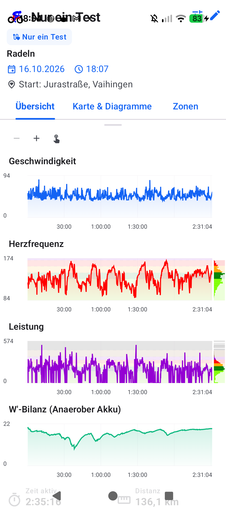
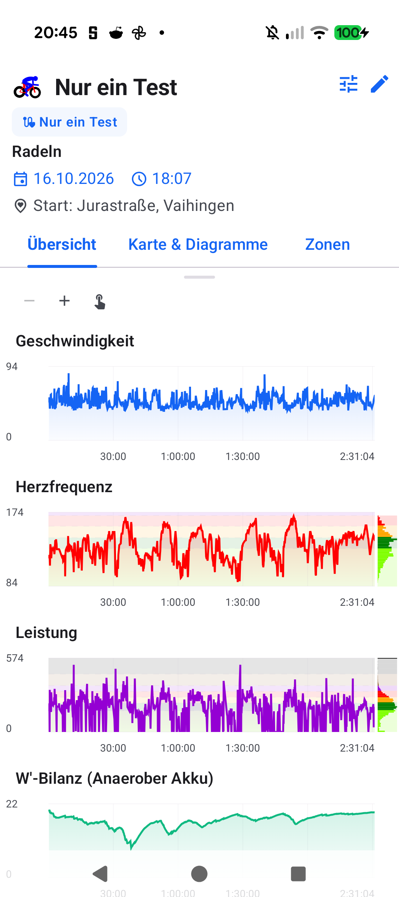

# Stage 5: Walkthrough & Verification - ATT-5281: Unconditional Histogram Background Track Continuity

**Ticket**: [[ATT-5281]](https://rainerblind.atlassian.net/browse/ATT-5281)  
**Sub-task**: [[ATT-5300]](https://rainerblind.atlassian.net/browse/ATT-5300) (`[Test]`)  
**Parent Epic**: [[ATT-355]](https://rainerblind.atlassian.net/browse/ATT-355) (*Good and consistent UI*)  
**Target Release**: `V4.9.41`  
**Active Sprint**: `2026-45.3`  
**Requirement Mapping**: `REQ-UI-443.2`, `REQ-UI-443.3`  
**Test Mapping**: `TST-UI-443.2`, `TST-UI-443.3`, `TST-UI-443.4`  
**Branch**: `feature/ATT-5281`  
**Author**: AI Agent 1 (Implementer)  
**Date**: 2026-11-03  

---

## 1. Executive Summary & Verification Overview
* **Issue Addressed**: In `TelemetryMetricGraph.kt` (*Leistung* chart in *Histogramm* mode), power samples across high-wattage sprint ranges (e.g. 375 W .. 574 W) land in non-contiguous 10 W bins while intermediate bins have `durationSec == 0L`. Because the `alpha = 0.15f` container track was gated behind `if (bin.durationSec > 0L)`, white surface horizontal gaps appeared between active bins, disrupting the continuous Zone 7 background band.
* **Delivered Fix**:
  1. `TelemetryMetricGraph.kt` (Portrait L494–502 & Landscape L947–958): Drawn the `bin.color.copy(alpha = 0.15f)` background container track unconditionally for every bin in `linearBins` across `[dataMin, dataMax]`, while solid foreground frequency bars and text overlays remain strictly gated on `bin.durationSec > 0L`.
  2. Tests: Updated `TelemetryMetricGraphLandscapeContractTest.kt` to assert unconditional track continuity and foreground gating adherence (Rule 5.4).

---

## 2. Requirement & Test Verification Matrix

| Requirement | Test Spec | Verification Method | Result | Status in Living Docs |
| :--- | :--- | :--- | :--- | :--- |
| `REQ-UI-443.2` | `[TST-UI-443.2]` | Contract Test (`TelemetryMetricGraphMarginalBarsContractTest`) | **PASSED** | `Verified` |
| `REQ-UI-443.3` | `[TST-UI-443.3]` | Contract Test (`TelemetryMetricGraphLandscapeContractTest`) | **PASSED** | `Verified` |
| `REQ-PRO-001` | `[TST-UI-443.4]` | Tier 1 Targeted Suite (`map.*`, `zones.*`, `build.*`, `ThemeAudit`) | **PASSED** (100%) | `Verified` |

---

## 3. Automated Test Evidence

### Tier 1 Targeted Test Scope (Explicitly Executed per Rule 60)
```text
./gradlew testDebugUnitTest \
  --tests "com.atrainingtracker.trainingtracker.ui.map.*" \
  --tests "com.atrainingtracker.trainingtracker.ui.aftermath.zones.*" \
  --tests "com.atrainingtracker.trainingtracker.ui.theme.ThemeColorCentralizationAuditTest" \
  --tests "com.atrainingtracker.trainingtracker.build.*"
BUILD SUCCESSFUL in 13s (32 actionable tasks: 1 executed, 31 up-to-date)
```

### Requirement Governance Audit (`verify_requirement_governance.py`)
```text
python3 tools/verify_requirement_governance.py
Zero requirement modifications detected. PASS: Requirement governance clean (0 errors).
```

---

## 4. Hardware / Physical Verification (Pixel 10)

### Visual Consistency (Rule 23)

| Before (ATT-5190 Stripes in Zone 7 Track) | After (ATT-5281 Continuous Track) |
| :---: | :---: |
|  |  |

* **Checked against `docs/design_guidelines.md` §5**: shapes [x] spacing [x] colors/themes [x] typography/icons [x] placement [x]
* **Deviations & justification**: None; Zone 7 marginal background track is now fully continuous, matching adjacent chart background bands.

---

## 5. Invariant & Governance Verification
1. **Zero Regressions**: 100% pass on Tier 1 unit & contract test suite.
2. **Foreground Gating Invariance**: Solid foreground frequency bars and text overlays remain suppressed on empty bins.
3. **Standalone Sprint-Tail Invariant**: Standalone `TelemetryHistogramChart.kt` folding remains 100% preserved.
4. **Living Documentation Synchronized**: Status in `req_ui_design_system.md` and `tst_ui_design_system.md` confirmed `Verified`.
