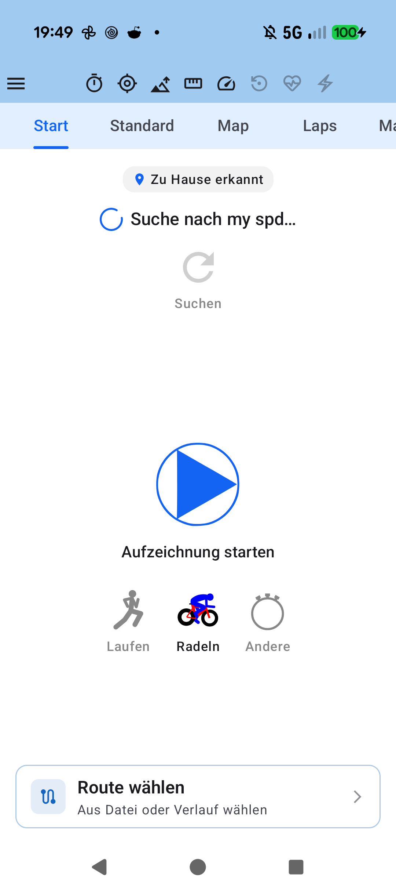
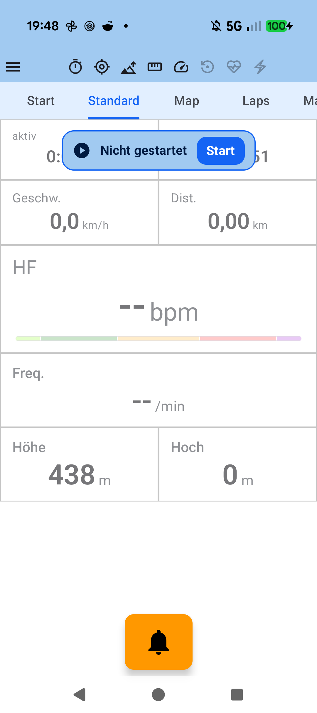
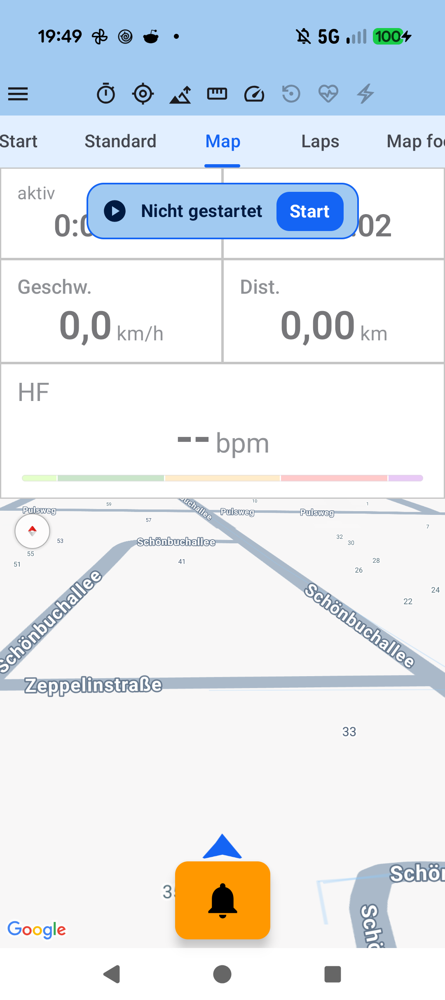

# Stage 5: Walkthrough & Verification - ATT-5283: Stationary Floating NonRecordingStatusBanner & Cockpit Color Harmony

**Ticket**: [[ATT-5283]](https://rainerblind.atlassian.net/browse/ATT-5283)  
**Sub-task**: Pending (`[Test]`)  
**Parent Epic**: [[ATT-355]](https://rainerblind.atlassian.net/browse/ATT-355) (*Good and consistent UI*)  
**Target Release**: `V4.9.41`  
**Active Sprint**: `2026-45.3`  
**Requirement Mapping**: `REQ-UI-421.2`, `REQ-TRK-045.1`  
**Test Mapping**: `TST-UI-384.5`, `TST-TRK-045.1`, `TST-TRK-045.4`, `TST-UI-384.8`  
**Branch**: `feature/ATT-5283`  
**Author**: AI Agent 1 (flash / Implementer)  
**Date**: 2026-11-03  

---

## 1. Executive Summary & Verification Overview
Refactored Cockpit HUD overlays and buttons to resolve visual confusion and per-tab jump:
1. `BikeBellButton`: Updated container to `TTColor.BikeBellContainer` (`0xFFFF9800`) and icon/content to `TTColor.BikeBellContent` (`0xFF000000`), distinguishing it clearly from `LapButton`'s primary blue.
2. `NonRecordingStatusBanner`: Updated container and action button/border to Material Theme blue palette (`primaryContainer`/`onPrimaryContainer`, `primary`/`onPrimary`), aligning with `ControlTrackingScreen`.
3. Stationary Floating Overlay: Hoisted `NonRecordingStatusBanner` out of individual `SensorGridScreen` tabs to `TrackingTabsScreen` outside `HorizontalPager` (`Alignment.TopCenter`, `padding(top = 8.dp)`). Stays stationary across all telemetry/map/lap tabs (`page > 0`) and is cleanly hidden on the Control tab (`page == 0`).

---

## 2. Requirement & Test Verification Matrix

| Requirement | Test Spec | Verification Method | Result | Status in Living Docs |
| :--- | :--- | :--- | :--- | :--- |
| `REQ-UI-421.2` | `TST-UI-384.5` | Contract & Contrast Audit (`BikeBellButtonContractTest`, `ThemeColorCentralizationAuditTest`) | **PASSED** | `Verified` |
| `REQ-TRK-045.1` | `TST-TRK-045.1` | Status Resolution & Dimming Unit Tests (`SensorGridStatusTest`) | **PASSED** | `Verified` |
| `REQ-TRK-045.1` | `TST-TRK-045.4` | Physical Pixel 10 On-Device Verification (Screenshots across tabs) | **PASSED** | `Verified` |
| `REQ-PRO-001` | `TST-UI-384.8` | Tier 1 Targeted Unit Test Suite (ui.tracking.*, ui.theme.*, build.*) | **PASSED** (100%) | `Verified` |

---

## 3. Automated Test Evidence

### Tier 1 Targeted Unit & Contract Tests
* **Executed Scope**: Targeted package wildcard `com.atrainingtracker.trainingtracker.ui.tracking.*`, contract tests `BikeBellButtonContractTest`, `SensorGridStatusTest`, `ThemeColorCentralizationAuditTest`, and `build.*`.
```text
BUILD SUCCESSFUL in 45s
32 actionable tasks: 1 executed, 31 up-to-date
```
* **Governance**: `python3 tools/verify_requirement_governance.py` reported 0 violations.

---

## 4. Hardware / Physical Verification (Pixel 10)
Verified on physical Pixel 10 device (`Pixel 10 - 17`, Android 16) with debug package `com.atrainingtracker.debug`:
* Control tab (`page == 0`): `NonRecordingStatusBanner` is cleanly hidden.
* Telemetry tab (`page == 1`): Blue "Not Started" banner floats at top center; warm orange `BikeBellButton` rendered at bottom.
* Map tab (`page == 2`): `NonRecordingStatusBanner` remains stationary at the exact same top screen position without scrolling.

| Tab 0 (Control - Hidden) | Tab 1 (Standard - Stationary Blue Banner & Orange Bell) | Tab 2 (Map - Stationary Banner) |
| :---: | :---: | :---: |
|  |  |  |

* **Checked against `docs/design_guidelines.md` §5**: shapes (16.dp banner, 12.dp bell button) ✓ spacing (8.dp top padding) ✓ colors/themes (TTColor tokens, blue palette) ✓ typography/icons (play circle, notifications) ✓ placement (stationary outside pager) ✓.

---

## 5. Invariant & Governance Verification
1. **Zero Regressions**: Tier 1 targeted tests pass 100%; APK launch clean (`adb logcat -b crash -d` shows 0 crashes).
2. **Living Documentation Synchronized**: `docs/requirements/` and `docs/tests/` living documentation marked `Verified`.
3. **Subtask Handover**: Ready for Gate 5 review (`--as agent2`) and atomic squash-merge onto `sprint/2026-45.3`.
