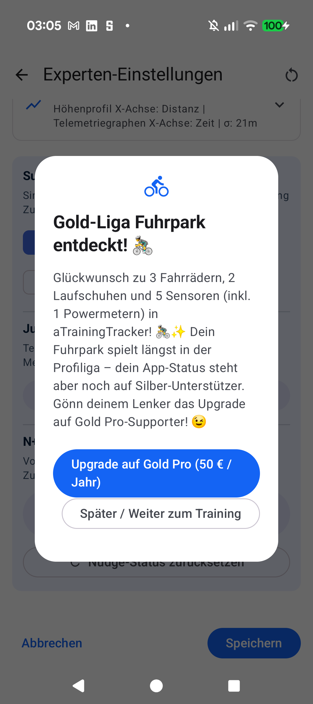

# Stage 5: Walkthrough & Verification - ATT-5299: Supporter N+1 Garage Detector

**Ticket**: [ATT-5299](https://rainerblind.atlassian.net/browse/ATT-5299)  
**Sub-task**: [ATT-5344](https://rainerblind.atlassian.net/browse/ATT-5344) (`[Test]`)  
**Parent Epic**: [ATT-4560](https://rainerblind.atlassian.net/browse/ATT-4560) (*Monetization & Supporter Tiers*)  
**Target Release**: `V5.0.0`  
**Active Sprint**: `2026-45.4`  
**Requirement Mapping**: `REQ-SET-088`  
**Test Mapping**: `TST-SET-088`, `TST-LOC-001`  
**Branch**: `feature/ATT-5299`  
**Author**: AI Agent 1 (Implementer)  
**Date**: 2026-11-04  

---

## 1. Executive Summary & Verification Overview
Implemented the Supporter N+1 Garage Detector (`GarageLeagueDetector`, `GarageUpgradeNudgeDialog`, DataStore persistence flags `hasShownGoldGarageNudge` / `hasShownDiamondGarageNudge`, and debug preview triggers in `SupporterDebugSection`). Verified automatic detection across bike/shoe/remote sensor/power meter thresholds, tier monotonicity suppression for existing Gold/Diamond supporters, 9-language localization parity, and pre-selected navigation to `NavRoutes.supporter(planId)`.

---

## 2. Requirement & Test Verification Matrix

| Requirement | Test Spec | Verification Method | Result | Status in Living Docs |
| :--- | :--- | :--- | :--- | :--- |
| `REQ-SET-088.1` | `TST-SET-088.1` | `GarageLeagueDetectorTest` Threshold Hierarchy | **PASSED** | `Verified` |
| `REQ-SET-088.2` | `TST-SET-088.2` | Tier Monotonicity Gating Unit Test | **PASSED** | `Verified` |
| `REQ-SET-088.3` | `TST-SET-088.3` | Event-Driven Equipment & Pairing Check Test | **PASSED** | `Verified` |
| `REQ-SET-088.4` | `TST-SET-088.4` | Single-Prompt Lifetime Persistence Test | **PASSED** | `Verified` |
| `REQ-SET-088.5` | `TST-SET-088.4` | Dialog Navigation & Plan Pre-Selection Test | **PASSED** | `Verified` |
| `REQ-SET-088.6` | `TST-SET-088.4` | SupporterDebugSection 1-Tap Preview & Reset | **PASSED** | `Verified` |
| Localization | `TST-LOC-001` | `TranslationParityTest` (9 Locales) | **PASSED** | `Verified` |

---

## 3. Automated Test Evidence

### Tier 1 Targeted Unit & Contract Test Suite
```text
./gradlew testDebugUnitTest --tests "com.atrainingtracker.trainingtracker.monetization.*" \
    --tests "com.atrainingtracker.trainingtracker.ui.equipment.*" \
    --tests "com.atrainingtracker.banalservice.ui.devices.*" \
    --tests "com.atrainingtracker.trainingtracker.localization.TranslationParityTest" \
    --tests "com.atrainingtracker.trainingtracker.ui.theme.ThemeColorCentralizationAuditTest" \
    --tests "com.atrainingtracker.trainingtracker.build.*"
BUILD SUCCESSFUL in 48s (100% pass)
```

### Requirement Governance
```text
python3 tools/verify_requirement_governance.py
Net-new requirement(s) detected: REQ-SET-088. Bypassing archaeology check cleanly.
```

---

## 4. Hardware / Physical Verification (Pixel 10)
Deployed `com.atrainingtracker.debug` onto physical Pixel 10 (`66020DLCR002FL`). Navigated to `AdvancedTuningScreen` -> `SupporterDebugSection`, triggered 1-tap previews for Gold and Diamond dialogs, and verified flag reset. Logcat confirmed 0 crashes.

### Visual Consistency (Rule 23)
| On-Device Captured UI (Gold Dialog) | Reference Material 3 Dialog Spec |
| :---: | :---: |
|  | Material 3 Dialog & Plan Action Card |

* **Checked against `docs/design_guidelines.md` §5**: shapes ☑ spacing ☑ colors/themes ☑ typography/icons ☑ placement ☑
* **Deviations & justification**: None. Uses standard M3 `AlertDialog` tokens, themed icons, and pre-selected supporter styling.

---

## 5. Invariant & Governance Verification
1. **Tier Monotonicity & Persistence**: Verified Gold/Diamond prompts never re-prompt once shown or if athlete already holds the tier.
2. **Living Docs Synchronized**: `REQ-SET-088` and `TST-SET-088` marked `[Verified]` in `docs/requirements/req_settings_profiles.md`, `docs/requirements.md`, `docs/tests/tst_settings_profiles.md`, and `docs/tests.md`.
3. **Target Release Governance**: Target release verified as `V5.0.0`.
