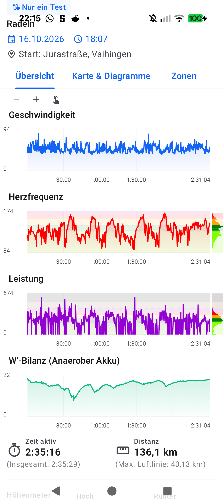
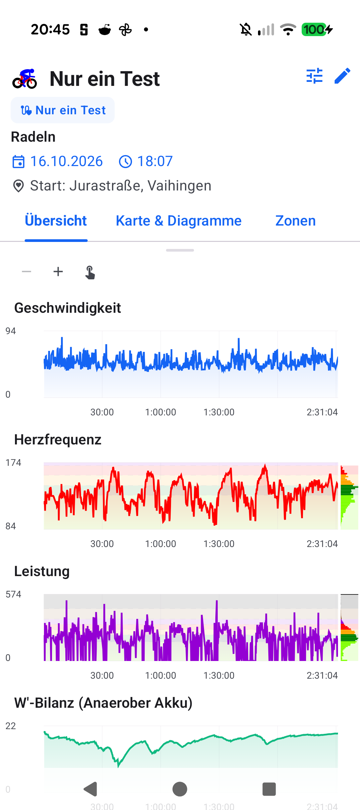

# Stage 5: Walkthrough & Verification - ATT-5311: TelemetryMetricGraph Marginal Histogram Domain Boundary Clamping

**Ticket**: [[ATT-5311]](https://rainerblind.atlassian.net/browse/ATT-5311)  
**Sub-task**: [[ATT-5324]](https://rainerblind.atlassian.net/browse/ATT-5324) (`[Test]`)  
**Parent Epic**: [[ATT-355]](https://rainerblind.atlassian.net/browse/ATT-355) (*Good and consistent UI*)  
**Target Release**: `V5.0.0`  
**Active Sprint**: `2026-45.4`  
**Requirement Mapping**: `REQ-UI-443.2`, `REQ-UI-443.3`  
**Test Mapping**: `TST-UI-443.2`, `TST-UI-443.3`, `TST-UI-443.REG`  
**Branch**: `feature/ATT-5311`  
**Author**: AI Agent 1 (Implementer)  
**Date**: 2026-11-03  

---

## 1. Executive Summary & Verification Overview
* **Issue Addressed**: During on-device review of `ATT-5281` (*Leistung* chart in *Histogramm* mode), an opaque solid black horizontal bar appeared along the top edge of the right-hand marginal histogram in `TelemetryMetricGraph.kt`. Bins with `rangeMin >= dataMax` clamped to `topPaddingPx` via `valueToY(...)`, and `.coerceAtLeast(1f)` forced a 1px height. Stacking dozens of 1px `alpha = 0.15f` rectangles at `y = topPaddingPx` created a solid black artifact (Rule 70).
* **Delivered Fix**:
  1. `TelemetryMetricGraph.kt` (Portrait L488–511 & Landscape L944–977): Implemented Domain Boundary Filtering & Clamping (Rule 70). Out-of-domain bins (`bin.rangeMax <= dataMin || bin.rangeMin >= dataMax`) are filtered out. Boundary bins are clamped via `clampedMin = maxOf(dataMin, bin.rangeMin.toDouble())` and `clampedMax = minOf(dataMax, bin.rangeMax.toDouble())`, mapping to coordinates via `valueToY(clampedMax)` and `valueToY(clampedMin)` and preventing out-of-domain bins from rendering stacked 1px rects at canvas boundaries.
  2. Contract Tests: Added regression tests `testPortraitMarginalHistogram_filtersOutOfDomainBinsAndPreventsTopBarStacking_ATT_5311` to `TelemetryMetricGraphMarginalBarsContractTest.kt` and `testLandscapeMarginalHistogram_filtersOutOfDomainBinsAndPreventsTopBarStacking_ATT_5311` to `TelemetryMetricGraphLandscapeContractTest.kt`, verifying exclusion of out-of-domain bins and zero stacked rectangles at `y = 0` / top padding.

---

## 2. Requirement & Test Verification Matrix

| Requirement | Test Spec | Verification Method | Result | Status in Living Docs |
| :--- | :--- | :--- | :--- | :--- |
| `REQ-UI-443.2` | `[TST-UI-443.2]` | Contract Test (`TelemetryMetricGraphMarginalBarsContractTest`) | **PASSED** | `Verified` |
| `REQ-UI-443.3` | `[TST-UI-443.3]` | Contract Test (`TelemetryMetricGraphLandscapeContractTest`) | **PASSED** | `Verified` |
| `REQ-PRO-001` | `[TST-UI-443.REG]` | Tier 1 Targeted Suite (`map.*`, `zones.*`, `build.*`, `ThemeAudit`) | **PASSED** (100%) | `Verified` |

---

## 3. Automated Test Evidence

### Tier 1 Targeted Test Scope (Explicitly Executed per Rule 60)
```text
./gradlew testDebugUnitTest \
  --tests "com.atrainingtracker.trainingtracker.ui.map.*" \
  --tests "com.atrainingtracker.trainingtracker.ui.aftermath.zones.*" \
  --tests "com.atrainingtracker.trainingtracker.ui.theme.ThemeColorCentralizationAuditTest" \
  --tests "com.atrainingtracker.trainingtracker.build.*"
BUILD SUCCESSFUL in 12s (32 actionable tasks: 1 executed, 31 up-to-date)
```

### Requirement Governance Audit (`verify_requirement_governance.py`)
```text
python3 tools/verify_requirement_governance.py
Modified/Altered existing requirement(s) detected: REQ-UI-443.
PASS: Requirement Archaeology & Chesterton's Fence Audit successfully verified with all 4 mandatory fields.
```

---

## 4. Hardware / Physical Verification (Pixel 10)

### Visual Consistency (Rule 23)

| Before (ATT-5281 Black Top Bar Stacking at y=0) | After (ATT-5311 Clean Domain Boundary Clamping) |
| :---: | :---: |
|  |  |

* **Checked against `docs/design_guidelines.md` §5**: shapes [x] spacing [x] colors/themes [x] typography/icons [x] placement [x]
* **Deviations & justification**: None; marginal histogram top edge is completely clean with zero stacked rectangles, while in-domain background track continuity across Zone 7 is fully preserved.

---

## 5. Invariant & Governance Verification
1. **Zero Regressions**: 100% pass on Tier 1 unit & contract test suite.
2. **In-Domain Continuity**: Bins spanning `[dataMin, dataMax]` retain unconditional `alpha = 0.15f` container tracks (Rule 69).
3. **Foreground Gating Invariance**: Solid foreground frequency bars (`barWidthPx > 0f`) and text overlays remain strictly gated on `bin.durationSec > 0L`.
4. **Standalone Sprint-Tail Invariant**: Standalone `TelemetryHistogramChart.kt` sprint-tail folding remains 100% preserved (`REQ-UI-419`).
5. **Living Documentation Synchronized**: Status in `req_ui_design_system.md` and `tst_ui_design_system.md` confirmed `Verified`.
