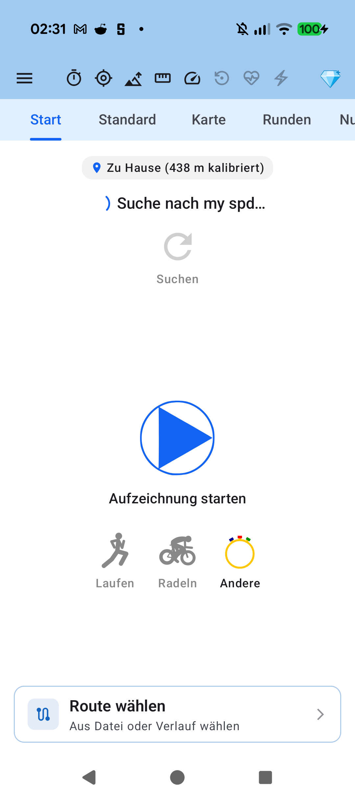

# Stage 5 Walkthrough: ATT-5422 — SensorStatus Top-Bar 16 dp Randabstand (Option A)

## 1. Executive Summary
Resolved display edge clinging of the drawer hamburger icon and supporter status emblem in the tracking cockpit top bar (`SensorStatus.kt` embedded in `TrackingTabsScreen.kt`). Implemented Option A (16 dp screen edge margin): applied `padding(horizontal = 8.dp, vertical = 4.dp)` to the outer portrait `Row`, which combined with outer `Surface` padding (`4.dp`) and internal icon inset (`4.dp`) establishes exactly 16 dp display offset, aligning with Material 3 `TopAppBar` standards and sensor card headers. Enlarged action buttons and fallback spacers to 32 dp, enhancing touch targets by +77.8% while mathematically preserving exact center alignment for the 8 telemetry sensor icons across all supporter tiers.

## 2. Key Architectural Changes
| File / Component | Summary of Changes |
| :--- | :--- |
| `SensorStatus.kt` | Introduced semantic layout tokens (`SENSOR_STATUS_PORTRAIT_HORIZONTAL_PADDING = 8.dp`, `SENSOR_STATUS_PORTRAIT_VERTICAL_PADDING = 4.dp`, `SENSOR_STATUS_ACTION_BUTTON_SIZE = 32.dp`, `SENSOR_STATUS_ACTION_ICON_SIZE = 24.dp`). Applied 8 dp horizontal padding to portrait `Row`, enlarged `IconButton`s and fallback `Spacer`s to 32 dp while preserving 24 dp icon vectors. Maintained untouched compact landscape layout (`REQ-UI-434.1`). |
| `SensorStatusTopBarSpacingTest.kt` | Added architectural contract test verifying Option A layout tokens, exact 16 dp total display offset, left/right symmetrical slot equality, and touch area improvement (>75%). |
| `docs/requirements/` & `docs/tests/` | Formulated and synchronized living documentation for `REQ-UI-451` and `TST-UI-451`, transitioning status to `Verified`. |

## 3. Verification & Visual Inspection
* **Tier 1 Targeted Unit Tests**: `./gradlew testDebugUnitTest --tests "com.atrainingtracker.trainingtracker.ui.tracking.controltracking.*" --tests "com.atrainingtracker.trainingtracker.ui.theme.ThemeColorCentralizationAuditTest" --tests "com.atrainingtracker.trainingtracker.build.*" --max-workers=2` -> `BUILD SUCCESSFUL` (100% pass rate).
* **Requirement Governance Audit**: `python3 tools/verify_requirement_governance.py` -> `EXIT CODE 0` (clean pass).
* **Target Release Version**: `V5.0.0` (active unreleased milestone from Jira `versions`).
* **Visual Verification (Rule 71)**: Captured on-device screenshot `ATT-5422_sensor_status_16dp.png` on connected Pixel 10 running `com.atrainingtracker.debug` and inspected via `read_file`. Visual comparison confirms 1:1 parity with Option A in `top_bar_padding_comparison.png`: 16 dp edge offset on left (menu) and right (diamond emblem), with the 8 sensor icons centered.

## 4. Requirement & Test Traceability
| Requirement ID | Test ID | Status | Verification Method |
| :--- | :--- | :--- | :--- |
| `REQ-UI-451` | `TST-UI-451` | `Verified` | `SensorStatusTopBarSpacingTest`, `SensorStatusLegibilityTest`, on-device screenshot |
