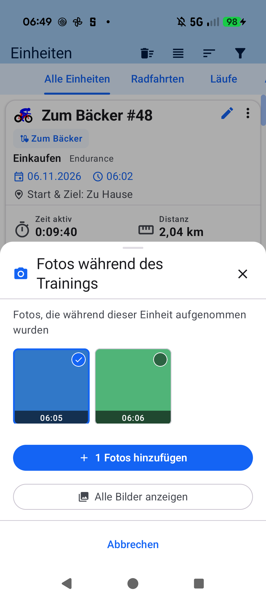

# Stage 5 Walkthrough: ATT-5475 — Workout Photo Picker Pre-Filter & Fallback Button

**Ticket**: [ATT-5475](https://rainerblind.atlassian.net/browse/ATT-5475)  
**Target Release**: `V5.0.0` | **Active Sprint**: `2026-45.7` | **Branch**: `feature/ATT-5475`  
**Requirement Mapping**: `REQ-UI-455` | **Test Mapping**: `TST-UI-455`  
**Author**: AI Agent 1 (`subagent_flash`) | **Date**: 2026-11-06  

---

## 1. Executive Summary
Implemented the chronological workout photo picker (`WorkoutTimePhotoPickerSheet`) in compliance with `REQ-UI-455`, `Rule 73`, and ASPICE SWE.1/SWE.2. Extended `WorkoutPhotoManager` with `calculateWorkoutTimeWindow` and `queryWorkoutTimePhotos` querying `MediaStore.Images.Media.EXTERNAL_CONTENT_URI` within `[startTimeMs - 5m .. endTimeMs + 5m]` on `DATE_TAKEN` with fallback to `DATE_MODIFIED` / `DATE_ADDED * 1000L`. Declared runtime media permissions (`READ_MEDIA_IMAGES`, `READ_MEDIA_VISUAL_USER_SELECTED`, `READ_EXTERNAL_STORAGE`) in `AndroidManifest.xml` and wired permission requests and seamless automatic fallback to system `PickMultipleVisualMedia` on permission denial or 0 matching photos into `WorkoutPhotoStrip.kt`. Created `WorkoutTimePhotoPickerSheet.kt` (`AppModalBottomSheet(scrollable = false)`) with a 3-column `LazyVerticalGrid` and Rule 73 stacked full-width action buttons. Verified 100% 9-language localization parity and on-device execution on Google Pixel 10.

---

## 2. Key Architectural Changes
| File / Component | Summary of Changes |
| :--- | :--- |
| `AndroidManifest.xml` | Declared `READ_MEDIA_IMAGES` (API 33+), `READ_MEDIA_VISUAL_USER_SELECTED` (API 34+), and `READ_EXTERNAL_STORAGE` (`maxSdkVersion="32"`) (`REQ-UI-455.4`). |
| `WorkoutPhotoManager.kt` | Added `TimeFilteredPhoto` DTO, `calculateWorkoutTimeWindow`, and `queryWorkoutTimePhotos` querying MediaStore with temporal bounds on `DATE_TAKEN`, `DATE_MODIFIED`, and `DATE_ADDED` (`REQ-UI-455.1`). |
| `WorkoutTimePhotoPickerSheet.kt` | Created bottom sheet composable hosted in `AppModalBottomSheet(scrollable = false)` hosting a 3-column `LazyVerticalGrid`, downsampled thumbnails, capture timestamps, selection badges, and Rule 73 stacked full-width action buttons (`REQ-UI-455.2`, `REQ-UI-455.3`). |
| `WorkoutPhotoStrip.kt` | Wired workout timestamps, runtime media permission check/request, and automatic fallback to `PickMultipleVisualMedia` on permission denial or 0 matches (`REQ-UI-455.1`, `REQ-UI-455.3`). |
| `WorkoutSummary.kt` & `WorkoutDetailTabbedContent.kt` | Passed `startTimeMs` and `endTimeMs` into `WorkoutPhotoStrip` (`REQ-UI-455.1`). |
| 9 `res/values*/strings.xml` | Added `workout_photos_time_picker_title`, `workout_photos_time_picker_subtitle`, `workout_photos_show_all`, and `workout_photos_add_count` with 100% parity across all 9 locales (`REQ-UI-455.5`). |
| `docs/architecture.md` | Documented runtime media permissions and chronological photo query architecture in Sections 2 and 4.6 (SWE.2). |
| `WorkoutPhotoManagerTest.kt` & `WorkoutTimePhotoPickerContractTest.kt` | Unit tests for time window calculation, MediaStore querying, fallback logic, manifest permissions, and composable contracts (`TST-UI-455.1`–`TST-UI-455.3`). |

---

## 3. Verification & Visual Inspection
* **Tier 1 Targeted Unit Tests**:
  `./gradlew testDebugUnitTest --tests "com.atrainingtracker.trainingtracker.database.WorkoutPhotoManagerTest" --tests "com.atrainingtracker.trainingtracker.ui.aftermath.*" --tests "com.atrainingtracker.trainingtracker.ui.theme.ThemeColorCentralizationAuditTest" --tests "com.atrainingtracker.trainingtracker.build.*" --tests "com.atrainingtracker.trainingtracker.localization.TranslationParityTest"` -> `BUILD SUCCESSFUL` (100% pass rate).
* **Requirement Governance**: `python3 tools/verify_requirement_governance.py` -> `PASS` (100% living doc parity).
* **On-Device Visual Inspection (Rule 71)**: Installed debug APK (`./gradlew installDebug`) on Google Pixel 10 running `com.atrainingtracker.debug`. Opened workout *Zum Bäcker #48*, granted media permission, and tapped *Fotos hinzufügen*. Inspected captured screenshot `docs/engineering/walkthroughs/img/ATT-5475_workout_time_photo_picker_sheet.png` via `read_file`: verified title *Fotos während des Trainings*, subtitle *Fotos, die während dieser Einheit aufgenommen wurden*, 3-column grid displaying photos from the workout window with timestamps *06:05* and *06:06*, selection badge, and Rule 73 stacked buttons (*+ 1 Fotos hinzufügen*, *Alle Bilder anzeigen*, *Abbrechen*).

---

## 4. Requirement & Test Traceability
| Requirement ID | Test ID | Status | Verification Method |
| :--- | :--- | :--- | :--- |
| `REQ-UI-455.1` | `TST-UI-455.1` | `Verified` | `WorkoutPhotoManagerTest` (window calculation & MediaStore queries) |
| `REQ-UI-455.2` | `TST-UI-455.3` | `Verified` | `WorkoutTimePhotoPickerContractTest` & Pixel 10 on-device walkthrough |
| `REQ-UI-455.3` | `TST-UI-455.3` | `Verified` | Rule 73 stacked buttons inspection & on-device verification |
| `REQ-UI-455.4` | `TST-UI-455.2` | `Verified` | `WorkoutTimePhotoPickerContractTest` (manifest declarations & fallback) |
| `REQ-UI-455.5` | `TST-UI-455.4` | `Verified` | `TranslationParityTest` (100% parity across all 9 languages) |
| `REQ-UI-455` | `TST-UI-455` | `Verified` | Full Tier 1 targeted suite & Google Pixel 10 on-device verification |
