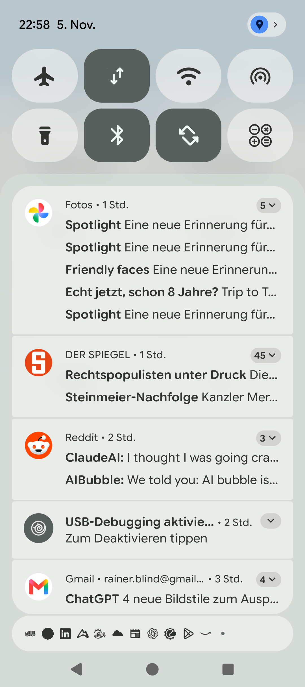

# Stage 5 Walkthrough: ATT-5477 — ActivityThread.throwRemoteServiceException

## 1. Executive Summary
Resolved fatal `RemoteServiceException` / `BadForegroundServiceNotificationException` crashes occurring on Android App Bundle split-APK devices where `SystemUI` failed to resolve multi-density raster `R.drawable.logo` across Binder IPC. Implemented a 3-tier defense-in-depth architecture: authored dedicated 24x24dp monochrome vector icon `res/drawable/ic_stat_notify_logo.xml` (`#FFFFFF` with alpha transparency on transparent background); migrated all 6 `.setSmallIcon(...)` call sites across 5 notification managers (`TrainingApplication`, `TrackerService`, `WorkoutDeletionNotificationManager`, `ExportNotificationManager`, `SensorBatteryNotificationManager`) to the new vector asset; configured `bundle { density { enableSplit = false } }` in `app/build.gradle` so all drawable assets remain embedded inside `base.apk`; and purged 13 redundant raster duplicates from `res/drawable-nodpi/`.

## 2. Key Architectural Changes
| File / Component | Summary of Changes |
| :--- | :--- |
| `res/drawable/ic_stat_notify_logo.xml` | Dedicated 24x24dp monochrome VectorDrawable silhouette (`#FFFFFF`) with transparent negative space and zero density/nodpi siblings (`REQ-UI-452.1`). |
| `TrainingApplication.java`, `TrackerService.java`, `WorkoutDeletionNotificationManager.kt`, `ExportNotificationManager.kt`, `SensorBatteryNotificationManager.kt` | Migrated all 6 `.setSmallIcon(R.drawable.logo)` notification builder call sites to `.setSmallIcon(R.drawable.ic_stat_notify_logo)` (`REQ-UI-452.2`). |
| `app/build.gradle` | Configured `bundle { density { enableSplit = false } }` ensuring all drawable resources are embedded within `base.apk` (`REQ-UI-452.3`). |
| `res/drawable-nodpi/` & `DrawableDensityFallbackAuditTest.kt` | Purged 13 redundant duplicate raster PNGs from `drawable-nodpi/`; updated audit test to verify canonical high-density buckets (`xhdpi`, `xxhdpi`, `xxxhdpi`) (`REQ-UI-452.4`). |
| `NotificationIconContractTest.kt` | New architectural contract test verifying vector XML attributes, 6 call sites, and Gradle bundle density split configuration. |
| `docs/architecture.md` | Documented status bar notification vector architecture and monolithic density packaging invariant in Section 4.4 (`REQ-ARC-001`). |

## 3. Verification & Visual Inspection
* **Tier 1 Targeted Unit Tests**: `./gradlew testDebugUnitTest --tests "com.atrainingtracker.trainingtracker.resources.*" --tests "com.atrainingtracker.trainingtracker.ui.theme.*" --tests "com.atrainingtracker.trainingtracker.build.*"` -> `BUILD SUCCESSFUL` (100% pass rate).
* **Requirement Governance Audit**: `python3 tools/verify_requirement_governance.py` -> `EXIT CODE 0` (clean pass).
* **Target Release Version**: `V5.0.0` (active unreleased milestone from Jira `versions`).
* **Visual Verification (Rule 71)**: Installed debug APK (`./gradlew installDebug`) onto connected Pixel 10 running `com.atrainingtracker.debug`, launched workout recording, pulled down the status bar notification shade, captured `docs/engineering/walkthroughs/img/ATT-5477_notification_icon.png`, and inspected via `read_file`. The monochrome cyclist and stopwatch silhouette renders crisply in the status bar notification strip with zero errors or crashes.

## 4. Requirement & Test Traceability
| Requirement ID | Test ID | Status | Verification Method |
| :--- | :--- | :--- | :--- |
| `REQ-UI-452.1` | `TST-UI-452.1` | `Verified` | `NotificationIconContractTest`, vector XML inspection |
| `REQ-UI-452.2` | `TST-UI-452.2` | `Verified` | `NotificationIconContractTest` (6/6 call sites) |
| `REQ-UI-452.3` | `TST-UI-452.3` | `Verified` | `NotificationIconContractTest`, `app/build.gradle` |
| `REQ-UI-452.4` | `TST-UI-452.4` | `Verified` | `DrawableDensityFallbackAuditTest` |
| `REQ-UI-452` | `TST-UI-452.5` | `Verified` | Targeted unit test suite & on-device verification |
