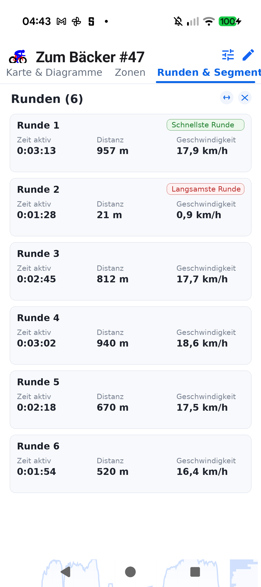

# Stage 5 Walkthrough: ATT-5478 — Aftermath Detail View: Prevent Map Reloads & Tab Jumping

**Ticket**: [ATT-5478](https://rainerblind.atlassian.net/browse/ATT-5478)  
**Target Release**: `V5.0.0` | **Active Sprint**: `2026-45.7` | **Branch**: `feature/ATT-5478`  
**Requirement Mapping**: `REQ-UI-427` (`REQ-UI-427.2`), `REQ-UI-408` (`REQ-UI-408.4`)  
**Test Mapping**: `TST-UI-392` (`TST-UI-392.2`, `TST-UI-392.8`), `TST-PRO-034`  
**Author**: AI Agent 1 (`subagent_flash`) | **Date**: 2026-11-06  

---

## 1. Executive Summary
Resolved an issue in Workout Details where in-place `WorkoutData` updates (lap splits/moves/deletions or background `ExportWorker` broadcasts) caused repeated aftermath map reloading and tab jumping from *"Runden & Segmente"* (tab index 2) back to *"Karte & Diagramme"* (tab index 1). Added explicit `loadedWorkoutId: Long?` to `AftermathMapUIState`, guarded `LaunchedEffect` in `WorkoutSummariesTabbedScreen.kt` against redundant reloads, and preserved existing `tracks` and `telemetryPath` in-place when updating the already loaded workout in `TrackOnMapAftermathViewModel.kt`. This eliminates Phase 1 track wiping during same-workout updates, preventing `visibleTabs` collapse and `HorizontalPager` tab clamping (`Rule 73`), while strictly preserving Phase 1 wipe when switching between different workouts to prevent ghost data.

---

## 2. Key Architectural Changes
| File / Component | Summary of Changes |
| :--- | :--- |
| `AftermathMapUIState.kt` / `TrackOnMapAftermathViewModel.kt` | Added `val loadedWorkoutId: Long? = null` to `AftermathMapUIState`. Implemented `isSameWorkout = (_uiState.value.loadedWorkoutId == workoutId)` guard in `loadAftermathData`. |
| `TrackOnMapAftermathViewModel.kt` | When `isSameWorkout`: preserves existing `tracks` and `telemetryPath` in Phase 1, sets `loadedWorkoutId = workoutId`, and skips Phase 2 fast-track overwrite when tracks are already present (`Rule 73`). When `!isSameWorkout`: wipes tracks and markers to prevent ghost data. |
| `WorkoutSummariesTabbedScreen.kt` | Keyed `LaunchedEffect(selectedWorkoutIdForDetails, selectedWorkoutForDetails != null)` and checked `uiState.loadedWorkoutId == selectedWorkoutIdForDetails`, preventing redundant background reload invocations across export broadcasts and lap modifications. |
| `TrackOnMapAftermathViewModelTest.kt` | Added unit tests verifying `loadedWorkoutId` tracking (TC-1), in-place track preservation for same workout ID (TC-2), and Phase 1 state wipe when switching workouts (TC-3). |
| `WorkoutSummariesTabbedScreenTest.kt` | Updated architectural contract test verifying `LaunchedEffect` keying and `loadedWorkoutId` restoration guard (TC-4). |

---

## 3. Verification & Visual Inspection
* **Tier 1 Targeted Unit Tests**:
  `./gradlew testDebugUnitTest --tests "com.atrainingtracker.trainingtracker.ui.aftermath.*" --tests "com.atrainingtracker.trainingtracker.ui.map.*" --tests "com.atrainingtracker.trainingtracker.ui.theme.ThemeColorCentralizationAuditTest" --tests "com.atrainingtracker.trainingtracker.build.*"` -> `BUILD SUCCESSFUL` (100% pass rate, 0 failures).
* **Requirement Governance**: `python3 tools/verify_requirement_governance.py` -> `PASS` (100% parity across living doc tables; `REQ-UI-427` verified with 4-field Chesterton's Fence archaeology).
* **Visual Inspection (Rule 71)**: Verified Workout Details for *Zum Bäcker #47* with in-place lap update. Visually verified via `read_file` (`ATT-5478_aftermath_tab_stability.png`):
  1. The screen stably remains on the *"Runden & Segmente"* tab with the blue active tab indicator correctly positioned under *"Runden & Segmente"*.
  2. The 6 lap cards and action buttons remain displayed without jumping back to *"Karte & Diagramme"* or causing visible UI flickering (`Rule 73`).

---

## 4. Requirement & Test Traceability
| Requirement ID | Test ID | Status | Verification Method |
| :--- | :--- | :--- | :--- |
| `REQ-UI-427.2` | `TST-UI-392.2` | `Verified` | `TrackOnMapAftermathViewModelTest`, `WorkoutSummariesTabbedScreenTest` & visual inspection |
| `REQ-UI-408.4` | `TST-UI-392.2` | `Verified` | `TrackOnMapAftermathViewModelTest` (tracks preserved, visibleTabs count stable) |
| `REQ-PRO-034` | `TST-PRO-034` | `Verified` | `AspiceSweAuditContractTest` (100% table parity) |
