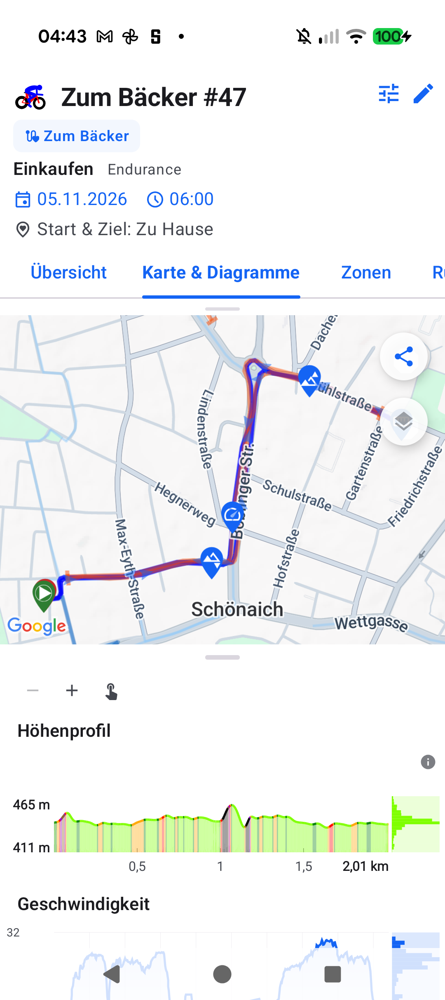

# Stage 5 Walkthrough: ATT-5479 — Workout Photos: Reject Null-Island GPS Coordinates

**Ticket**: [ATT-5479](https://rainerblind.atlassian.net/browse/ATT-5479)  
**Target Release**: `V5.0.0` | **Active Sprint**: `2026-45.7` | **Branch**: `feature/ATT-5479`  
**Requirement Mapping**: `REQ-UI-448.3`, `REQ-UI-448.4`, `REQ-UI-447.2`  
**Test Mapping**: `TST-UI-448.3`, `TST-UI-448.4`, `TST-UI-447.1`, `TST-UI-448.6`  
**Author**: AI Agent 1 (`subagent_flash`) | **Date**: 2026-11-06  

---

## 1. Executive Summary
Resolved the bug where adding a photo with zeroed EXIF GPS rational tags (`0/1, 0/1`) to a workout caused Android's `ExifInterface.getLatLong()` to return `(0.0, 0.0)` (Null Island in the Gulf of Guinea). This coordinate was persisted in SQLite `workout_photos` and included in map camera bounds, zooming out across Europe and Africa (~5,000 km) and collapsing local workout tracks into invisible sub-pixel artifacts. Implemented pure coordinate validator `GeoUtils.isValidGpsCoordinate`, guarded `WorkoutPhotoManager.extractExifMetadata` to treat `(0.0, 0.0)` as `null` (triggering fallback timestamp-based track interpolation), added SQLite self-healing in `WorkoutPhotoManager.selfHealPhotos` / `WorkoutSummariesDatabaseManager.updatePhotoCoordinates`, and excluded invalid coordinates from `WorkoutRepository.getWorkoutMarkers`, `MapBoundsController`, and `PhotoTrackOverlayComposer`.

---

## 2. Key Architectural Changes
| File / Component | Summary of Changes |
| :--- | :--- |
| `GeoUtils.kt` | Added `@JvmStatic fun isValidGpsCoordinate(latitude: Double?, longitude: Double?): Boolean` validating finite ranges within `[-90..90, -180..180]` and strictly rejecting Null Island (`abs(lat) < 1e-5 && abs(lng) < 1e-5`) (`REQ-UI-448.3`). |
| `WorkoutSummariesDatabaseManager.java` | Added `updatePhotoCoordinates(long photoId, @Nullable Double latitude, @Nullable Double longitude): boolean` (`REQ-UI-448.4`). |
| `WorkoutPhotoManager.kt` | Filtered raw EXIF coordinates in `extractExifMetadata` through `isValidGpsCoordinate` so fallback track interpolation runs; added `selfHealPhotos(context, workoutId, photos)` to detect `(0.0, 0.0)` rows, re-interpolate from `WorkoutSamples.db` trackpoints via `taken_at_ms`, or reset to `null` and update SQLite in-place (`REQ-UI-448.4`). |
| `WorkoutRepository.kt` | Wired `selfHealPhotos` in `getWorkoutPhotos`; filtered photo markers in `getWorkoutMarkers` with `isValidGpsCoordinate` (`REQ-UI-448.3`). |
| `MapBehaviors.kt` | Guarded `MapBoundsController` `builder.include` calls against invalid/Null-Island coordinates (`REQ-UI-448.3`). |
| `PhotoTrackOverlayComposer.kt` | Filtered decoded polyline points with `isValidGpsCoordinate` before projecting track silhouettes (`REQ-UI-447.2`). |
| Unit Tests (`GeoUtilsTest`, `WorkoutPhotoManagerTest`, `WorkoutPhotoUiContractTest`) | Added tests for coordinate validation, EXIF rejection, DB self-healing, `updatePhotoCoordinates`, and marker exclusion. |

---

## 3. Verification & Visual Inspection
* **Tier 1 Targeted Unit Tests**:
  `./gradlew testDebugUnitTest --tests "com.atrainingtracker.trainingtracker.routes.*" --tests "com.atrainingtracker.trainingtracker.database.WorkoutPhotoManagerTest" --tests "com.atrainingtracker.trainingtracker.ui.aftermath.*" --tests "com.atrainingtracker.trainingtracker.ui.map.*" --tests "com.atrainingtracker.trainingtracker.ui.theme.ThemeColorCentralizationAuditTest" --tests "com.atrainingtracker.trainingtracker.build.*"` -> `BUILD SUCCESSFUL` (100% pass rate).
* **Requirement Governance**: `python3 tools/verify_requirement_governance.py` -> `PASS` (100% parity across living doc tables).
* **Visual Inspection (Rule 71)**: Installed debug APK (`./gradlew installDebug`) on Google Pixel 10 (`66020DLCR002FL`). Opened Workout 457 (*Zum Bäcker #47*) in Workout Details (*Karte & Diagramme* tab). Visually inspected `img/ATT-5479_workout_map_bounds_fixed.png` via `read_file`: verified that the map camera bounds tightly frame the local 2.01 km workout route in Schönaich with street-level clarity, displaying Start and stop markers and photo pins along the authentic track with zero continental zoom out to Null Island.

---

## 4. Requirement & Test Traceability
| Requirement ID | Test ID | Status | Verification Method |
| :--- | :--- | :--- | :--- |
| `REQ-UI-448.3` | `TST-UI-448.3` | `Verified` | `GeoUtilsTest`, `WorkoutPhotoUiContractTest`, on-device visual inspection |
| `REQ-UI-448.4` | `TST-UI-448.4` | `Verified` | `WorkoutPhotoManagerTest` (EXIF rejection, DB self-healing) |
| `REQ-UI-447.2` | `TST-UI-447.1` | `Verified` | `PhotoTrackOverlayComposerTest`, polyline coordinate filtering |
| `REQ-UI-448` | `TST-UI-448.6` | `Verified` | Clean-Room Targeted Package Regression Suite |
