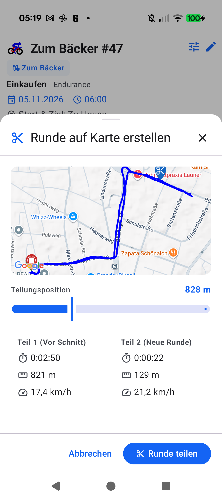
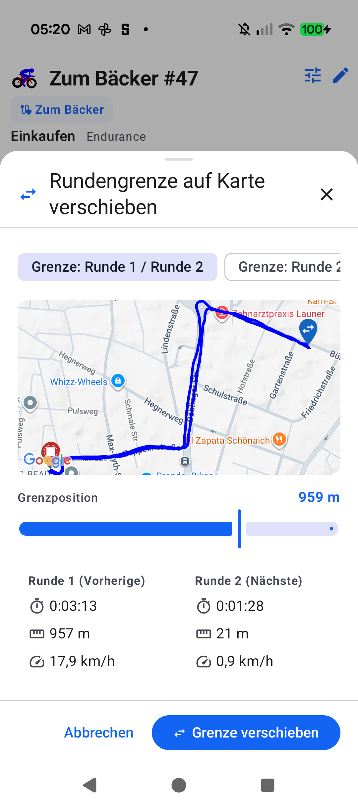

# Stage 5 Walkthrough: ATT-5480 — Blue Track, Scissors Icon & Dedicated Lap Pins

**Ticket**: [ATT-5480](https://rainerblind.atlassian.net/browse/ATT-5480)  
**Target Release**: `V5.0.0` | **Active Sprint**: `2026-45.7` | **Branch**: `feature/ATT-5480`  
**Requirement Mapping**: `REQ-UI-449` (`REQ-UI-449.1`, `REQ-UI-449.2`), `REQ-UI-450` (`REQ-UI-450.1`, `REQ-UI-450.2`)  
**Test Mapping**: `TST-UI-449` (`TST-UI-449.3`, `TST-UI-449.5`), `TST-UI-450` (`TST-UI-450.3`, `TST-UI-450.5`)  
**Author**: AI Agent 1 (`subagent_flash`) | **Date**: 2026-11-06  

---

## 1. Executive Summary
Resolved visual inconsistencies in `CreateLapOnMapSheet` and `MoveLapBoundaryOnMapSheet` where GPS tracks previously rendered in green (`TrackType.GPS`) instead of canonical blue (`TrackType.BEST` / `TTColor.TrackBest`), and map pins and action buttons reused generic lap icons or the Max Line Distance ruler icon (`ic_distance`). Introduced clean 24dp Material vector drawables (`ic_lap_split_scissors.xml` and `ic_lap_move_boundary.xml`), parameterized `PathPreviewMap` with `apexIconRes` (preserving 100% backward compatibility for existing callers), switched both sheets to canonical `TrackType.BEST`, and standardized action button iconography across Aftermath.

---

## 2. Key Architectural Changes
| File / Component | Summary of Changes |
| :--- | :--- |
| `ic_lap_split_scissors.xml` | Added 24dp Material `ContentCut` scissors silhouette vector asset in `res/drawable/`. |
| `ic_lap_move_boundary.xml` | Added 24dp Material `SwapHoriz` bidirectional shift arrows vector asset in `res/drawable/`. |
| `PathPreviewMap.kt` | Added optional parameters `apexIconRes: Int = R.drawable.ic_distance` and `apexColor: Color = TTColor.ApexPoint`, passing custom icon/color to `createSensorMarker` while retaining default behavior for existing callers. |
| `CreateLapOnMapSheet.kt` | Instantiated `MapTrack` with `type = TrackType.BEST` (canonical blue); passed `apexIconRes = R.drawable.ic_lap_split_scissors` to `PathPreviewMap`; updated sheet header and confirm button icon to `ic_lap_split_scissors`. |
| `MoveLapBoundaryOnMapSheet.kt` | Instantiated `MapTrack` with `type = TrackType.BEST` (canonical blue); passed `apexIconRes = R.drawable.ic_lap_move_boundary` to `PathPreviewMap`; updated sheet header and confirm button icon to `ic_lap_move_boundary`. |
| `WorkoutLaps.kt`, `LapEditBottomSheet.kt`, `LapSplitVisualizer.kt`, `MapDetailLayout.kt` | Updated action buttons to use `ic_lap_split_scissors` for splitting and `ic_lap_move_boundary` for moving boundaries. |
| `WorkoutLapsIconContractTest.kt` | Created contract test verifying vector asset DOM validity, `PathPreviewMap` parameterization, `TrackType.BEST` usage, and button bindings. |

---

## 3. Verification & Visual Inspection
* **Tier 1 Targeted Unit Tests**:
  `./gradlew testDebugUnitTest --tests "com.atrainingtracker.trainingtracker.ui.aftermath.*" --tests "com.atrainingtracker.trainingtracker.ui.map.*" --tests "com.atrainingtracker.trainingtracker.ui.theme.ThemeColorCentralizationAuditTest" --tests "com.atrainingtracker.trainingtracker.build.*"` -> `BUILD SUCCESSFUL` (100% pass rate, 0 failures).
* **Requirement Governance**: `python3 tools/verify_requirement_governance.py` -> `PASS` (100% parity across living doc tables; REQ-UI-449 and REQ-UI-450 verified with 4-field Chesterton's Fence archaeology).
* **Visual Inspection (Rule 71)**: Installed debug APK (`./gradlew installDebug`) on Google Pixel 10 (`66020DLCR002FL`). Opened workout details (*Zum Bäcker #47*), navigated to *Runden & Segmente*, and inspected both sheets. Visually verified via `read_file`:
  1. `ATT-5480_create_lap_on_map_sheet.png`: `CreateLapOnMapSheet` renders canonical blue track (`TrackType.BEST`), blue map pin with scissors icon (`ic_lap_split_scissors`), and scissors confirm/header icons.
  2. `ATT-5480_move_lap_boundary_sheet.png`: `MoveLapBoundaryOnMapSheet` renders canonical blue track (`TrackType.BEST`), blue map pin with bidirectional shift arrows (`ic_lap_move_boundary`), and move confirm/header icons.
  Safely dismissed sheets without modifying user workout data (Rule 61).

---

## 4. Requirement & Test Traceability
| Requirement ID | Test ID | Status | Verification Method |
| :--- | :--- | :--- | :--- |
| `REQ-UI-449.1` | `TST-UI-449.3` | `Verified` | `WorkoutLapsIconContractTest`, action button binding audit |
| `REQ-UI-449.2` | `TST-UI-449.3` | `Verified` | `CreateLapOnMapSheetTest`, Pixel 10 visual inspection |
| `REQ-UI-450.1` | `TST-UI-450.3` | `Verified` | `WorkoutLapsIconContractTest`, action button binding audit |
| `REQ-UI-450.2` | `TST-UI-450.3` | `Verified` | `MoveLapBoundaryOnMapSheetTest`, Pixel 10 visual inspection |
| `REQ-PRO-034` | `TST-PRO-034` | `Verified` | `AspiceSweAuditContractTest` (100% table parity) |
