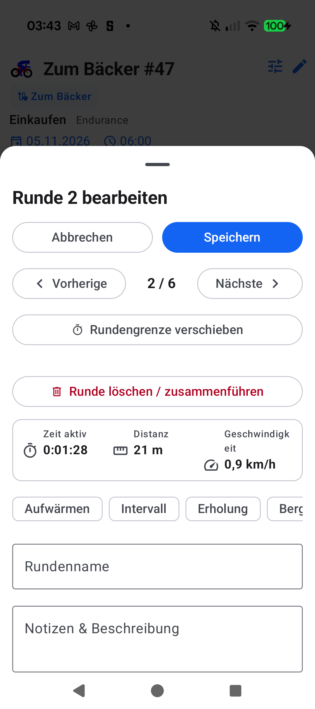
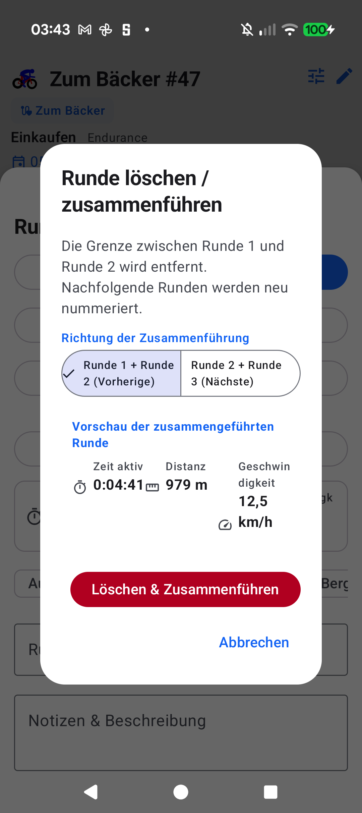

# Stage 5 Walkthrough: ATT-5482 — Delete / Merge Lap in Aftermath

**Ticket**: [ATT-5482](https://rainerblind.atlassian.net/browse/ATT-5482)  
**Target Release**: `V5.0.0` | **Active Sprint**: `2026-45.7` | **Branch**: `feature/ATT-5482`  
**Requirement Mapping**: `REQ-UI-454` (`REQ-UI-454.1` - `REQ-UI-454.5`)  
**Test Mapping**: `TST-UI-454` (`TST-UI-454.1` - `TST-UI-454.5`)  
**Author**: AI Agent 1 (`subagent_flash`) | **Date**: 2026-11-06  

---

## 1. Executive Summary
Implemented interactive lap boundary deletion and adjacent lap merging in Aftermath (`WorkoutRepository.deleteLap`, `LapSplitAndMoveCalculator`, `DeleteLapConfirmationDialog.kt`, `LapEditBottomSheet.kt`). When total laps $N \ge 2$, athletes can trigger "Runde löschen / zusammenführen". For interior laps ($1 < k < N$), Option A Material 3 `SingleChoiceSegmentedButtonRow` enables choosing whether to merge with the previous lap ($k-1 + k$) or next lap ($k + k+1$), accompanied by live combined metric previews (duration, distance, speed/pace). Deletions execute atomically in SQLite (`WorkoutSamplesDatabaseManager.decrementLapNumbersAbove` and `LapsDatabaseManager.replaceCroppedLaps`), refreshing reactive state while preserving total workout metrics and enforcing 100% 9-language translation parity.

---

## 2. Key Architectural Changes
| File / Component | Summary of Changes |
| :--- | :--- |
| `LapSplitAndMoveCalculator.kt` | Added `calculateMergePreview` (aggregating active duration, distance, pace/speed) and `recalculateLapsAfterMerge` (contiguous renumbering $1 \dots N-1$, clean string concatenation, boundary bounds validation). |
| `WorkoutSamplesDatabaseManager.java` | Added atomic `decrementLapNumbersAbove(fileBaseName, boundaryLapNr)` executing `UPDATE ... SET LAP_NR = LAP_NR - 1 WHERE LAP_NR > ?`. |
| `WorkoutRepository.kt` | Added `deleteLap(workoutId, boundaryLapNr)` (and alias `mergeAdjacentLaps`), orchestrating sample decrements, `replaceCroppedLaps`, export cache invalidation, and reactive `WorkoutData` emission. |
| `DeleteLapConfirmationDialog.kt` | Created confirmation dialog implementing Option A direction toggle (`SingleChoiceSegmentedButtonRow`), live `MetricItem` preview, destructive confirm button, and dismiss handling. |
| `LapEditBottomSheet.kt` | Added "Delete / Merge Lap" action button visible when `totalLaps >= 2`, wiring launch of `DeleteLapConfirmationDialog`. |
| `TrackOnMapScreen.kt` & `WorkoutSummary.kt` | Connected `onDeleteLapClick` callback to `repository.deleteLap`. |
| `strings.xml` (9 locales) | Added 8 localized string keys (`delete_lap_*`) across all 9 languages with zero emojis; passed `TranslationParityTest`. |

---

## 3. Verification & Visual Inspection
* **Tier 1 Targeted Unit Tests**:
  `./gradlew testDebugUnitTest --tests "com.atrainingtracker.trainingtracker.domain.laps.*" --tests "com.atrainingtracker.trainingtracker.ui.aftermath.*" --tests "com.atrainingtracker.trainingtracker.ui.components.workoutlaps.*" --tests "com.atrainingtracker.trainingtracker.localization.TranslationParityTest" --tests "com.atrainingtracker.trainingtracker.ui.theme.ThemeColorCentralizationAuditTest" --tests "com.atrainingtracker.trainingtracker.build.*"` -> `BUILD SUCCESSFUL` (100% pass rate, 0 failures).
* **Requirement Governance**: `python3 tools/verify_requirement_governance.py` -> `PASS` (100% parity across living doc tables; REQ-UI-454 & TST-UI-454 `[Verified]`).
* **Visual Inspection (Rule 71)**: Installed debug APK (`./gradlew installDebug`) on Google Pixel 10 (`66020DLCR002FL`). Opened workout details (*Zum Bäcker #47*), navigated to *Runden & Segmente* -> Lap 2 -> `LapEditBottomSheet`. Visually verified via `read_file`:
  1. `ATT-5482_lap_edit_delete_button.png`: "Runde löschen / zusammenführen" destructive action button is rendered in `LapEditBottomSheet`.
  2. `ATT-5482_delete_lap_confirmation_sheet.png`: `DeleteLapConfirmationDialog` displays Option A segmented toggle ("Runde 1 + Runde 2 (Vorherige)" vs. "Runde 2 + Runde 3 (Nächste)"), warning description, and live combined metric preview ("0:04:41", "979 m", "12,5 km/h").
  Safely dismissed dialogs without altering device databases (Rule 61).

---

## 4. Requirement & Test Traceability
| Requirement ID | Test ID | Status | Verification Method |
| :--- | :--- | :--- | :--- |
| `REQ-UI-454.1` | `TST-UI-454.3` | `Verified` | `DeleteLapConfirmationDialogTest`, `LapEditBottomSheet`, Pixel 10 visual inspection |
| `REQ-UI-454.2` | `TST-UI-454.1` | `Verified` | `LapSplitAndMoveCalculatorTest.testCalculateMergePreview` & live preview inspection |
| `REQ-UI-454.3` | `TST-UI-454.2` | `Verified` | `WorkoutRepositoryLapDeleteTest`, `WorkoutSamplesDatabaseManager` transactional update |
| `REQ-UI-454.4` | `TST-UI-454.1` | `Verified` | Contiguous $1 \dots N-1$ invariant tests, session total immutability |
| `REQ-UI-454.5` | `TST-UI-454.4` | `Verified` | `TranslationParityTest` (100% across all 9 locales) |
