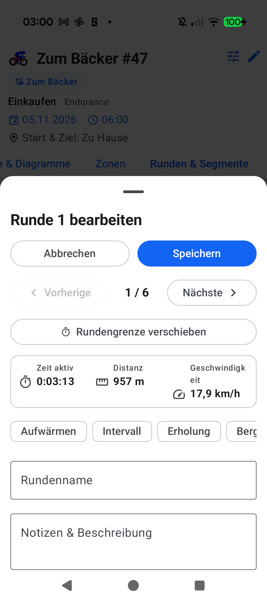

# Stage 5 Walkthrough: ATT-5483 — LapEditBottomSheet in Workout Details

**Ticket**: [ATT-5483](https://rainerblind.atlassian.net/browse/ATT-5483)  
**Target Release**: `V5.0.0` | **Active Sprint**: `2026-45.7` | **Branch**: `feature/ATT-5483`  
**Requirement Mapping**: `REQ-UI-142`, `REQ-UI-408`, `REQ-UI-450`  
**Test Mapping**: `TST-UI-095`, `TST-UI-371`, `TST-UI-450`  
**Author**: AI Agent 1 (`subagent_flash`) | **Date**: 2026-11-06  

---

## 1. Executive Summary
Resolved the issue where tapping on a lap in the *"Runden & Segmente"* tab of Workout Details (`TrackOnMapScreen.kt` / `WorkoutDetailTabbedContent.kt`) did nothing visible because `LapEditBottomSheet` was previously only wired inside `WorkoutSummary.kt`. Forwarded `onLapClick: ((LapData) -> Unit)?` through `WorkoutDetailTabbedContent.kt`, hosted `LapEditBottomSheet` as a modal overlay at the root of `TrackOnMapScreen.kt` alongside tabbed content (`Rule 47`), persisted custom lap name and description edits via `WorkoutRepository.updateLapDetails`, and wired seamless transition to `MoveLapBoundaryOnMapSheet` (`REQ-UI-450.1`).

---

## 2. Key Architectural Changes
| File / Component | Summary of Changes |
| :--- | :--- |
| `WorkoutDetailTabbedContent.kt` | Exposed `onLapClick: ((LapData) -> Unit)? = null` parameter across tab container and `RenderWorkoutDetailCardSections`; forwarded lap click events in `WorkoutDetailSectionType.LAPS` (`REQ-UI-408.3`). |
| `TrackOnMapScreen.kt` | Added `activeEditingLap` state; forwarded `onLapClick` to `WorkoutDetailTabbedContent` and fallback `LapSplitVisualizerCard`; hosted `LapEditBottomSheet` overlay at screen root alongside `CreateLapOnMapSheet` and `MoveLapBoundaryOnMapSheet` (Rule 47); wired `onSaveLap` to `repository.updateLapDetails` and `onMoveBoundaryClick` to `MoveLapBoundaryOnMapSheet` (`REQ-UI-142`, `REQ-UI-450`). |
| `WorkoutDetailTabbedContentTest.kt` | Added contract test asserting `onLapClick` parameter exposure and invocation on lap tap (`TST-UI-371.3`). |
| `TrackOnMapScreenLapRoutingContractTest.kt` | Added contract tests asserting `activeEditingLap` state, `LapEditBottomSheet` modal overlay hosting, repository persistence wiring, and boundary move transition (`TST-UI-095.4`, `TST-UI-450.3`). |
| `docs/requirements/` & `docs/tests/` | Updated living requirements (`REQ-UI-142`, `REQ-UI-408`, `REQ-UI-450`) and tests (`TST-UI-095`, `TST-UI-371`, `TST-UI-450`) to `[Verified]` with 100% master index parity. |

---

## 3. Verification & Visual Inspection
* **Tier 1 Targeted Unit Tests**:
  `./gradlew testDebugUnitTest --tests "com.atrainingtracker.trainingtracker.ui.aftermath.*" --tests "com.atrainingtracker.trainingtracker.ui.map.*" --tests "com.atrainingtracker.trainingtracker.ui.theme.ThemeColorCentralizationAuditTest" --tests "com.atrainingtracker.trainingtracker.build.*"` -> `BUILD SUCCESSFUL` (100% pass rate, 0 failures).
* **Requirement Governance**: `python3 tools/verify_requirement_governance.py` -> `PASS` (100% parity across living doc tables).
* **Visual Inspection (Rule 71)**: Installed debug APK (`./gradlew installDebug`) on Google Pixel 10 (`66020DLCR002FL`). Opened workout details (*Zum Bäcker #47*), switched to the *Runden & Segmente* tab, and tapped Lap 1 row. Visually verified via `read_file` that `LapEditBottomSheet` opens as an interactive modal overlay displaying the lap metrics ("Zeit aktiv 0:03:13", "Distanz 957 m", "Geschwindigkeit 17,9 km/h"), sequential navigation ("1 / 6"), "Rundengrenze verschieben" action, quick-tag chips, and name/description inputs.

---

## 4. Requirement & Test Traceability
| Requirement ID | Test ID | Status | Verification Method |
| :--- | :--- | :--- | :--- |
| `REQ-UI-142` | `TST-UI-095.4` | `Verified` | `TrackOnMapScreenLapRoutingContractTest` & Pixel 10 visual inspection |
| `REQ-UI-408` | `TST-UI-371.3` | `Verified` | `WorkoutDetailTabbedContentTest` |
| `REQ-UI-450` | `TST-UI-450.3` | `Verified` | `TrackOnMapScreenLapRoutingContractTest` & Boundary move handoff |
| `REQ-PRO-034` | `TST-PRO-034` | `Verified` | `AspiceSweAuditContractTest` (100% table parity) |
