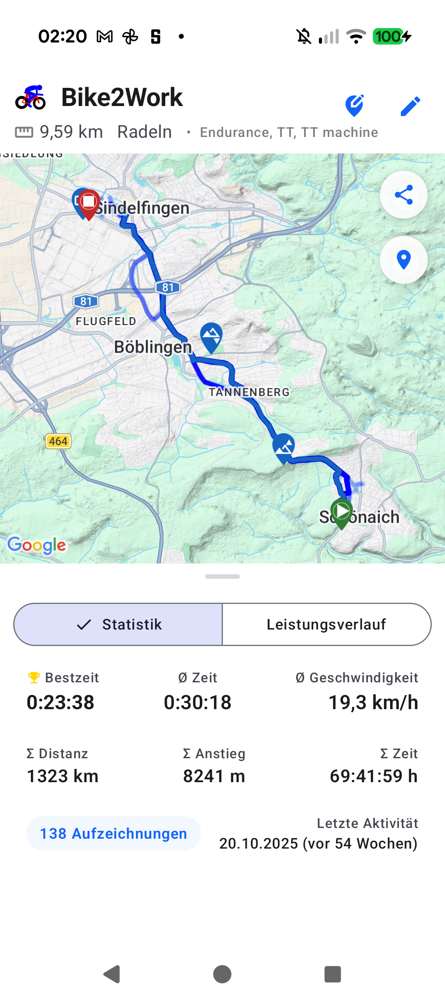
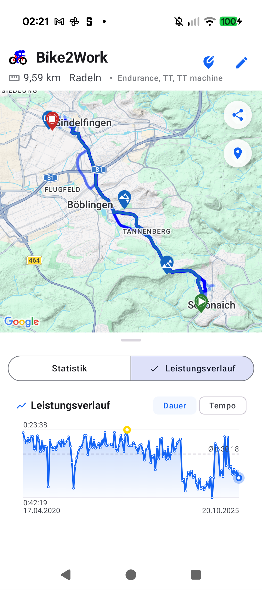

# Stage 5 Walkthrough: ATT-5485 — Split-Pane Lieblingsstrecke Layout with Large Central Map

**Ticket**: [ATT-5485](https://rainerblind.atlassian.net/browse/ATT-5485)  
**Target Release**: `V5.0.0` | **Active Sprint**: `2026-45.7` | **Branch**: `feature/ATT-5485`  
**Requirement Mapping**: `REQ-SET-068`, `REQ-SET-078` | **Test Mapping**: `TST-SET-055`, `TST-SET-078`  
**Author**: AI Agent 1 (`subagent_flash`) | **Date**: 2026-11-06  

---

## 1. Executive Summary
Restructured `WorkoutClusterHeatmapScreen` to leverage `MapDetailLayout`'s split-pane architecture in compliance with `REQ-SET-068` and `REQ-SET-078`. Streamlined `WorkoutClusterSummaryHeader` in `MapDetailLayout.header` to a compact 2-line layout (`Row 1`: Sport icon, cluster name, and action buttons; `Row 2`: compact `WorkoutClusterMetadataRow` or marker chips). Moved the multi-tier dashboard into `MapDetailLayout.analyticsContent`, enabling the draggable `SplitPaneDivider` and expanding the central map viewport from ~30% to ~65% screen height. Implemented Material 3 `SingleChoiceSegmentedButtonRow` for Tab 1 (*Statistik*: Tiers 1–3) vs. Tab 2 (*Leistungsverlauf*: `WorkoutClusterTrendChartCard` when valid count $N \ge 2$). Streamlined `WorkoutClusterTrendChartCard` by removing the redundant 50dp bottom callout card and wiring `detectTapGestures` directly to `onSelectWorkout(hit.workoutId)` for instant peek sheet launch. Added `cluster_tab_statistics` with 100% parity across all 9 supported application locales.

---

## 2. Key Architectural Changes
| File / Component | Summary of Changes |
| :--- | :--- |
| `WorkoutClusterHeatmapScreen.kt` | Restructured `MapDetailLayout`: slotted compact 2-line `WorkoutClusterSummaryHeader` into `header` and `WorkoutClusterDetailDashboard` into `analyticsContent`. Created `WorkoutClusterMetadataRow` (`RefDistance • SportName • LinkedEquipment`). In `WorkoutClusterDetailDashboard`, integrated `SingleChoiceSegmentedButtonRow` detail tabs (*Statistik* vs. *Leistungsverlauf*) (`REQ-SET-068`, `REQ-SET-078.1`). |
| `WorkoutClusterTrendChartCard.kt` | Removed redundant bottom callout `Surface` banner (~50 dp height saving). Updated `Canvas` `detectTapGestures` to dispatch `onSelectWorkout(hit.workoutId)` directly on point tap (`REQ-SET-078.4`). |
| 9 `res/values*/strings.xml` | Added localized `cluster_tab_statistics` across all 9 supported locales (`EN, DE, ES, FR, IT, JA, NL, PL, PT`) (`REQ-SET-078.5`). |
| `WorkoutClusterTrendLayoutAndVisibilityTest.kt` | Updated layout contract assertions: verifies `analyticsContent` split-pane integration, 2-line header, segmented button tabs, direct tap-to-peek launch, and callout banner removal (`TST-SET-055`, `TST-SET-078`). |
| Living Docs (`req_settings_profiles.md` / `tst_settings_profiles.md`) | Synchronized living requirement and test specifications to `Verified` (`REQ-SET-068`, `REQ-SET-078`). |

---

## 3. Verification & Visual Inspection
* **Tier 1 Targeted Unit Tests**:
  `./gradlew testDebugUnitTest --tests "com.atrainingtracker.trainingtracker.ui.clusters.*" --tests "com.atrainingtracker.trainingtracker.ui.theme.ThemeColorCentralizationAuditTest" --tests "com.atrainingtracker.trainingtracker.build.*" --tests "com.atrainingtracker.trainingtracker.TranslationParityTest"` -> `BUILD SUCCESSFUL` (100% pass rate in 14s).
* **Requirement Governance**: `python3 tools/verify_requirement_governance.py` -> `PASS` (100% parity across living doc tables).
* **Visual Inspection (Rule 71)**: Installed debug APK (`./gradlew installDebug`) on Google Pixel 10 running `com.atrainingtracker.debug`. Navigated to *Lieblingsstrecken* -> *Bike2Work* (138 workouts). Inspected `img/ATT-5485_cluster_split_pane_stats.png` and `img/ATT-5485_cluster_split_pane_trend.png` via `read_file`. Confirmed compact 2-line header, ~65% screen height central map, draggable `SplitPaneDivider`, responsive segmented tabs, and trend chart without bottom callout card.

---

## 4. Requirement & Test Traceability
| Requirement ID | Test ID | Status | Verification Method |
| :--- | :--- | :--- | :--- |
| `REQ-SET-068` | `TST-SET-055` | `Verified` | Unit test contract (`WorkoutClusterTrendLayoutAndVisibilityTest`), live Pixel 10 on-device inspection |
| `REQ-SET-078` | `TST-SET-078` | `Verified` | Unit & contract tests (`WorkoutClusterTrendMathTest`, `WorkoutClusterTrendLayoutAndVisibilityTest`), on-device inspection |
