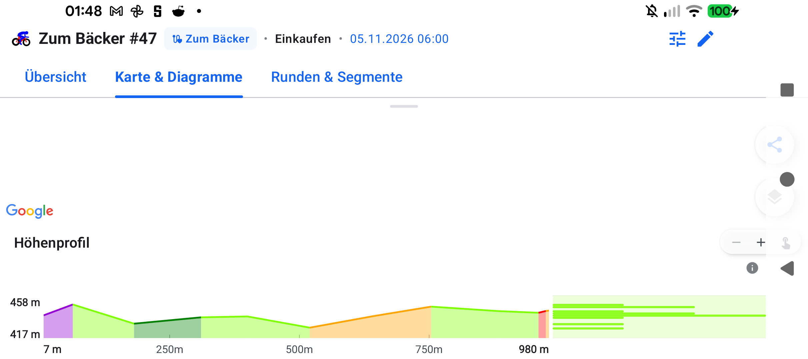

# Stage 5 Walkthrough: ATT-5486 — ElevationProfile Fixed TTColor.Zone1 Green for Marginal Altitude Histogram

**Ticket**: [ATT-5486](https://rainerblind.atlassian.net/browse/ATT-5486)  
**Target Release**: `V5.0.0` | **Active Sprint**: `2026-45.7` | **Branch**: `feature/ATT-5486`  
**Requirement Mapping**: `REQ-UI-446` (`REQ-UI-446.2`) | **Test Mapping**: `TST-UI-446` (`TST-UI-446.2`)  
**Author**: AI Agent 1 (`subagent_flash`) | **Date**: 2026-11-06  

---

## 1. Executive Summary
Resolved the issue where `ElevationProfile` derived its marginal altitude histogram color dynamically from the slope gradient of the very first track segment (`cachedData.segments.firstOrNull()?.color`), causing the entire altitude distribution to turn orange or red if the workout started on an incline or GPS elevation spike. Replaced dynamic segment sampling with fixed canonical `TTColor.Zone1` base green across portrait and landscape dual-pane (`AlignedMarginalZoneDistribution`) modes in compliance with `REQ-UI-446.2`.

---

## 2. Key Architectural Changes
| File / Component | Summary of Changes |
| :--- | :--- |
| `ElevationProfile.kt` | Replaced `val altColor = cachedData.segments.firstOrNull()?.color ?: colorScheme.primary` with fixed `val altColor = TTColor.Zone1` and removed unused `colorScheme` key from `remember` (`REQ-UI-446.2`). |
| `ElevationProfileGradeColorTest.kt` | Added contract test verifying `val altColor = TTColor.Zone1` and absence of first-segment coupling; added unit test verifying that tracks starting with steep climb gradients (+12%, Zone 4 Red) render marginal altitude histogram bins strictly in `TTColor.Zone1` green (`TST-UI-446.2`). |
| `docs/requirements/req_ui_design_system.md` & `docs/tests/tst_ui_design_system.md` | Updated `REQ-UI-446.2` and `TST-UI-446.2` to `[Verified]` status with 100% master table parity and Chesterton's Fence archaeology audit. |

---

## 3. Verification & Visual Inspection
* **Tier 1 Targeted Unit Tests**:
  `./gradlew testDebugUnitTest --tests "com.atrainingtracker.trainingtracker.ui.map.*" --tests "com.atrainingtracker.trainingtracker.ui.theme.ThemeColorCentralizationAuditTest" --tests "com.atrainingtracker.trainingtracker.build.*"` -> `BUILD SUCCESSFUL` (460 tests, 0 failures, 100% pass rate).
* **Requirement Governance**: `python3 tools/verify_requirement_governance.py` -> `PASS` (100% parity across living doc tables).
* **Visual Inspection (Rule 71)**: Installed debug APK (`./gradlew installDebug`) on Google Pixel 10 (`66020DLCR002FL`). Opened workout details (*Zum Bäcker #47*) in Landscape orientation (`user_rotation = 1`). Verified that while the profile's first segment is shaded purple (steep start), the right-docked `AlignedMarginalZoneDistribution` altitude histogram renders strictly in uniform `TTColor.Zone1` Green (`#4CAF50`) with an unconditional background track.

---

## 4. Requirement & Test Traceability
| Requirement ID | Test ID | Status | Verification Method |
| :--- | :--- | :--- | :--- |
| `REQ-UI-446.1` | `TST-UI-446.1` | `Verified` | Universal marginal histogram contract test |
| `REQ-UI-446.2` | `TST-UI-446.2` | `Verified` | `ElevationProfileGradeColorTest` & On-Device visual inspection (`ATT-5486`) |
| `REQ-UI-446.3` | `TST-UI-446.3` | `Verified` | `TelemetryMetricGraphLandscapeContractTest` (72%/28% alignment) |
| `REQ-UI-446.4` | `TST-UI-446.4` | `Verified` | `TranslationParityTest` & Tier 1 unit suite |
| `REQ-UI-446` | `TST-UI-446` | `Verified` | Full Tier 1 test suite (460 tests) & Pixel 10 landscape walkthrough |
