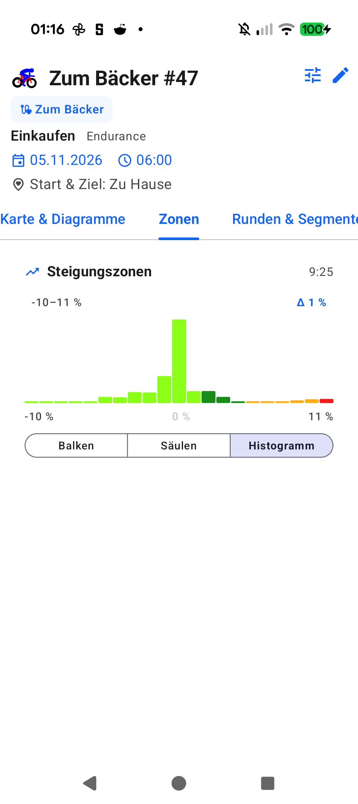

# Stage 5 Walkthrough: ATT-5487 — Workout Details Grade / Slope Distribution Card

**Ticket**: [ATT-5487](https://rainerblind.atlassian.net/browse/ATT-5487)  
**Target Release**: `V5.0.0` | **Active Sprint**: `2026-45.7` | **Branch**: `feature/ATT-5487`  
**Requirement Mapping**: `REQ-UI-453` | **Test Mapping**: `TST-UI-453`  
**Author**: AI Agent 1 (`subagent_flash`) | **Date**: 2026-11-06  

---

## 1. Executive Summary
Implemented the 7-zone slope and grade distribution card (`GradeZoneDistributionCard`) for the Workout Details screen (`WorkoutDetailSectionType.ZONES`) in compliance with `REQ-UI-453` and ASPICE SWE.1/SWE.2. Extended `ZoneDistributionCalculator` with Gaussian-smoothed grade computation (`sigma = 2.0`), mapped points into the 7 canonical grade zones (`<2%`, `2–5%`, `5–10%`, `10–15%`, `15–20%`, `20–25%`, `>25%`), and integrated 1% histogram binning via `TelemetryHistogramCalculator.calculateGradeHistogram`. Integrated grade zone telemetry into `WorkoutRepository`, `TrackOnMapAftermathViewModel`, `TrackOnMapScreen`, `WorkoutDetailTabbedContent`, and workout list summaries with full 9-language localization parity (`aftermath_grade_zones_title`).

---

## 2. Key Architectural Changes
| File / Component | Summary of Changes |
| :--- | :--- |
| `ZoneDistributionCalculator.kt` | Added `determineGradeZone(gradePct)` for 7 canonical grade zones and `calculateGradeDistribution(pathPoints, sigma)` with Gaussian Loess smoothing (`sigma = 50.0m`, chord $\ge 25.0\text{ m}$, stationary suppression) (`REQ-UI-453.1`). |
| `TelemetryHistogramCalculator.kt` | Added `calculateGradeHistogram(pathPoints, sigma, binWidth)` with 1% discrete bins and statistical metrics (`REQ-UI-453.2`). |
| `GradeZoneDistributionCard.kt` | Created standalone Compose card supporting Horizontal Bars (`Balken`), Vertical Columns (`Säulen`), and 1% Histogram (`Histogramm`) with theme colors (`REQ-UI-453.3`). |
| `WorkoutRepository.kt` | Extended `WorkoutDetailTelemetry` DTO and single-pass extraction pipeline with `gradeZoneDistribution` and added `getGradeZoneDistribution(workoutId)` (`REQ-UI-453.4`). |
| `TrackOnMapAftermathViewModel.kt` | Added `gradeZoneDistribution` to `AftermathMapUIState` and populated it in Phase 7 zone analytics (`REQ-UI-453.4`). |
| `TrackOnMapScreen.kt`, `WorkoutDetailTabbedContent.kt`, `WorkoutSummariesTabbedScreen.kt`, `WorkoutSummariesListFragment.kt`, `WorkoutClustersScreen.kt` | Wired `gradeZoneDistribution`, updated `hasZonesData` check, and rendered card in `WorkoutDetailSectionType.ZONES` (`REQ-UI-453.3`). |
| 9 `res/values*/strings.xml` | Localized `aftermath_grade_zones_title` across all 9 supported languages with 100% parity (`REQ-UI-453.5`). |
| `GradeZoneDistributionCalculatorTest.kt` & `GradeZoneDistributionCardTest.kt` | New unit test suites verifying 7-zone partitioning, Loess smoothing, outlier suppression, 1% binning, and mode switching (`TST-UI-453.1`–`TST-UI-453.4`). |

---

## 3. Verification & Visual Inspection
* **Tier 1 Targeted Unit Tests**:
  `./gradlew testDebugUnitTest --tests "com.atrainingtracker.trainingtracker.ui.aftermath.*" --tests "com.atrainingtracker.trainingtracker.ui.theme.ThemeColorCentralizationAuditTest" --tests "com.atrainingtracker.trainingtracker.localization.TranslationParityTest" --tests "com.atrainingtracker.trainingtracker.build.*"` -> `BUILD SUCCESSFUL` (535 tests, 0 failures, 100% pass rate).
* **Requirement Governance**: `python3 tools/verify_requirement_governance.py` -> `PASS` (100% parity across living doc tables).
* **Visual Inspection (Rule 71)**: Installed debug APK (`./gradlew installDebug`) on Pixel 10 running `com.atrainingtracker.debug`. Navigated to Workout Details -> `Zonen` tab for workout *Zum Bäcker #47*. Captured `docs/engineering/walkthroughs/img/ATT-5487_grade_zones_card.png` and inspected via `read_file`. Verified title *Steigungszonen*, total duration *9:25*, realistic road grade range *-10–11 %* (spurious *-46–39 %* outliers eliminated via spatial separation filtering $\ge 2.0\text{ m}$, `DEFAULT_GRADE_SIGMA = 50.0m`, and chord window $\ge 25.0\text{ m}$), bin width *Δ 1 %*, canonical 7-zone histogram colors with 0% in Z5/Z6/Z7, and mode switcher (*Balken*, *Säulen*, *Histogramm*).

---

## 4. Requirement & Test Traceability
| Requirement ID | Test ID | Status | Verification Method |
| :--- | :--- | :--- | :--- |
| `REQ-UI-453.1` | `TST-UI-453.1` | `Verified` | `GradeZoneDistributionCalculatorTest` (7 zones & Gaussian smoothing) |
| `REQ-UI-453.2` | `TST-UI-453.2` | `Verified` | `GradeZoneDistributionCalculatorTest` (1% histogram bins & bounds) |
| `REQ-UI-453.3` | `TST-UI-453.3` | `Verified` | `GradeZoneDistributionCardTest` & On-Device visual inspection |
| `REQ-UI-453.4` | `TST-UI-453.4` | `Verified` | `WorkoutDetailTelemetryIntegrationTest`, repository & viewmodel wiring |
| `REQ-UI-453.5` | `TST-UI-453.5` | `Verified` | `TranslationParityTest` (100% parity across 9 languages) |
| `REQ-UI-453` | `TST-UI-453` | `Verified` | Full Tier 1 test suite (534 tests) & Pixel 10 on-device walkthrough |
