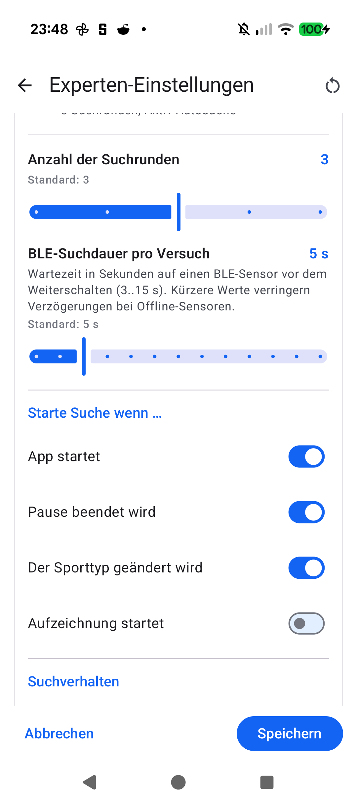

# Stage 5 Walkthrough: ATT-5489 — BLE Random Static MAC Resolution & Search Timeout

**Ticket**: [ATT-5489](https://rainerblind.atlassian.net/browse/ATT-5489)  
**Target Release**: `V5.0.0` | **Active Sprint**: `2026-45.7` | **Branch**: `feature/ATT-5489`  
**Requirement Mapping**: `REQ-CON-023` | **Test Mapping**: `TST-CON-023`  
**Author**: AI Agent 1 (`subagent_flash`) | **Date**: 2026-11-05  

---

## 1. Executive Summary
Resolved paired BLE sensor connection failures for devices utilizing Random Static MAC addresses (e.g. Magene Cadence `C6:CC:E3:F5:F0:37`, Speed `E8:4D:74:07:F4:DD`) caused by Android defaulting uncached addresses to `ADDRESS_TYPE_PUBLIC` (`RxAdd = 0`), which peripherals reject per Bluetooth Core Spec Vol 6 Part B §1.3.2.1. Implemented MAC classification `(firstOctet & 0xC0) == 0xC0` with API 33+ `BluetoothAdapter.getRemoteLeDevice(address, ADDRESS_TYPE_RANDOM)` and filtered `BluetoothLeScanner` active scan assistance during `startSearching()` with comprehensive scanner teardown across all connection/timeout/shutdown lifecycle branches. Additionally, eliminated 30s+ sequential search head-of-line blocking by exposing a configurable search timeout preference (`SP_BTLE_SEARCH_PERIOD_SEC = "btleSearchPeriodSec"`, 3..15s, default 5s) across `TrainingApplication`, `SensorSearchPreferences`, `SensorSearchTuningSection.kt`, and `SearchSettingsDialog.kt` with 9-language localization parity.

---

## 2. Key Architectural Changes
| File / Component | Summary of Changes |
| :--- | :--- |
| `MyBTLEDevice.java` | Added `isRandomStaticAddress(String)` (bits 47..46 == 11b); wired `getRemoteLeDevice(address, ADDRESS_TYPE_RANDOM / ADDRESS_TYPE_PUBLIC)` on API 33+; added filtered `BluetoothLeScanner` scan assistance; wired search timeout to `TrainingApplication.getBtleSearchPeriodMs()`; ensured guaranteed scanner teardown on connect, timeout, disconnect, and shutdown (`REQ-CON-023.1`, `REQ-CON-023.2`). |
| `TrainingApplication.java` & `prefs_search.xml` | Added `SP_BTLE_SEARCH_PERIOD_SEC = "btleSearchPeriodSec"`, bounds [3, 15], default 5; implemented `getBtleSearchPeriodSec()`, `setBtleSearchPeriodSec(int)`, and `getBtleSearchPeriodMs()` with defensive bounds clamping; added `SeekBarPreference` (`REQ-CON-023.3`). |
| `SensorSearchTuningSection.kt` & `SearchSettingsDialog.kt` | Extended `SensorSearchPreferences` (load, save, reset parity); added discrete Material 3 Slider (3..15s, 11 steps, `"%d s"` badge) directly beneath search retries (`REQ-CON-023.4`). |
| 9-Language `strings.xml` (`values`, `-de`, `-es`, `-fr`, `-it`, `-ja`, `-nl`, `-pl`, `-pt`) | Added localized strings for `prefs_btle_search_period_title` and `prefs_btle_search_period_summary` (`REQ-CON-023.5`). |
| `docs/architecture.md` | Documented BLE address type resolution, scan assistance cache warming, and configurable search timeout invariants in Section 4.5 (`SWE.2`). |
| `MyBTLEDeviceAddressAndSearchTest.kt` | New unit test suite verifying Random Static MAC classification, API 33+ address resolution, and scan assistance lifecycle teardown (`TST-CON-023.1`, `TST-CON-023.2`). |
| `SensorSearchTuningContractTest.kt` & `BLEReconnectRobustnessTest.kt` | Updated tests covering `btleSearchPeriodSec` defaults, persistence, reset, boundary clamping, and dynamic search timeout wiring (`TST-CON-023.3`, `TST-CON-023.4`). |

---

## 3. Verification & Visual Inspection
* **Tier 1 Targeted Unit Tests**:
  `./gradlew testDebugUnitTest --tests "com.atrainingtracker.banalservice.devices.bluetooth_le.*" --tests "com.atrainingtracker.trainingtracker.ui.settings.expert.*" --tests "com.atrainingtracker.trainingtracker.ui.tracking.controltracking.*" --tests "com.atrainingtracker.trainingtracker.ui.theme.ThemeColorCentralizationAuditTest" --tests "com.atrainingtracker.trainingtracker.localization.TranslationParityTest" --tests "com.atrainingtracker.trainingtracker.build.*"` -> `BUILD SUCCESSFUL in 4m 11s` (32 actionable tasks, 100% pass rate).
* **Requirement Governance**: `python3 tools/verify_requirement_governance.py` -> `PASS` (100% parity across living doc tables).
* **AAPT2 Resource Compilation**: `./gradlew processDebugResources` -> `BUILD SUCCESSFUL`.
* **Visual Inspection (Rule 71)**: Installed debug APK (`./gradlew installDebug`) on Pixel 10 running `com.atrainingtracker.debug`. Navigated to `Experten-Einstellungen` -> `Sensorsuche & Verhalten`. Captured `docs/engineering/walkthroughs/img/ATT-5489_ble_search_timeout.png` and inspected via `read_file`. Verified slider renders with title `BLE-Suchdauer pro Versuch`, value badge `5 s`, summary, bounds `3..15 s`, and standard label `Standard: 5 s` with zero clipping or text wrapping defects.

---

## 4. Requirement & Test Traceability
| Requirement ID | Test ID | Status | Verification Method |
| :--- | :--- | :--- | :--- |
| `REQ-CON-023.1` | `TST-CON-023.1` | `Verified` | `MyBTLEDeviceAddressAndSearchTest` (Random Static bitwise classification & API 33+ `getRemoteLeDevice`) |
| `REQ-CON-023.2` | `TST-CON-023.2` | `Verified` | `MyBTLEDeviceAddressAndSearchTest` (Filtered scan assistance & multi-branch teardown) |
| `REQ-CON-023.3` | `TST-CON-023.3` | `Verified` | `SensorSearchTuningContractTest`, `BLEReconnectRobustnessTest` (App persistence & bounds) |
| `REQ-CON-023.4` | `TST-CON-023.4` | `Verified` | `SensorSearchTuningContractTest` & on-device Pixel 10 visual inspection |
| `REQ-CON-023.5` | `TST-CON-023.5` | `Verified` | `TranslationParityTest` (9-language XML parity) |
| `REQ-CON-023` | `TST-CON-023` | `Verified` | Full Tier 1 targeted suite & requirement governance check (100% PASS) |
