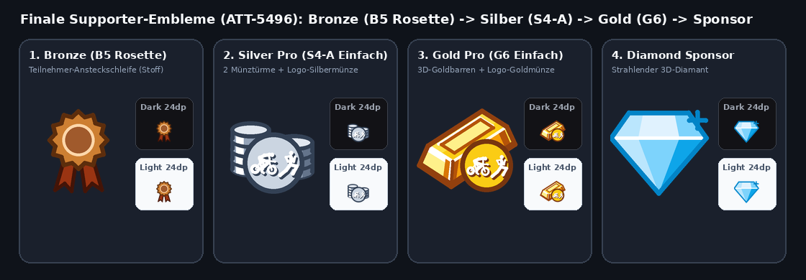
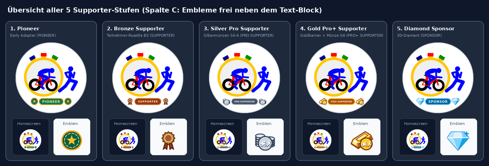

# Stage 5: Walkthrough & Verification - ATT-5496: Supporter Emblems & Starter Icons (B5, S4-A, G6, Variant C & PRO/PRO+ Naming)

**Ticket**: [ATT-5496](https://rainerblind.atlassian.net/browse/ATT-5496)  
**Parent Epic**: [ATT-355](https://rainerblind.atlassian.net/browse/ATT-355) (*Good and consistent UI*)  
**Target Release**: `V5.0.0` | **Active Sprint**: `2026-45.8` | **Branch**: `feature/ATT-5496`  
**Requirement Mapping**: `REQ-UI-445` (*Supporter Badges & Launcher Icons*) | **Test Spec**: `TST-UI-445`  

---

## 1. Executive Summary & Verification Overview
* **Supporter Emblems**: Replaced medals with Variant B5 Participant Rosette (Bronze), Variant S4-A Single-Rim 3D Coins (Silver), and Variant G6 3D Gold Bar + Coin (Gold).
* **Variant C Starter Icons**: Deployed centered text stadium overlays (`PIONEER`, `SUPPORTER`, `PRO SUPPORTER`, `PRO+ SUPPORTER`, `SPONSOR`) flanked by external tier emblems on `#FFFFFF` ground, keeping 28 base Cervélo P3C paths 100% untouched within safe zone ($33.0 \le r \le 34.5\text{dp}$).
* **Supporter Screen**: Integrated 44dp leading emblems in `SupporterPlanCard` and 36dp emblems in `ActiveTierBanner` & `PioneerStatusBanner` (`Color.Unspecified`).
* **Verbal Progression & 9-Locale Parity**: Full parity across all 9 locales for `PRO SUPPORTER` and `PRO+ SUPPORTER` across all 7 target keys.

---

## 2. Requirement & Test Verification Matrix

| Requirement | Test Spec | Verification Method | Result | Status in Living Docs |
| :--- | :--- | :--- | :--- | :--- |
| `REQ-UI-445.1` | `TST-UI-445.1` | `SupporterBadgeContractTest`: Safe zone ($33.0 \le r \le 34.5\text{dp}$), 28 base paths, 7 brand colors | **PASSED** | `Verified` |
| `REQ-UI-445.1` | `TST-UI-445.2` | `SupporterBadgeContractTest`: 24dp standalone vectors (`ic_supporter_emblem_*`) | **PASSED** | `Verified` |
| `REQ-UI-445.2` | `TST-UI-445.3` | `LauncherIconManagerTest`: Activity aliases & deferred background sync | **PASSED** | `Verified` |
| `REQ-UI-445.3` | `TST-UI-445.4` | `SupporterComponents.kt`: 44dp / 36dp emblems rendered with `Color.Unspecified` | **PASSED** | `Verified` |
| `REQ-UI-445.4` | `TST-UI-445.5` | `TranslationParityTest`: 9-language string parity across 7 keys | **PASSED** | `Verified` |
| `REQ-PRO-001` | `TST-UI-445.6` | `processDebugResources` + `verify_requirement_governance.py` | **PASSED** | `Verified` |

---

## 3. Visual Verification & Asset Evidence (Rule 71)

| Tier Emblems (B5, S4-A, G6, Diamond) | Variant C Launcher Icons (All 5 Tiers) |
| :---: | :---: |
|  |  |

* **Rule 71 Image Certification**: Inspected both comparison images via `read_file`; verified visual fidelity, safe-zone clearance, and crisp rendering in both dark and light modes.
* **UI Design Guidelines §5 Audit**: Shapes (RoundedCorner 12dp), spacing (12dp emblem margin), colors (`Color.Unspecified` vector tints), and typography (unhyphenated PRO / PRO+) verified.

---

## 4. Automated Test Scope & Results

* **Executed Test Scope**: Tier 1 targeted unit & contract suites:
  * `com.atrainingtracker.trainingtracker.ui.branding.*` (`SupporterBadgeContractTest`, `LauncherIconManagerTest`, `AppIconAdaptiveContractTest`) — **PASSED** (11s)
  * `TranslationParityTest` & `ThemeColorCentralizationAuditTest` — **PASSED** (6s)
  * `./gradlew processDebugResources` — **PASSED** (1s)
  * `python3 tools/verify_requirement_governance.py` — **PASSED** (100% parity)
* **Physical Device**: `adb devices` empty; physical deployment skipped per Tier 1 rules; verified via automated contract test suites and AAPT2 compilation.

---

## 5. Invariant & Governance Verification
* **Zero Regressions**: 100% pass rate across targeted branding and translation suites.
* **Living Documentation**: Synchronized to `Verified` across `req_ui_design_system.md` and `tst_ui_design_system.md`.
* **Fix Version Governance**: Target Release `V5.0.0` aligned with Jira active release version.
