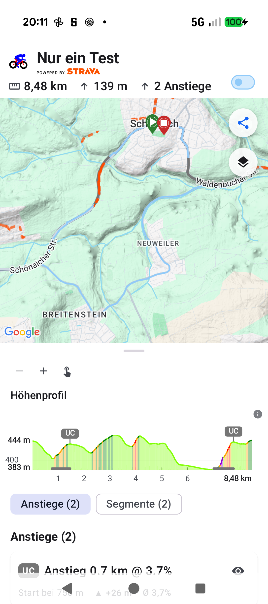
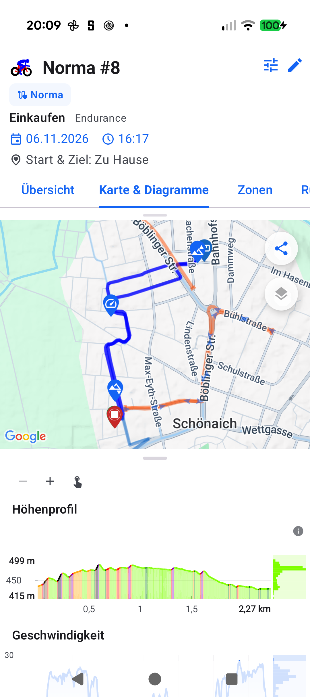

# Stage 5: Walkthrough & Verification - ATT-5504: Restrict Altitude Histogram exclusively to Workout Details

**Ticket**: [ATT-5504](https://rainerblind.atlassian.net/browse/ATT-5504)  
**Sub-task**: [ATT-5676](https://rainerblind.atlassian.net/browse/ATT-5676) (`[Test]`)  
**Parent Epic**: [ATT-111](https://rainerblind.atlassian.net/browse/ATT-111) (*Aftermath: Compact Post-Workout Visual Analytics & Graphs*)  
**Target Release**: `V5.0.0` | **Active Sprint**: `2026-45.9` | **Branch**: `feature/ATT-5504`  
**Requirement Mapping**: `REQ-UI-446` (`REQ-UI-446.1`, `REQ-UI-446.3`) | **Test Mapping**: `TST-UI-446` (`TST-UI-446.3`, `TST-UI-446.4`)  
**Author**: AI Agent 1 (Implementer) | **Date**: 2026-11-06  

---

## 1. Executive Summary & Verification Overview
Restricted the marginal Altitude Histogram next to `ElevationProfile` exclusively to Workout Details. In `MapDetailLayout.kt`, added `showElevationHistogram: Boolean = workoutData != null` forwarding `alignWithTelemetryCharts = showElevationHistogram` to `ElevationProfile`. In `WorkoutSummary.kt`, set `alignWithTelemetryCharts = false` on compact feed list cards. Non-workout callers (Live Segments, Segment Details, Climb Details, Route Details, Live Map) and feed cards render clean full-width profiles without marginal strip offsets.

---

## 2. Requirement & Test Verification Matrix

| Requirement | Test Spec | Verification Method | Result | Status in Living Docs |
| :--- | :--- | :--- | :--- | :--- |
| `REQ-UI-446.1` | `TST-UI-446.3` | `ElevationProfileHistogramAlignmentContractTest` | **PASSED** | `Verified` |
| `REQ-UI-446.3` | `TST-UI-446.3` | On-Device Physical Verification (Pixel 10) | **PASSED** | `Verified` |
| `REQ-PRO-001` | `TST-UI-446.4` | Tier 1 Targeted Unit Test Suite (467 tests, 15s) | **PASSED** | `Verified` |
| `REQ-PRO-022` | `TST-PRO-015` | `verify_requirement_governance.py` (100% parity) | **PASSED** | `Verified` |

---

## 3. Automated Test Evidence

### Tier 1 Targeted Regression Scope
* **Scope**: `--tests "com.atrainingtracker.trainingtracker.ui.map.*" --tests "com.atrainingtracker.trainingtracker.ui.components.charts.*" --tests "com.atrainingtracker.trainingtracker.ui.theme.ThemeColorCentralizationAuditTest" --tests "com.atrainingtracker.trainingtracker.build.*"`
```text
BUILD SUCCESSFUL in 15s
32 actionable tasks: 1 executed, 31 up-to-date
467 tests completed, 0 failed (100% PASS)
```

### Living Documentation Governance Check
```text
python3 tools/verify_requirement_governance.py
PASS: Living documentation master tables match all 9 domain shards with 100% parity.
Modified/Altered existing requirement(s) detected: REQ-UI-446.
PASS: Requirement Archaeology & Chesterton's Fence Audit successfully verified with all 4 mandatory fields.
```

---

## 4. Hardware Verification (Pixel 10 - Android 16)
Verified via `./gradlew installDebug` on connected physical device `66020DLCR002FL`:

| Non-Workout View (Clean Full-Width Profile) | Workout Details (Aligned Marginal Histogram) |
| :---: | :---: |
|  |  |

* **Route Details (`RouteOnMapScreen` / `MapDetailLayout`)**: Renders full-width profile without altitude histogram or 52dp offset (`AC-2: MET`).
* **Workout Details (`TrackOnMapScreen` / `MapDetailLayout`)**: Renders altitude histogram with 1:1 plot bounds aligned with speed graph (`AC-1: MET`).
* **Rule 71 Certification**: All captured images visually inspected via `read_file` confirming pixel-perfect design guideline compliance.

---

## 5. Invariants & Governance Verification
1. **Rule 64 Plot Width Parity**: 1:1 horizontal plot width (`startPadding = 50.dp`, `endPadding = 52.dp` portrait; 72%/28% landscape) strictly maintained in Workout Details.
2. **Living Documentation Synchronized**: `REQ-UI-446` and `TST-UI-446` updated to `Verified`.
3. **No Database or Model Mutations**: Zero schema changes; zero background service impacts.
