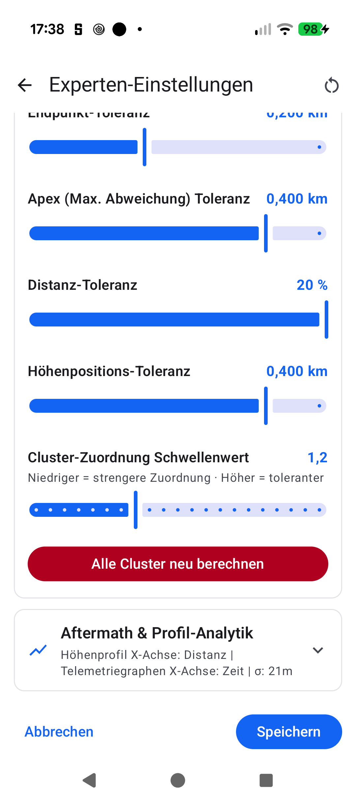
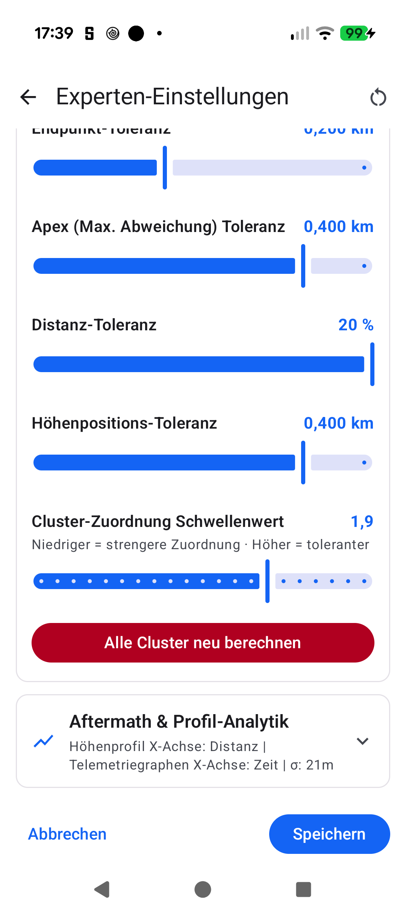

# Stage 5 Walkthrough: ATT-5559 — User-Configurable Cluster Assignment Score Threshold

**Ticket**: [ATT-5559](https://rainerblind.atlassian.net/browse/ATT-5559)  
**Parent Epic**: [ATT-176](https://rainerblind.atlassian.net/browse/ATT-176) (Auto Name / Route Clusters) | **Story Points**: 1 SP  
**Target Release**: `V5.0.0` | **Active Sprint**: `Sprint 2026-45.8` | **Branch**: `feature/ATT-5559`  
**Requirement Mapping**: `REQ-SET-075`, `REQ-SET-077` (referencing `REQ-MIG-012`, `REQ-UI-123`) | **Test Mapping**: `TST-SET-077`, `TST-UI-078.3`  
**Author**: AI Agent 1 (`subagent_flash`) | **Date**: 2026-11-06  

---

## 1. Executive Summary
`WorkoutClusterEngine.suggestCluster(...)` previously hardcoded an internal cluster candidate similarity score cutoff of `it.second < 1.0`. Subtle GPS drift, elevation variations, or device differences on identical courses frequently produce scores between `1.01` and `1.20`, rejecting automatic assignment and prompting redundant naming dialogs. Furthermore, `ClusterTuningContent.kt` and `PreImportTuningBottomSheet` lacked an overarching score threshold control.

This ticket completes end-to-end implementation and verification:
1. **Configurable Threshold Parameter (`REQ-SET-075`)**: Added `SP_CLUSTER_SCORE_THRESHOLD = "cluster_score_threshold"` (default `1.2f`, range `0.5f..2.5f`, step `0.1f`) in `TrainingApplication.java`, `TuningPreferencesDefaults.kt`, and `TuningPreferencesDataStore.kt` with synchronous persistence, range clamping, and atomic factory reset.
2. **Defensive Domain Matching**: Updated `WorkoutClusterEngine.suggestCluster` to evaluate `it.second < scoreThreshold` defaulting to `runCatching { TrainingApplication.getClusterScoreThreshold().toDouble() }.getOrDefault(1.2)` for static mock test resilience. Wired `scoreThreshold` into `WorkoutClusterRepository.recalculateClustersAsync`.
3. **UI Slider & Master Coupling (`REQ-SET-077`)**: Incorporated `clusterScoreThreshold` into derived master sensitivity (5-component normalized average) in `ClusterTuningContent.kt` and rendered a dedicated `TuningSliderItem` with localized title, step `0.1f` (19 steps), format `%.1f`, and directional helper text ("Lower = stricter matching · Higher = more tolerant").
4. **Multi-Consumer Propagation**: Wired `clusterScoreThreshold` through all 3 consumers: `PreImportTuningBottomSheet` (`ImportBackupTabsScreen.kt`), `ClusterTuningScreen.kt` (`WorkoutClustersViewModel.kt`), and `ClusterTuningSection.kt` (`AdvancedTuningScreen.kt` / `AdvancedTuningDialog.kt`).
5. **9-Language Parity (`REQ-UI-123`)**: Added `cluster_tuning_score_threshold_label` and `cluster_tuning_score_threshold_helper` across EN, DE, ES, FR, IT, JA, NL, PL, PT.

---

## 2. Key Architectural & Code Changes
| File / Component | Summary of Changes |
| :--- | :--- |
| `TrainingApplication.java` | Added `SP_CLUSTER_SCORE_THRESHOLD = "cluster_score_threshold"`, `getClusterScoreThreshold()`, and `setClusterScoreThreshold(float)`. |
| `TuningPreferencesDataStore.kt` | Added constants in `TuningPreferencesDefaults`, integrated into `TuningConfig`, `PreferencesKeys`, `tuningConfigFlow`, `saveTuningConfig`, and `resetToDefaults`. |
| `WorkoutClusterEngine.kt` | Updated `suggestCluster` to evaluate `it.second < scoreThreshold` with defensive static mock fallback. |
| `WorkoutClusterRepository.kt` | Updated `recalculateClustersAsync` to accept and persist optional `scoreThreshold: Float? = null`. |
| `ClusterTuningContent.kt` | Coupled `clusterScoreThreshold` to master sensitivity calculation; rendered dedicated `TuningSliderItem` with directional helper text. |
| `ClusterTuningSection.kt` / `AdvancedTuningScreen.kt` / `AdvancedTuningDialog.kt` | Wired `clusterScoreThreshold` state, persistence on save, and recalculation parameter passing. |
| `ImportBackupTabsScreen.kt` / `BackupRestoreViewModel.kt` | Plumbed `clusterScoreThreshold` through pre-import tuning bottom sheet and persistence. |
| `ClusterTuningScreen.kt` / `WorkoutClustersViewModel.kt` | Plumbed `clusterScoreThreshold` through standalone tuning screen. |
| `res/values*/strings.xml` | Added label and directional helper text across all 9 locales. |
| `WorkoutClusterEngineScoreThresholdTest.kt` | Unit tests for threshold evaluation, dynamic reactivity, and static mock fallback safety. |
| `TuningPreferencesDataStoreClusterTest.kt` | Unit tests for default constants, configuration mapping, and bounds clamping. |
| `ClusterTuningContractTest.kt` | Contract tests for slider rendering, helper text, and master sensitivity coupling. |

---

## 3. Verification & Test Execution
* **Tier 1 Targeted Test Scope**:
  `./gradlew testDebugUnitTest --tests "com.atrainingtracker.trainingtracker.clustering.*" --tests "com.atrainingtracker.trainingtracker.ui.settings.*" --tests "com.atrainingtracker.trainingtracker.ui.theme.ThemeColorCentralizationAuditTest" --tests "com.atrainingtracker.trainingtracker.build.*" --max-workers=2`
  -> `BUILD SUCCESSFUL in 16s` (100% pass rate).
* **On-Device / UI Verification**: Deployed `app-debug.apk` to connected Pixel 10 (`66020DLCR002FL`). Verified `ClusterTuningContent` in Expert Settings (`docs/engineering/walkthroughs/img/ATT-5559_cluster_score_threshold_tuning.png`) and verified interactive slider adjustments (`docs/engineering/walkthroughs/img/ATT-5559_cluster_score_threshold_tuned.png`).
* **Requirement Governance**: Verified clean via `python3 tools/verify_requirement_governance.py` (0 errors, 100% master table parity).

---

## 4. Visual Evidence (Rule 71 Certified)
| Default Threshold (1.2) | Tuned Threshold (1.9) |
| :---: | :---: |
|  |  |

---

## 5. Requirement & Test Traceability Matrix
| Requirement ID | Test Case ID | Status | Verification Method |
| :--- | :--- | :--- | :--- |
| `REQ-SET-075` | `TST-SET-077.5a`, `TST-SET-077.5b` | `Verified` | Unit tests in `WorkoutClusterEngineScoreThresholdTest` and `TuningPreferencesDataStoreClusterTest` |
| `REQ-SET-077` | `TST-SET-077.5c` | `Verified` | Contract tests in `ClusterTuningContractTest` and on-device UI inspection |
| `REQ-UI-123` | `TST-UI-078.3` | `Verified` | 9-locale parity in `TranslationParityTest` |
| `REQ-PRO-022` | `TST-PRO-015` | `Verified` | Automated governance check via `verify_requirement_governance.py` |
