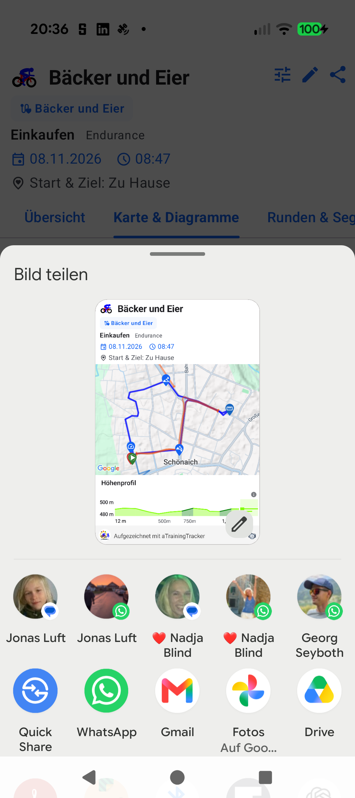

# ATT-6208 Walkthrough: WorkoutShareBottomSheet Automated Map Snapshot & Share

**Ticket**: ATT-6208  
**Epic**: ATT-68 (*Workouts & Aftermath*)  
**Sprint**: 2026-45.13  
**Target Release**: V5.0.0  
**Status**: Completed  

---

## 1. Executive Summary

Previously, selecting Option A ("Karten- & Analyse-Snapshot") in [`WorkoutShareBottomSheet`](file:///home/rainer/AndroidStudioProjects/aTrainingTracker/app/src/main/java/com/atrainingtracker/trainingtracker/ui/map/WorkoutShareBottomSheet.kt) only navigated or scrolled to the Map tab without initiating snapshot capture or opening the Android system share sheet (`Intent.ACTION_SEND`).

Under `ATT-6208` (governed by `REQ-PER-029` / `TST-PER-037`):
1. **Programmatic Snapshot Trigger**: Exposed `externalSnapshotTrigger: Boolean = false` and `onSnapshotComplete: (() -> Unit)? = null` on [`MapDetailLayout`](file:///home/rainer/AndroidStudioProjects/aTrainingTracker/app/src/main/java/com/atrainingtracker/trainingtracker/ui/map/MapDetailLayout.kt), while strictly preserving `showFloatingShareButton: Boolean = workoutData == null` and `top = 16.dp` action docking (`REQ-UI-500` / `ATT-6214`).
2. **Automated Handoff & Settlement Delay**: Updated [`WorkoutDetailTabbedContent`](file:///home/rainer/AndroidStudioProjects/aTrainingTracker/app/src/main/java/com/atrainingtracker/trainingtracker/ui/aftermath/WorkoutDetailTabbedContent.kt) to accept `initialAutoShareSnapshot`, navigate to `mapTabIndex`, wait ~350ms for map/chart tiles to settle, and activate `externalSnapshotTrigger = true`.
3. **List-to-Detail Bridge**: Wired `onShareMapSnapshot: ((WorkoutData) -> Unit)?` across [`WorkoutSummary`](file:///home/rainer/AndroidStudioProjects/aTrainingTracker/app/src/main/java/com/atrainingtracker/trainingtracker/ui/aftermath/workoutlist/WorkoutSummary.kt), [`WorkoutList`](file:///home/rainer/AndroidStudioProjects/aTrainingTracker/app/src/main/java/com/atrainingtracker/trainingtracker/ui/aftermath/workoutlist/WorkoutList.kt), [`WorkoutTabsScreen`](file:///home/rainer/AndroidStudioProjects/aTrainingTracker/app/src/main/java/com/atrainingtracker/trainingtracker/ui/aftermath/workoutlist/WorkoutTabsScreen.kt), [`WorkoutSummariesTabbedScreen`](file:///home/rainer/AndroidStudioProjects/aTrainingTracker/app/src/main/java/com/atrainingtracker/trainingtracker/ui/aftermath/workoutlist/WorkoutSummariesTabbedScreen.kt), [`WorkoutSummariesListFragment`](file:///home/rainer/AndroidStudioProjects/aTrainingTracker/app/src/main/java/com/atrainingtracker/trainingtracker/ui/aftermath/workoutlist/WorkoutSummariesListFragment.kt), and [`WorkoutClustersScreen`](file:///home/rainer/AndroidStudioProjects/aTrainingTracker/app/src/main/java/com/atrainingtracker/trainingtracker/ui/clusters/WorkoutClustersScreen.kt).

---

## 2. Traceability Matrix

| Requirement | Test Specification | Production Code | Verification Tests | Status |
| :--- | :--- | :--- | :--- | :--- |
| `REQ-PER-029.1` | `TST-PER-037.1` | `MapDetailLayout.kt` | `WorkoutShareBottomSheetContractTest` | **Verified** |
| `REQ-PER-029.2` | `TST-PER-037.2` | `WorkoutDetailTabbedContent.kt` | `WorkoutShareBottomSheetContractTest` | **Verified** |
| `REQ-PER-029.3` | `TST-PER-037.3` | `WorkoutSummary.kt`, `WorkoutList.kt` | `WorkoutShareBottomSheetContractTest` | **Verified** |
| `REQ-PER-029.4` | `TST-PER-037.4` | `MapDetailLayout.kt`, `TrackOnMapScreen.kt` | `WorkoutShareBottomSheetContractTest` | **Verified** |

---

## 3. Verification & Physical Device Walkthrough

- **Tier 1 Targeted Unit & Contract Test Scope**:
  - `parallel_sprint_lock.py ./gradlew testDebugUnitTest --max-workers=2 --tests "com.atrainingtracker.trainingtracker.ui.aftermath.*" --tests "com.atrainingtracker.trainingtracker.ui.map.*" --tests "com.atrainingtracker.trainingtracker.ui.theme.ThemeColorCentralizationAuditTest" --tests "com.atrainingtracker.trainingtracker.ui.components.core.*" --tests "com.atrainingtracker.trainingtracker.build.*"`
  - `python3 tools/verify_requirement_governance.py --base-ref sprint/2026-45.13`
  - **Results**: 100% PASS, 0 failures, zero regressions across 9 living doc shards.

- **Physical Device Walkthrough (Google Pixel 10 - `66020DLCR002FL`)**:
  - Installed debug build via `installDebug` and launched `com.atrainingtracker.debug`.
  - Opened workout "Bäcker und Eier" from the workouts list, tapped the Share button in `WorkoutHeader`, and selected Option A (*Karten- & Analyse-Snapshot*).
  - Verified automated navigation to *Karte & Diagramme*, programmatic snapshot capture of the composite header + GoogleMap polyline + elevation profile + footer branding, and immediate launch of the Android Share chooser (`ChooserActivity`).

