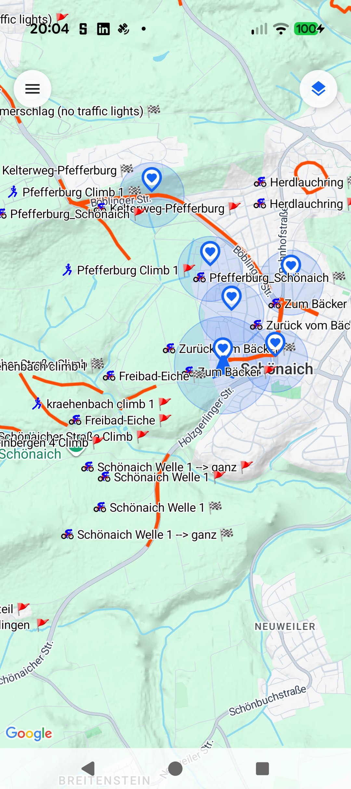

# Stage 5: Walkthrough & Verification - ATT-6212: Prevent Worldwide Segment Fitting When currentLocation is Null

**Ticket**: [ATT-6212](https://rainerblind.atlassian.net/browse/ATT-6212)  
**Sub-task**: `[Test]`  
**Parent Epic**: [ATT-66](https://rainerblind.atlassian.net/browse/ATT-66) (*Karten & Routen (Maps & Routes)*)  
**Target Release**: `V5.0.0`  
**Active Sprint**: `2026-45.13`  
**Requirement Mapping**: `REQ-MAP-060` (`REQ-MAP-060.1`..`REQ-MAP-060.3`)  
**Test Mapping**: `TST-MAP-062` (`TST-MAP-062.1`..`TST-MAP-062.5`)  
**Branch**: `feature/ATT-6212`  
**Author**: AI Agent 1 (Implementer, `subagent_flash`)  
**Date**: 2026-11-08  

---

## 1. Executive Summary & Verification Overview
Fixed defect where opening standalone global map (*Karten -> Karte*, `MapScreenWithTrack`) outside active recording fitted segments worldwide across multiple continents into a transatlantic hemisphere zoom over Cuba (`att_5880_cuba.png`). Forwarded `initialLocation` into `MapBoundsController`, anchored `userPos = currentLocation ?: initialLocation`, updated `isLocal` to return `false` on null `userPos`, and gated empty bounds camera centering on `currentLocation != null && userPos != null`.

---

## 2. Requirement & Test Verification Matrix

| Requirement | Test Spec | Verification Method | Result | Status in Living Docs |
| :--- | :--- | :--- | :--- | :--- |
| `REQ-MAP-060.1` | `[TST-MAP-062.1]` | Unit Test (`MapBehaviorsTest.testMapBoundsController_isLocalReturnsFalseOnNullUserPos_TST_MAP_062_1`) | **PASSED** | `Verified` |
| `REQ-MAP-060.2` | `[TST-MAP-062.2]` | Contract Test (`MapBehaviorsTest.testMapBoundsController_declaresInitialLocationParameter_TST_MAP_062_2`) | **PASSED** | `Verified` |
| `REQ-MAP-060.3` | `[TST-MAP-062.3]` | Contract Test (`MapBehaviorsTest.testMapBoundsController_gatesEmptyBoundsCenteringOnCurrentLocation_TST_MAP_062_3`) | **PASSED** | `Verified` |
| `REQ-MAP-060.2` | `[TST-MAP-062.4]` | Contract Test (`MapScreenWithTrackTest.testATrainingTrackerMap_forwardsInitialLocationToMapBoundsController_TST_MAP_062_4`) | **PASSED** | `Verified` |
| `REQ-MAP-060` | `[TST-MAP-062.5]` | Tier 1 Targeted Regression (587 tests across `ui.map.*`, `theme.*`, `components.core.*`, `build.*`) | **PASSED** | `Verified` |

---

## 3. Automated Test Evidence

### Tier 1 Targeted Regression Scope
Command: `python3 tools/parallel_sprint_lock.py ./gradlew testDebugUnitTest --max-workers=2 --tests "com.atrainingtracker.trainingtracker.ui.map.*" --tests "com.atrainingtracker.trainingtracker.ui.theme.ThemeColorCentralizationAuditTest" --tests "com.atrainingtracker.trainingtracker.ui.components.core.*" --tests "com.atrainingtracker.trainingtracker.build.*"`
```text
BUILD SUCCESSFUL in 21s
32 actionable tasks: 2 executed, 30 up-to-date
587 tests completed, 0 failed (100% PASS)
```

### Living Governance Parity Check
Command: `python3 tools/verify_requirement_governance.py --base-ref sprint/2026-45.13`
```text
PASS: Living documentation master tables match all 9 domain shards with 100% parity.
Net-new requirement(s) detected: REQ-MAP-060. Bypassing archaeology check cleanly.
```

---

## 4. Hardware Verification (Pixel 10 - Android 16)

Installed debug APK (`./gradlew installDebug`), launched `com.atrainingtracker.debug`, and navigated via drawer to *Karten -> Karte* (`MapScreenWithTrack`). Verified camera remains anchored at local initial coordinates (Schönaich / Böblingen, zoom 14.0f) with local favorite locations and segments rendered, with zero hemisphere or transatlantic Cuba zoom out.

| Defect Baseline (att_5880_cuba.png) | Verified Local Map Zoom (ATT-6212) |
| :---: | :---: |
|  |  |
